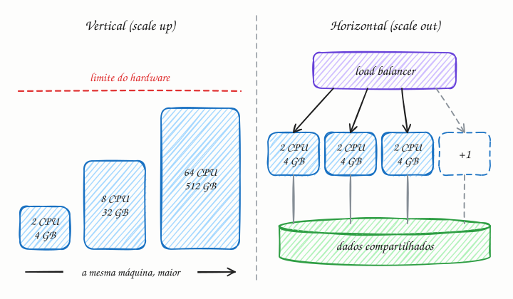

## O essencial

- **Escalar verticalmente** significa fazer upgrade de uma única máquina, por exemplo adicionando mais CPU, mais RAM ou um armazenamento mais rápido.
- **Escalar horizontalmente** significa adicionar mais máquinas e espalhar o trabalho entre elas.

A escala vertical é mais fácil, mas esbarra nos limites do hardware e fica cara. A horizontal é mais difícil, porque você precisa de balanceamento de carga, serviços stateless e armazenamento compartilhado. Pense assim: a vertical é um super-herói ficando mais forte; a horizontal é montar uma equipe.

## Aprofundando

Em inglês, a escala vertical também é chamada de *scale up*, e a horizontal, de *scale out*. As duas resolvem o mesmo problema, mais carga do que a máquina atual aguenta, de jeitos opostos.

### Vertical: simples até bater no teto

Trocar uma máquina de 8 núcleos por uma de 64 não exige mudar uma linha de código, e tudo continua num lugar só: sem rede entre nós, sem dados divididos. Por isso é o primeiro passo de quase todo sistema, principalmente do banco de dados. Os problemas aparecem depois:

- **Teto físico.** Não dá para crescer para sempre: as maiores instâncias de nuvem têm centenas de vCPUs e terabytes de RAM, e acima disso não há para onde subir.
- **Ponto único de falha.** Se a máquina cai, cai tudo. E trocar o tamanho de uma máquina virtual costuma exigir desligá-la e religá-la.
- **Retorno decrescente.** Um software que não aproveita vários núcleos não fica mais rápido com mais núcleos (cap. 6).

### Horizontal: quase sem teto, mas com pré-requisitos

Com várias máquinas atrás de um load balancer (cap. 11), a capacidade cresce somando peças comuns. Um exemplo: se cada servidor aguenta 2.000 requisições por segundo e o pico é de 9.000, você precisa de 5 servidores e coloca 6. Com essa folga, chamada de N+1, a queda de um deles ainda deixa 10.000 req/s de capacidade. A falha de uma máquina vira perda de capacidade, e não queda do sistema. E um autoscaler pode ligar e desligar máquinas conforme a demanda.

O preço são os três pré-requisitos citados no começo do capítulo:

1. **Balanceamento de carga**, para distribuir as requisições.
2. **Serviços stateless** (cap. 8): se a sessão do usuário mora na memória do servidor 1, o servidor 2 não consegue atendê-lo.
3. **Armazenamento compartilhado**: os dados precisam estar acessíveis de qualquer máquina, num banco, num cache ou num storage de objetos.

### O gargalo migra para os dados

Servidores de aplicação stateless escalam na horizontal com facilidade. O banco de dados, que guarda o estado, é o último a escalar. O caminho típico: crescer o banco na vertical, depois adicionar réplicas de leitura (cap. 24) e cache, e só então dividir os dados em shards (cap. 23). Na prática, os dois tipos se combinam: você escolhe um tamanho de máquina que faça sentido e multiplica.

## Analogia

Pense numa linha de ônibus lotada. A prefeitura pode trocar o ônibus comum por um biarticulado (escala vertical): resolve por um tempo, mas não existe ônibus maior que caiba nas ruas e, se ele quebrar, a linha para. Ou pode colocar mais ônibus na mesma linha (escala horizontal): a capacidade cresce quase sem limite e um ônibus quebrado não para a linha, mas agora alguém precisa coordenar os horários e distribuir os passageiros.

## No mundo real

- **Bancos relacionais** como PostgreSQL e MySQL costumam crescer primeiro na vertical: todas as escritas passam por um primário, e uma máquina maior é o jeito mais simples de dar fôlego a ele.
- **O Stack Overflow** ficou conhecido por atender um tráfego enorme com poucos servidores robustos, inclusive os de banco (SQL Server), crescendo mais na vertical do que na horizontal.
- **Kubernetes e nuvem:** o Horizontal Pod Autoscaler cria e remove réplicas de um serviço conforme métricas como uso de CPU; na AWS, os Auto Scaling groups fazem o mesmo com máquinas virtuais.
- **Cassandra** foi desenhado para escalar na horizontal: mais capacidade é mais nós, com os dados repartidos entre eles (cap. 23).

## Trade-offs

| | Vertical (scale up) | Horizontal (scale out) |
|---|---|---|
| Mudança no código | Nenhuma | Serviços stateless e dados compartilhados |
| Limite | A maior máquina disponível | Quase ilimitado na camada stateless |
| Falha de uma máquina | O sistema cai | Perde-se um pedaço da capacidade |
| Custo | Dispara no topo da linha | Cresce aos poucos, máquina a máquina |
| Complexidade | Baixa | Load balancer, rede, deploy em várias máquinas |
| Elasticidade | Redimensionar costuma exigir reinício | Autoscaling liga e desliga máquinas |

## Na entrevista

- Comece simples e mostre o caminho: *"Começo com algumas instâncias stateless atrás de um load balancer e um banco primário bem dimensionado. Quando o banco virar gargalo, adiciono réplicas de leitura e cache; se as escritas não couberem numa máquina, faço sharding."*
- Faça a conta: estime o pico em req/s, a capacidade de uma máquina e quantas você precisa com folga (N+1).
- Mostre que sabe onde a horizontal dói: estado local (sessões, uploads em disco) e dados.
- Não descarte a vertical: para o banco, uma máquina maior costuma ser a solução mais barata no curto prazo.

## Cuidado com

- **Atualização:** o "fica cara" vale menos na nuvem. Dentro de uma mesma família de instâncias, o preço costuma crescer na proporção do tamanho: o dobro de vCPUs custa cerca do dobro. Hoje, os argumentos fortes contra a vertical são o teto e o ponto único de falha.
- **Horizontal não é linear para sempre.** Coordenação, banco compartilhado e partes sequenciais limitam o ganho (cap. 6).
- **Mais máquinas com estado local não é escala horizontal.** Se cada servidor guarda sessões ou arquivos no próprio disco, adicionar servidores só espalha o problema.

## Teste-se

**P:** Qual a diferença entre escalar na vertical e escalar na horizontal?

**R:** Na vertical, você aumenta a capacidade de uma única máquina (CPU, RAM, disco). Na horizontal, você adiciona máquinas e divide o trabalho entre elas.

**P:** Cada servidor da sua API aguenta 1.500 req/s e o pico esperado é de 5.000 req/s. Quantos servidores você coloca?

**R:** Cinco. Quatro cobrem o pico (6.000 req/s de capacidade para 5.000 de demanda) e o quinto é a folga para que a queda de um servidor não derrube o serviço (N+1).

**P:** Você colocou 10 servidores atrás de um load balancer e o sistema continua lento. Adicionar mais 10 resolve?

**R:** Não necessariamente. Se o gargalo é um banco único ou outro recurso compartilhado, mais servidores de aplicação só aumentam a fila na frente dele. É preciso achar e escalar o gargalo (cap. 6).
