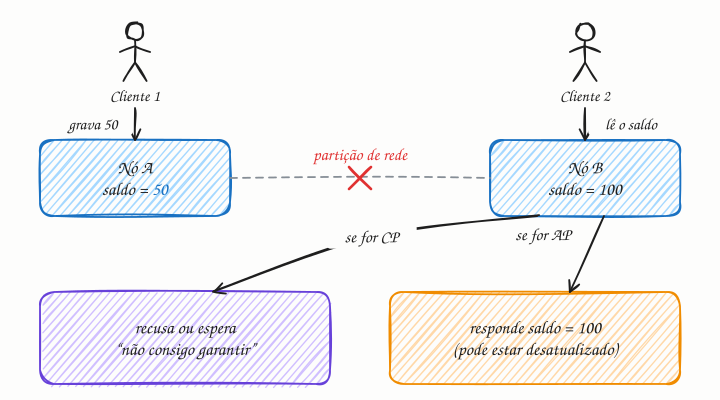

## O essencial

O Teorema CAP diz que, na presença de uma partição de rede, um sistema distribuído precisa escolher entre **Consistência** e **Disponibilidade**. Consistência significa que todos os usuários veem os mesmos dados ao mesmo tempo. Disponibilidade significa que o sistema sempre responde, mesmo que os dados possam estar um pouco desatualizados.

Você não consegue ter consistência perfeita e disponibilidade perfeita quando a sua rede está quebrada. Por isso, você decide qual das duas sacrificar de acordo com o seu caso de uso.

## Aprofundando

CAP é a sigla de três propriedades:

- **C de Consistency (consistência):** toda leitura recebe a escrita mais recente ou um erro. O nome técnico é *linearizabilidade*: o sistema se comporta como se existisse uma única cópia dos dados.
- **A de Availability (disponibilidade):** toda requisição que chega a um nó saudável recebe uma resposta que não é erro, sem garantia de que seja a mais recente.
- **P de Partition tolerance (tolerância a partições):** o sistema continua funcionando mesmo quando mensagens entre os nós se perdem ou atrasam.

O ponto que muita gente erra: **num sistema distribuído, P não é opcional.** Redes falham. Um cabo é cortado, um switch trava, um datacenter perde contato com o outro. Então a escolha real nunca foi "escolha 2 de 3". A pergunta é: *quando acontecer uma partição, o que o sistema faz?*

Imagine dois nós, A e B, que guardam cópias de um saldo de R$ 100. A rede entre eles cai. Um cliente grava "saldo = 50" no nó A e, logo depois, outro cliente lê o saldo no nó B:

- **Sistema CP:** o nó B percebe que não consegue confirmar com A e **recusa** a leitura (ou espera a rede voltar). Você perde disponibilidade, mas nunca devolve um dado errado.
- **Sistema AP:** o nó B **responde** com o último valor que conhece, R$ 100. Você continua no ar, mas pode servir um dado velho. Quando a rede volta, os nós reconciliam as diferenças.

Fora das partições, um sistema pode, e deve, ser consistente e disponível ao mesmo tempo. O CAP só fala do momento da falha. O que acontece no dia a dia, sem partição, é assunto do PACELC (cap. 3).

## Analogia

Duas agências de um banco anotam os saldos dos clientes em cadernos e se atualizam por telefone. A linha cai. Um cliente chega na agência B querendo sacar. A agência pode **recusar o saque** até a linha voltar (escolheu consistência) ou **liberar o saque** com base no caderno, correndo o risco de o cliente já ter sacado na agência A (escolheu disponibilidade).

## No mundo real

- **Tendência CP:** sistemas de coordenação como **etcd** e **ZooKeeper** (que guardam configuração e locks do Kubernetes e do Kafka antigo, por exemplo) preferem ficar indisponíveis do lado minoritário de uma partição a devolver dados inconsistentes.
- **Tendência AP:** o **Cassandra** e o **DynamoDB** (com leituras eventualmente consistentes, que são o padrão dele) priorizam continuar respondendo e reconciliam as réplicas depois.
- **Ajustável por consulta:** no Cassandra você escolhe o nível de consistência de cada leitura e escrita (`ONE`, `QUORUM`, `ALL`), movendo o ponteiro entre C e A conforme a operação.

## Trade-offs

| | Priorizar consistência (CP) | Priorizar disponibilidade (AP) |
|---|---|---|
| Durante a partição | Recusa ou atrasa parte das requisições | Responde sempre, talvez com dado velho |
| Bom para | Saldo, estoque, reserva de assento, locks | Feed, curtidas, carrinho, contadores |
| Risco | Erros e timeouts para o usuário | Conflitos que precisam ser resolvidos depois |
| Custo de engenharia | Consenso e quórum entre réplicas | Reconciliação (last-write-wins, CRDTs) |

## Na entrevista

- Nunca diga "escolhi CA". Diga: *"Como partições são inevitáveis, a pergunta é o que fazemos quando uma acontece."*
- Amarre a escolha ao **requisito de negócio**: "Para o saldo da carteira, prefiro CP: melhor um erro temporário do que gastar o mesmo dinheiro duas vezes. Para a contagem de curtidas, AP: ninguém se importa se o número atrasar alguns segundos."
- Mostre que a escolha pode ser **por funcionalidade**, e não uma só para o sistema inteiro.

## Cuidado com

- **"Escolha 2 de 3"** é uma simplificação enganosa. Em sistemas distribuídos, P não é negociável.
- **O C do CAP não é o C do ACID** (cap. 4). No ACID, consistência é respeitar as regras de integridade do banco. No CAP, é linearizabilidade.
- **"Disponível" no CAP é uma definição formal** (todo nó saudável responde). Não é o mesmo que os "99,9% de uptime" de um SLA (cap. 48).

## Teste-se

**P:** Por que "escolher CA" não faz sentido num sistema distribuído?

**R:** Porque partições de rede acontecem de qualquer jeito. O sistema precisa tolerá-las; a escolha real é entre C e A *durante* a partição.

**P:** Um sistema de reserva de assentos de avião deve tender a CP ou AP?

**R:** CP. Vender o mesmo assento para duas pessoas é muito pior do que recusar uma reserva por alguns segundos durante uma falha de rede.

**P:** Qual a diferença entre o "C" do CAP e o "C" do ACID?

**R:** No CAP, é linearizabilidade: toda leitura vê a última escrita. No ACID, é manter as regras de integridade do banco (constraints, invariantes) depois de cada transação.
