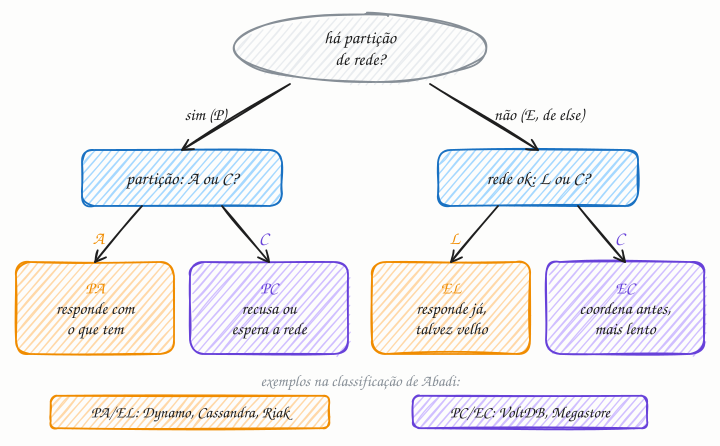

## O essencial

O PACELC estende o CAP e diz: se houver uma **P**artição, escolha entre disponibilidade (**A**vailability) e **C**onsistência; senão (**E**lse), escolha entre **L**atência e **C**onsistência. Mesmo quando a rede está funcionando bem, você continua trocando leituras lentas, mas consistentes, por leituras rápidas, mas eventualmente consistentes.

Sistemas que sincronizam dados entre regiões muitas vezes pagam em latência para manter a consistência forte. Isso explica por que alguns bancos de dados são rápidos, mas um pouco desatualizados, enquanto outros são mais lentos, mas sempre precisos.

## Aprofundando

A sigla foi proposta por Daniel Abadi em 2010 e detalhada num artigo dele de 2012. A crítica ao CAP: partições são raras, mas o sistema paga um preço pela consistência o tempo todo, mesmo com a rede perfeita. Leia a sigla como um *if/else*: **se P, então A ou C; senão (E), L ou C.**

### De onde vem a latência

O custo do *else* vem da replicação. Para uma escrita ser consistente, a réplica que a recebe precisa ouvir as outras antes de confirmar. Para uma leitura ser consistente, ela precisa ir ao líder ou consultar várias réplicas. Cada consulta custa pelo menos um round trip pela rede:

| Onde estão as réplicas | Round trip típico |
|---|---|
| Mesmo datacenter | menos de 1 ms |
| Zonas diferentes da mesma região | poucos ms |
| São Paulo e costa leste dos EUA | por volta de 120 ms |

Com réplicas no mesmo datacenter, a consistência sai quase de graça. Com réplicas em continentes diferentes, cada operação consistente fica uma viagem intercontinental mais lenta.

### O botão do quórum

Bancos no estilo Dynamo deixam você girar esse botão. Com 3 réplicas (N = 3), você define quantas precisam confirmar cada escrita (W) e quantas respondem cada leitura (R):

- **W = 1, R = 1:** responde a réplica mais rápida. Latência mínima, mas a leitura pode cair numa réplica que ainda não recebeu a escrita. É o EL.
- **W = 2, R = 2:** como R + W > N, todo conjunto de leitura cruza com o de escrita, e a leitura sempre encontra pelo menos uma réplica com a escrita mais recente. Em troca, cada operação espera a segunda réplica mais lenta. É o EC.

Na partição, o mesmo botão decide o PAC: se o cliente só alcança uma réplica, exigir W = 2 significa recusar a escrita (PC); aceitar com W = 1 mantém o sistema no ar, ao custo de conflitos para resolver depois (PA).

## Analogia

Você precisa confirmar quantas pessoas da família vão ao churrasco de domingo. Num dia normal, pode responder na hora, pelo que acha (rápido, mas talvez errado), ou perguntar no grupo da família e esperar todo mundo responder (certo, mas demorado): latência ou consistência. Se o celular de metade da família estiver sem sinal (a partição), a escolha muda: chutar o número (disponibilidade) ou não confirmar até falar com todos (consistência).

## No mundo real

- **DynamoDB:** as leituras são eventualmente consistentes por padrão (EL). Com `ConsistentRead`, a leitura é fortemente consistente, consome o dobro de capacidade, pode demorar mais e pode falhar se houver problema de rede: EC e PC na mesma tabela.
- **Cassandra:** o nível de consistência é escolhido a cada consulta. Com vários datacenters, `QUORUM` conta réplicas de todos eles e pode esperar por outra região; `LOCAL_QUORUM` conta só as do datacenter local e responde mais rápido.
- **Azure Cosmos DB:** oferece cinco níveis de consistência, de *Strong* a *Eventual*, com *Session* como padrão, e a documentação apresenta cada nível como um trade-off entre consistência, latência e disponibilidade.

## Trade-offs

| Sem partição | Priorizar latência (EL) | Priorizar consistência (EC) |
|---|---|---|
| Leitura | Da réplica mais próxima ou mais rápida | Do líder ou de um quórum |
| Escrita | Confirma depois de gravar numa réplica | Confirma depois de várias réplicas gravarem |
| Tempo de resposta | Mínimo, mesmo com réplicas distantes | Soma round trips; cresce com a distância |
| Dado lido | Pode estar atrasado | O mais recente já confirmado |
| Bom para | Feed, catálogo, contadores, recomendações | Saldo, estoque, configuração, locks |

## Na entrevista

- Traga o PACELC quando o CAP aparecer: *"O CAP só fala da falha. No dia a dia, a pergunta é quanta latência eu aceito pagar por consistência."*
- Se o design tem réplicas em várias regiões, faça a conta: uma escrita consistente entre São Paulo e a Virgínia custa pelo menos uns 120 ms a mais.
- Escolha por operação: "Saldo: EC, leitura no líder. Feed: EL, leitura na réplica local."
- Cite os botões concretos: quórum (R + W > N), nível de consistência por consulta, leitura forte opcional.

## Cuidado com

- **Atualização:** o artigo fala em bancos "rápidos" e bancos "precisos", mas hoje muitos deixam escolher por operação: `ConsistentRead` no DynamoDB, nível por consulta no Cassandra, cinco níveis no Cosmos DB. Rótulos como PA/EL descrevem o comportamento padrão, não uma lei do produto.
- **O L vale para escritas também.** Replicação síncrona deixa a escrita mais lenta, não só a leitura.
- **EL não é "inconsistente para sempre".** As réplicas convergem; o risco é ler um valor atrasado por algum tempo (cap. 7).

## Teste-se

**P:** O que a parte "ELC" do PACELC acrescenta ao CAP?

**R:** Que, mesmo sem partição, existe um trade-off entre latência e consistência: manter réplicas sincronizadas exige esperar por elas pela rede, o que deixa cada operação mais lenta.

**P:** Uma rede social com réplicas em três continentes quer carregar o feed em menos de 100 ms. Como o feed deve se comportar no dia a dia?

**R:** Como EL: ler da réplica do próprio continente e aceitar alguns segundos de atraso. Coordenar com outros continentes custaria mais de 100 ms só em round trips.

**P:** O DynamoDB é PA/EL ou PC/EC?

**R:** Depende da operação. Leituras eventualmente consistentes, o padrão, se comportam como EL; leituras com `ConsistentRead` são fortes, podem demorar mais e podem falhar durante problemas de rede, um comportamento EC/PC.
