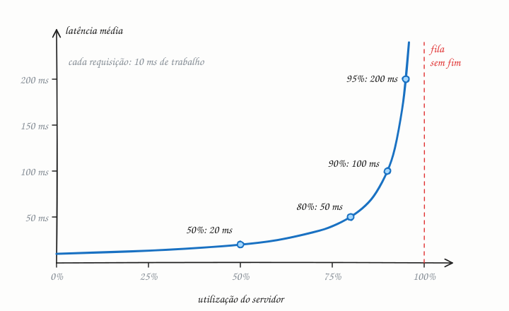

## O essencial

- **Throughput** (vazão) é quantas requisições o seu sistema consegue atender por segundo.
- **Latência** é quanto tempo uma única requisição leva, do início ao fim.

Muitas vezes você consegue aumentar o throughput fazendo mais trabalho em paralelo, mas isso pode aumentar a latência se filas se formarem. Pense num restaurante que aceita muitos pedidos ao mesmo tempo, mas faz os clientes esperarem mais. Um bom design de sistema tenta equilibrar os dois: throughput suficiente para o pico de carga, mas latência baixa para uma experiência de uso fluida.

## Aprofundando

### Como medir

Throughput se mede em requisições por segundo (RPS, ou QPS quando são consultas) ou em MB/s. Latência se mede em milissegundos, e nunca só pela média. Use percentis: p50 é a mediana; um p99 de 800 ms significa que 1 em cada 100 requisições leva 800 ms ou mais. A cauda pesa mais do que parece: no artigo *The Tail at Scale* (Google, 2013), Jeff Dean e Luiz André Barroso mostram que, se uma requisição depende de 100 servidores em paralelo e cada um é lento em 1% das vezes, 63% das requisições ficam lentas (1 − 0,99¹⁰⁰ ≈ 0,63).

### A ponte entre os dois: a Lei de Little

Quantas requisições estão em andamento ao mesmo tempo? A Lei de Little responde: **concorrência = throughput × latência**. Para atender 1.000 req/s com 200 ms cada, você precisa sustentar 1.000 × 0,2 = 200 requisições simultâneas, em threads, conexões ou workers. Se cada requisição segura uma conexão com o banco durante esses 200 ms e o banco aceita no máximo 50 conexões, o teto é 50 ÷ 0,2 = 250 req/s, não importa quantos servidores de aplicação você ligue.

### Por que a latência dispara perto do limite

Quando as requisições chegam mais rápido do que o servidor dá conta, elas esperam na fila. Num modelo clássico de fila (M/M/1), a latência média é o tempo de serviço dividido por (1 − utilização):

Com 10 ms de trabalho por requisição, o servidor a 50% de utilização responde em 20 ms, em média; a 90%, em 100 ms. Subir de 50% para 90% rende 80% mais vazão e multiplica a latência por cinco. Por isso sistemas saudáveis operam com folga, longe dos 100%.

### Lotes: vazão em troca de latência

Juntar trabalho em lotes (batching) aumenta a vazão porque divide um custo fixo, como uma ida ao disco ou um pacote de rede, entre muitos itens; em troca, cada item espera o lote encher. O produtor do Kafka faz isso com a configuração `linger.ms`, que espera alguns milissegundos para agrupar mensagens, e o algoritmo de Nagle, no TCP, faz o mesmo com pacotes pequenos.

## Analogia

A balsa que cruza o rio leva 60 carros por viagem, mas cada travessia, com embarque e desembarque, dura meia hora: vazão alta, latência alta. Uma lancha leva seis pessoas em cinco minutos: latência baixa, vazão pequena. Pôr uma segunda balsa dobra quantos carros cruzam por hora, mas não encurta nenhuma travessia. E no feriado, quando a fila cresce no cais, a espera passa a ser maior do que a própria viagem.

## No mundo real

- **Kafka** é o exemplo clássico de throughput: agrupa mensagens em lotes e grava em disco de forma sequencial para sustentar volumes enormes, aceitando alguns milissegundos a mais por mensagem.
- **Redis** e outros caches em memória (cap. 41) atacam a latência: uma leitura com ida e volta na rede local costuma levar menos de 1 ms, contra vários milissegundos de uma consulta que precisa ir ao disco.
- **CDNs** (cap. 15) reduzem latência encurtando a distância: servir um arquivo de um servidor na mesma cidade evita a viagem até outro continente.
- **Metas em percentis:** SLOs costumam ser escritos como "p99 abaixo de 300 ms", e não como média (cap. 48).

## Trade-offs

| | Otimizar throughput | Otimizar latência |
|---|---|---|
| Técnicas típicas | Lotes, filas, paralelismo | Cache, proximidade, menos round trips |
| Utilização das máquinas | Alta, sempre ocupadas | Com folga, para manter filas curtas |
| Custo por requisição | Menor | Maior (capacidade ociosa) |
| Bom para | Ingestão de logs, ETL, jobs em lote | Checkout, busca, jogos, APIs interativas |
| Métrica principal | Itens por segundo | p95 e p99 |

## Na entrevista

- Pergunte cedo os dois números: *"Quantas requisições por segundo no pico? Qual latência é aceitável no p99?"* Eles guiam o resto do design.
- Use a Lei de Little para dimensionar: "1.000 req/s × 200 ms = 200 requisições simultâneas; preciso de pelo menos isso em conexões e workers."
- Separe o caminho síncrono do assíncrono: o que o usuário espera precisa de latência baixa; o resto vai para uma fila (cap. 44) e é otimizado para throughput.
- Diga que planeja com folga, longe dos 100% de utilização.

## Cuidado com

- **Média esconde a cauda.** Uma média de 50 ms convive com um p99 de 2 s: basta 1% de requisições muito lentas. Acompanhe p95 e p99.
- **Mais servidores não encurtam uma requisição.** Eles aumentam a vazão e reduzem a fila, mas, se a requisição faz dez consultas em série, continua lenta. Para cortar latência, corte trabalho ou paralelize dentro da requisição.
- **A latência do servidor não é a que o usuário sente.** O usuário soma DNS, conexão TLS, rede e renderização. Meça também do lado do cliente.

## Teste-se

**P:** Qual a diferença entre throughput e latência?

**R:** Throughput é quantas requisições o sistema completa por unidade de tempo; latência é quanto tempo uma requisição leva, do início ao fim.

**P:** Seu serviço precisa atender 2.000 req/s, e cada requisição segura uma conexão com o banco por 50 ms. Quantas conexões o pool precisa ter, no mínimo?

**R:** Pela Lei de Little, 2.000 × 0,05 = 100 conexões ocupadas em média. Na prática, um pouco mais, para absorver variações.

**P:** Se cada requisição leva 100 ms, o servidor atende no máximo 10 por segundo?

**R:** Só se atender uma de cada vez. Com 50 requisições em paralelo, ele pode chegar a 500 por segundo: a latência limita cada requisição, não a vazão total.
