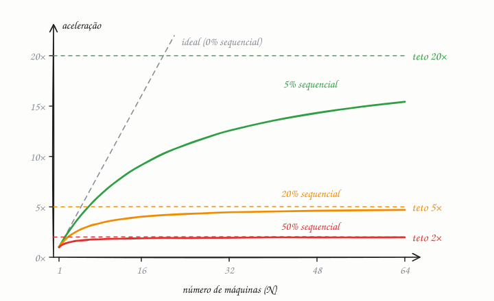

## O essencial

A Lei de Amdahl diz que o ganho de velocidade obtido com paralelização é limitado pela parte que não pode ser paralelizada. Se 20% do seu sistema é sempre sequencial, nenhuma quantidade de máquinas extras vai resolver esse gargalo.

Explicando melhor: se toda requisição sempre precisa passar por um único banco de dados primário (o *master*), esse primário vai limitar o seu desempenho. Essa lei lembra você de caçar gargalos, em vez de simplesmente adicionar mais servidores.

## Aprofundando

Gene Amdahl apresentou o argumento em 1967. Se **s** é a fração do trabalho que só roda em sequência e **N** é o número de processadores ou máquinas, a aceleração (speedup) é:

```text
aceleração(N) = 1 / (s + (1 − s) / N)
```

A parte paralela encolhe à medida que N cresce; a sequencial, não. Com N tendendo ao infinito, (1 − s)/N vai a zero e sobra o teto: **1/s**. Com s = 20%, o máximo é 5×; com 5%, 20×; com 50%, 2×.



### Um exemplo com números

Imagine um job noturno que leva 100 minutos numa máquina: 80 minutos de processamento que dá para dividir e 20 minutos de uma etapa que só roda em sequência, como consolidar tudo num arquivo único.

| Máquinas | Tempo | Aceleração |
|---|---|---|
| 1 | 20 + 80 = 100 min | 1× |
| 4 | 20 + 20 = 40 min | 2,5× |
| 16 | 20 + 5 = 25 min | 4× |
| 64 | 20 + 1,25 = 21,25 min | 4,7× |

Ir de 16 para 64 máquinas multiplica o custo por quatro e economiza menos de 4 minutos. Os 20 minutos sequenciais nunca somem.

### Na arquitetura

O exemplo do primário único aplica a mesma ideia à vazão: se toda escrita passa por ele e ele aguenta 5.000 escritas por segundo, o sistema nunca passa disso, com 10 ou com 100 servidores de aplicação. As saídas atacam o s:

- **Medir antes de escalar:** tracing (cap. 47) e profiling mostram onde o tempo realmente vai.
- **Dividir o recurso único:** sharding (cap. 23), réplicas de leitura (cap. 24), cache (cap. 41).
- **Tirar trabalho do caminho crítico:** o que não precisa acontecer antes da resposta vai para uma fila (cap. 44).
- **Evitar locks globais e contadores centrais**, que fazem esperar em fila quem poderia correr em paralelo.

## Analogia

Numa mudança, chamar mais amigos ajuda a encaixotar e a levar as caixas até o corredor. Mas o prédio tem um elevador de serviço só, e cada viagem dele demora o mesmo, com 2 ou com 20 amigos. Se metade do dia é esperar o elevador, nem um time inteiro faz a mudança terminar em menos da metade do tempo. Para ganhar de verdade, você precisa de um segundo elevador, ou de menos caixas.

## No mundo real

- **Processadores com muitos núcleos:** um programa que passa 10% do tempo em trechos sequenciais nunca fica mais de 10× mais rápido, tenha a máquina 64 ou 128 núcleos. Depois de certo ponto, núcleos extras rendem pouco.
- **MapReduce e Spark:** o processamento se divide entre centenas de máquinas, mas cada etapa só termina quando a tarefa mais lenta termina, e juntar o resultado final num lugar só é trabalho sequencial. O artigo original do MapReduce (Google, 2004) já descrevia tarefas de reserva para não ficar refém dessas retardatárias.
- **Bancos com um único primário:** no PostgreSQL e no MySQL com replicação tradicional, todas as escritas passam pelo primário; réplicas aumentam a capacidade de leitura, mas não a de escrita.

## Trade-offs

| | Adicionar máquinas | Reduzir a parte sequencial |
|---|---|---|
| Esforço | Baixo: mudar um número no autoscaler | Alto: redesenhar dados e fluxo |
| Ganho | Decrescente, com teto em 1/s | Sobe o próprio teto |
| Custo | Cresce com cada máquina | Engenharia, uma vez |
| Risco | Pagar por máquinas quase ociosas | Complexidade: shards, filas, consistência |
| Quando faz sentido | Longe do teto, com s pequeno | Curva já achatada |

## Na entrevista

- Quando propuser "mais servidores", diga o que continua único: banco primário, lock global, contador central, fila com um só consumidor.
- Faça a conta de cabeça: *"Se 10% do trabalho de cada requisição é sequencial no primário, o teto é 10×; para passar disso, preciso particionar as escritas."*
- Mostre que mede antes: "Primeiro eu olharia o tracing para ver onde a latência está."
- Mencione que a curva achata: dobrar as máquinas perto do teto quase não muda nada.

## Cuidado com

- **Atualização:** a lei é otimista para sistemas distribuídos, porque ignora o custo de coordenar as máquinas (rede, locks, consenso). A Lei Universal de Escalabilidade, de Neil Gunther, inclui esse custo e mostra que, a partir de certo ponto, mais máquinas podem deixar o sistema **mais lento**.
- **Amdahl supõe um problema de tamanho fixo.** Se o volume de dados cresce junto com as máquinas, a parte paralela cresce e o ganho total é maior; essa é a Lei de Gustafson, de 1988.
- **O exemplo do primário é sobre vazão**, não sobre o tempo de uma tarefa. O raciocínio é o mesmo: o recurso que todos disputam define o teto.

## Teste-se

**P:** O que diz a Lei de Amdahl?

**R:** Que a aceleração obtida com paralelismo é limitada pela fração sequencial do trabalho: com fração s, o máximo é 1/s, não importa quantas máquinas você adicione.

**P:** Um processo tem 10% de trabalho sequencial. Qual a aceleração com 9 máquinas? E com infinitas?

**R:** Com 9: 1 / (0,1 + 0,9/9) = 1 / 0,2 = 5×. Com infinitas, o teto é 1 / 0,1 = 10×.

**P:** Com 20% de trabalho sequencial, dobrar as máquinas de 32 para 64 dobra a velocidade?

**R:** Não. A aceleração passa de cerca de 4,4× para 4,7×: a parte paralela já ficou pequena perto dos 20% sequenciais, que não encolhem.
