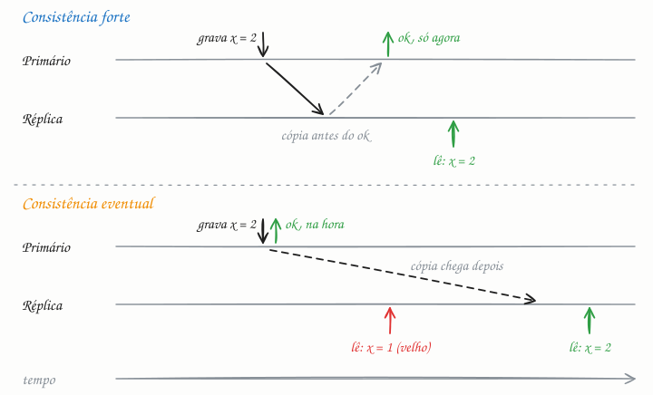

## O essencial

- **Consistência forte** significa que todos os usuários veem os mesmos dados imediatamente depois de uma escrita.
- **Consistência eventual** significa que as atualizações se espalham ao longo do tempo e os nós podem discordar por um breve período.

A consistência forte é mais fácil de entender, mas costuma ser mais lenta e menos disponível quando há falhas. A consistência eventual é ótima para sistemas de grande escala, como timelines ou contadores, em que o frescor perfeito não é crítico. O segredo é escolher o modelo que combina com a experiência de usuário de que você precisa.

## Aprofundando

Os dois modelos aparecem assim que você replica dados: um primário recebe as escritas e réplicas copiam o que ele grava. A diferença está em **quando o primário confirma a escrita** e **de onde vêm as leituras**.

- **Forte:** o primário só confirma depois que as réplicas também aplicaram a mudança (replicação síncrona), ou as leituras vão sempre ao primário ou a um quórum. Depois do "ok", qualquer leitura vê o valor novo. O nome técnico é linearizabilidade (cap. 2).
- **Eventual:** o primário confirma na hora e as réplicas recebem a mudança depois (replicação assíncrona). A distância entre o primário e uma réplica é o atraso de replicação (replication lag): em geral, milissegundos; sob carga pesada ou falha, segundos ou minutos.

A promessa eventual é modesta: *se as escritas pararem, um dia todas as réplicas terão o mesmo valor*. Ela não diz quando, nem o que você vê no meio do caminho.

### O meio-termo

Entre os dois extremos, há garantias que resolvem os bugs mais visíveis sem pagar o preço inteiro:

- **Ler o que você escreveu (read-your-writes):** você sempre vê as próprias escritas. Resolve o clássico "postei um comentário, recarreguei a página e ele sumiu".
- **Leituras monotônicas:** você nunca volta no tempo. Sem essa garantia, um contador pode mostrar 105 e, ao recarregar, 103, porque a segunda leitura caiu numa réplica mais atrasada.
- **Consistência causal:** se uma escrita depende de outra, todos veem as duas na ordem certa. A resposta nunca aparece antes da pergunta.

Para ter read-your-writes com réplicas assíncronas, um truque comum é mandar as leituras do próprio usuário para o primário por alguns segundos depois de ele escrever. Outro é guardar a versão da escrita e só ler de uma réplica que já chegou nela.

## Analogia

Quando o supermercado muda um preço, o caixa passa a cobrar o valor novo na hora, mas as etiquetas das gôndolas são trocadas por um funcionário ao longo da manhã. Até ele passar pelo corredor, quem olha a prateleira vê o preço antigo: consistência eventual. Consistência forte seria só cobrar o preço novo depois que a última etiqueta fosse trocada: nunca haveria divergência, mas a mudança demoraria bem mais para valer.

## No mundo real

- **Amazon S3:** até 2020, sobrescrever um objeto e lê-lo logo depois podia devolver a versão antiga. Desde dezembro de 2020, o S3 garante consistência forte de leitura após escrita em todas as operações, sem custo extra.
- **PostgreSQL:** a replicação por streaming é assíncrona por padrão, e uma réplica pode estar atrasada. Com `synchronous_commit = remote_apply`, o commit só retorna depois que a réplica síncrona aplicou a mudança e já a mostra nas consultas.
- **DNS** é eventual por desenho: uma mudança de registro só chega a todos quando os caches expiram, conforme o TTL (cap. 16).
- **Google Spanner** oferece consistência forte entre regiões, com relógios sincronizados (TrueTime) e consenso, ao custo de escritas mais lentas.

## Trade-offs

| | Consistência forte | Consistência eventual |
|---|---|---|
| Leitura logo após a escrita | Sempre vê o valor novo | Pode ver o valor antigo por um tempo |
| Latência de escrita | Maior: espera réplicas ou quórum | Menor: confirma na hora |
| Durante falhas | Pode recusar ou atrasar | Continua respondendo |
| Código da aplicação | Simples de raciocinar | Precisa tolerar dados atrasados e conflitos |
| Bom para | Saldo, estoque, senha, permissões | Timeline, curtidas, contadores, recomendações |

## Na entrevista

- Escolha por funcionalidade, não para o sistema inteiro: *"Saldo e estoque com consistência forte; timeline e curtidas, eventual."*
- Mostre que conhece o atraso de replicação e o efeito dele no usuário, e ofereça a correção: "No perfil, garanto read-your-writes: logo depois de editar, as leituras do próprio usuário vão para o primário."
- Se o entrevistador perguntar "eventual quanto?", fale em medir o replication lag e alertar quando ele passar de um limite.

## Cuidado com

- **"Eventual" não tem prazo.** A definição só promete convergência se as escritas pararem. Na prática, o atraso costuma ser de milissegundos, mas sob carga pode chegar a minutos; monitore.
- **"Imediatamente" conta a partir da confirmação.** Mesmo com consistência forte, uma leitura simultânea à escrita pode ver o valor velho ou o novo; a garantia vale para leituras que começam depois do "ok".
- **Atualização:** o artigo apresenta só os dois extremos. Na prática, os bancos oferecem níveis intermediários (read-your-writes, leituras monotônicas, causal, atraso máximo garantido) e deixam escolher por operação (cap. 3).

## Teste-se

**P:** O que a consistência eventual garante, e o que ela não garante?

**R:** Garante que, se as escritas pararem, as réplicas convergem para o mesmo valor. Não garante quando isso acontece, nem que uma leitura logo depois da escrita veja o valor novo.

**P:** Um usuário troca a foto de perfil, recarrega a página e vê a foto antiga. Que garantia está faltando, e como você corrige?

**R:** Read-your-writes. Mande as leituras desse usuário para o primário por alguns segundos depois da escrita, ou leia só de réplicas que já alcançaram a versão que ele gravou.

**P:** Num sistema eventualmente consistente, um contador de curtidas pode mostrar 105 e, ao recarregar, 103?

**R:** Pode. Sem a garantia de leituras monotônicas, a segunda leitura pode cair numa réplica mais atrasada que a primeira.
