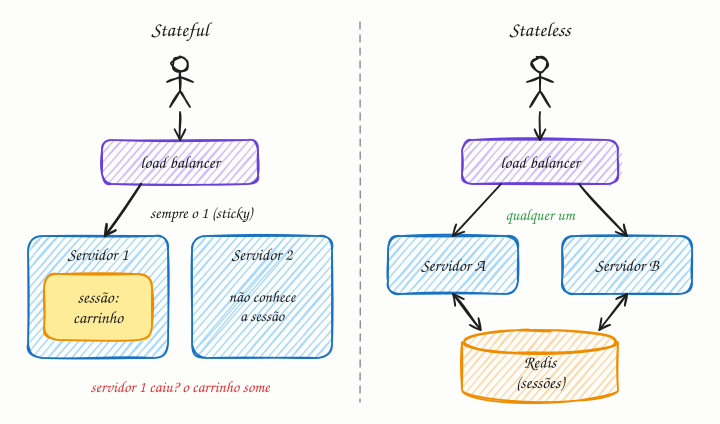

## O essencial

- Um serviço **stateful** (com estado) lembra o contexto do usuário entre uma requisição e outra, muitas vezes guardando os dados de sessão localmente.
- Um serviço **stateless** (sem estado) trata cada requisição como nova e depende de armazenamentos externos, como caches ou bancos de dados, para qualquer estado.

Serviços stateless são mais fáceis de escalar horizontalmente, porque qualquer instância pode atender qualquer requisição. Sistemas stateful podem ser mais simples de programar, mas são mais difíceis de balancear e de recuperar quando um servidor falha (failover). Nos sistemas modernos em nuvem, tentamos empurrar o estado para os bancos de dados e manter os serviços o mais stateless possível.

## Aprofundando

Imagine uma loja virtual com dois servidores atrás de um load balancer (cap. 11). A usuária põe um tênis no carrinho; a requisição cai no servidor 1, que guarda o carrinho num dicionário em memória. A próxima requisição cai no servidor 2, e o carrinho está vazio.

Há três jeitos de resolver:

1. **Sticky sessions (afinidade de sessão):** o load balancer marca a usuária, em geral com um cookie, e manda todas as requisições dela para o servidor 1. Funciona, mas o estado continua preso à máquina: se o servidor 1 cair ou for reiniciado num deploy, o carrinho some; a carga fica desigual; e desligar servidores no autoscaling derruba sessões.
2. **Estado num armazenamento externo:** o carrinho vai para um Redis ou um banco, indexado por um ID de sessão que viaja no cookie. Qualquer servidor busca a sessão pelo ID. Custa uma ida à rede por requisição (menos de 1 ms no mesmo datacenter), mas os servidores viram peças descartáveis.
3. **Estado com o cliente:** a sessão viaja na própria requisição, num token assinado, como um JWT. O servidor só confere a assinatura, sem consultar nada. O preço: é difícil revogar um token antes de ele expirar, e um cookie comporta só uns 4 KB.

### Stateless não quer dizer "sem estado nenhum"

O estado não desaparece: ele sai da memória de cada servidor e vai para uma camada feita para guardá-lo, com replicação e backup. Algumas coisas são stateful por natureza: bancos de dados, conexões WebSocket abertas (cap. 20), servidores de jogo com a partida em memória. Para elas, a saída não é fingir que o estado não existe, e sim tratá-lo com técnicas próprias, como réplicas, particionamento e checkpoints.

Um cache local em memória é aceitável num serviço stateless, desde que seja só otimização: se a instância morrer, nada se perde além de algumas consultas mais lentas.

## Analogia

Ligar para um call center onde só a atendente Márcia conhece o seu caso é stateful: se a ligação cai e você é atendido por outra pessoa, precisa explicar tudo de novo; se a Márcia sai de férias, ninguém sabe do seu problema. O atendimento com número de protocolo é stateless: qualquer atendente digita o protocolo, puxa o histórico do sistema e continua de onde parou.

## No mundo real

- **The Twelve-Factor App**, guia de boas práticas para aplicações em nuvem, manda executar a aplicação como processos stateless, chama sticky sessions de violação e sugere guardar sessões num armazenamento com expiração, como Redis ou Memcached.
- **Kubernetes** separa os dois mundos: Deployments para serviços stateless, cujos pods são intercambiáveis, e StatefulSets para bancos e afins, que precisam de identidade estável e disco próprio por pod.
- **HTTP** é stateless por definição: cada requisição pode ser entendida sozinha. Os cookies foram criados justamente para carregar estado entre requisições.

## Trade-offs

| | Stateful | Stateless |
|---|---|---|
| Onde fica a sessão | Na memória do servidor | Em Redis, banco ou token do cliente |
| Balanceamento | Precisa de afinidade (sticky) | Qualquer algoritmo serve |
| Falha de um servidor | As sessões dele se perdem | Outro servidor assume sem perda |
| Escala e deploy | Desligar máquinas derruba usuários | Liga e desliga instâncias à vontade |
| Latência | O estado já está na memória | Uma consulta extra ao armazenamento |
| Código | Mais simples no começo | Exige decidir onde o estado mora |

## Na entrevista

- Ao desenhar a camada de aplicação, diga logo: *"Os servidores são stateless; a sessão fica no Redis com TTL. Assim, o autoscaling e os deploys não derrubam ninguém."*
- Se surgir algo stateful (WebSocket, jogo, upload em andamento), mostre como lida com isso: um registro de qual servidor tem a conexão de cada usuário e pub/sub (cap. 45) para entregar as mensagens.
- Se citar JWT, mencione o trade-off: dispensa a consulta, mas complica a revogação; tokens de vida curta ajudam.

## Cuidado com

- **Sticky session não torna o serviço stateless.** Ela só esconde o estado atrás do load balancer; a sessão continua morrendo com o servidor.
- **Disco local também é estado.** Um upload salvo em `/tmp` no servidor 1 não existe no servidor 2; use um storage de objetos.
- **JWT não é cofre.** O conteúdo de um token assinado só está codificado em base64, e qualquer um que tenha o token consegue lê-lo. Não coloque nele nada sigiloso.

## Teste-se

**P:** O que torna um serviço stateless?

**R:** Ele não guarda, entre uma requisição e outra, nada que só ele saiba. O estado necessário vem na própria requisição (um token) ou é buscado num armazenamento externo, então qualquer instância pode atender.

**P:** Você tem quatro servidores com sessões em memória e precisa fazer deploy sem deslogar ninguém. O que muda na arquitetura?

**R:** As sessões saem da memória: vão para um Redis com TTL ou viram tokens assinados. Aí dá para reiniciar os servidores um a um sem perder nenhuma sessão.

**P:** Ligar sticky sessions no load balancer resolve o problema de um serviço stateful?

**R:** Não. O usuário volta sempre ao mesmo servidor, mas o estado continua preso a ele: se o servidor cair ou for reiniciado, a sessão se perde, e a carga pode ficar desigual.
