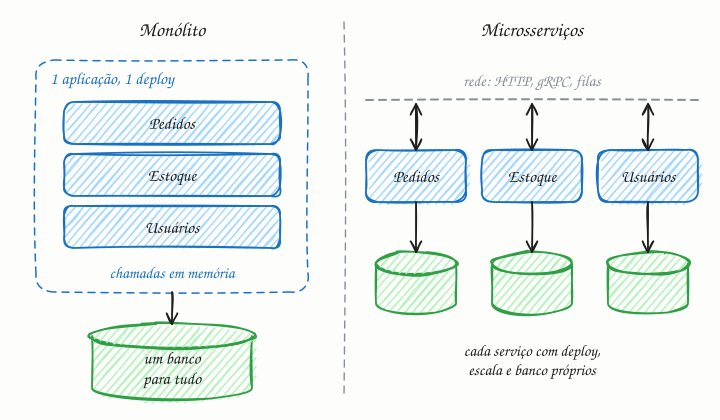

## O essencial

Um monólito é uma única aplicação que reúne muitas funcionalidades numa só unidade de deploy. Microsserviços dividem as funcionalidades em serviços separados, que se comunicam pela rede.

Microsserviços ajudam os times a trabalhar de forma independente e a escalar partes diferentes separadamente, mas trazem complexidade na comunicação, na depuração e na consistência dos dados. Monólitos são mais simples para começar e muitas vezes dão conta até uma certa escala.

E aqui mora o detalhe: muitos sistemas excelentes começam como monólitos e evoluem aos poucos para microsserviços quando a dor é real.

## Aprofundando

### Quando uma função vira chamada de rede

No monólito, o checkout chama `estoque.reservar()` e `pagamento.cobrar()` como funções: leva nanossegundos, não falha pela metade e tudo cabe numa transação do banco. Separe em serviços e cada chamada passa a:

- **Demorar mais:** ida e volta na rede, mais serialização em JSON ou Protobuf. Dez chamadas em sequência somam milissegundos.
- **Falhar parcialmente:** o pagamento pode ter sido cobrado e a resposta, se perdido no caminho. Você passa a precisar de timeouts, retries com backoff (cap. 35), idempotência (cap. 36) e circuit breakers (cap. 33).
- **Perder a transação única:** cada serviço tem o próprio banco, então "reservar e cobrar" vira uma saga, com ações de compensação (cap. 39).
- **Dificultar a depuração:** um erro atravessa cinco serviços; sem tracing distribuído (cap. 47), ninguém acha a origem.

A disponibilidade também se multiplica. Se uma página depende de 10 serviços, cada um com 99,9% de disponibilidade, ela fica em 0,999¹⁰ ≈ 99%: de uns 43 minutos fora do ar por mês para mais de 7 horas.

### O que você ganha em troca

- **Deploy independente:** o time de pagamentos publica várias vezes por dia sem esperar os outros.
- **Escala separada:** se a busca recebe 50 vezes mais tráfego que o cadastro, só ela ganha mais instâncias.
- **Isolamento de falhas:** com timeouts e fallback, um vazamento de memória nas recomendações não derruba o checkout.

### O caminho do meio

O **monólito modular** tem um único deploy, mas módulos com fronteiras claras: cada um com sua API interna e suas tabelas, sem mexer nas dos outros. Quando um módulo precisa mesmo escalar ou ser publicado sozinho, ele é extraído aos poucos, com o padrão *strangler fig*: o serviço novo assume uma rota de cada vez, até o código antigo poder ser removido.

E lembre da Lei de Conway: sistemas tendem a copiar a estrutura de comunicação da organização que os constrói. Microsserviços fazem mais sentido quando há vários times que precisam andar sem pisar uns nos outros.

## Analogia

Um restaurante tradicional tem uma cozinha só: todos os pratos saem dela, a equipe se fala por cima do balcão e, se o gás acaba, para tudo. Uma praça de alimentação é como microsserviços: cada quiosque tem cozinha, estoque e equipe próprios e muda o cardápio sem pedir licença aos vizinhos. Mas montar uma bandeja com o hambúrguer de um, o suco de outro e a sobremesa de um terceiro exige enfrentar três filas.

## No mundo real

- **Netflix:** depois de uma corrupção de banco de dados que, em 2008, parou o envio de DVDs por três dias, trocou o datacenter próprio e a aplicação monolítica por centenas de microsserviços na AWS, migração concluída em 2016.
- **Shopify:** mantém o núcleo como um grande monólito em Ruby on Rails, dividido em componentes com fronteiras verificadas por uma ferramenta própria, o Packwerk, em vez de quebrá-lo em serviços.
- **Amazon Prime Video:** em 2023, a equipe de monitoramento de qualidade de vídeo trocou uma arquitetura distribuída, com funções serverless, por um único processo e relatou corte de mais de 90% no custo de infraestrutura daquele serviço.

## Trade-offs

| | Monólito | Microsserviços |
|---|---|---|
| Para começar | Rápido: um repositório, um deploy | Lento: infraestrutura, pipelines, rede |
| Chamadas internas | Funções em memória | Rede, com latência e falhas parciais |
| Dados | Um banco, transações ACID | Banco por serviço, sagas, consistência eventual |
| Deploy | Tudo junto, coordenado entre times | Por serviço, times independentes |
| Escala | O sistema inteiro de uma vez | Cada parte conforme a demanda |
| Depuração | Um log, uma stack trace | Tracing distribuído obrigatório |

## Na entrevista

- Comece pelo porquê, não pela moda: *"Com um time pequeno, começo com um monólito modular. Extraio um serviço quando houver um motivo concreto: escala muito diferente, ritmo de deploy próprio ou um time dono dele."*
- Se desenhar microsserviços, mostre que sabe o custo: API Gateway (cap. 14), comunicação síncrona ou por eventos, sagas para consistência, tracing para depurar.
- Diga explicitamente que cada serviço tem o próprio banco.

## Cuidado com

- **Monólito distribuído:** serviços que só podem ser publicados juntos, ou que leem as tabelas uns dos outros, somam os custos dos dois mundos sem os benefícios.
- **Microsserviço não se define pelo tamanho**, e sim por deploy independente, dados próprios e uma API clara.
- **Atualização:** o artigo descreve um caminho de mão única, do monólito para microsserviços. Hoje o monólito modular é tratado como destino legítimo, e há casos documentados de volta, como o do Prime Video em 2023.

## Teste-se

**P:** O que caracteriza um microsserviço, além de ser "pequeno"?

**R:** Deploy independente, dados próprios e comunicação com os outros serviços apenas por uma API, pela rede. O tamanho não é o critério.

**P:** Uma startup com quatro desenvolvedores vai lançar um MVP. Monólito ou microsserviços?

**R:** Monólito, de preferência modular: um deploy, um banco, transações simples e menos infraestrutura. Microsserviços resolvem problemas de times grandes e escala desigual, que ainda não existem.

**P:** Dez serviços separados que leem e escrevem no mesmo banco de dados formam uma arquitetura de microsserviços?

**R:** Não de verdade. É um monólito distribuído: uma mudança no esquema afeta todos, e nenhum serviço consegue evoluir ou escalar os próprios dados de forma independente.
