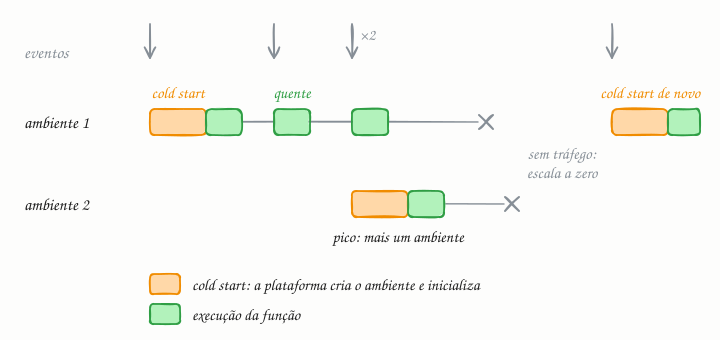

## O essencial

Serverless permite rodar pequenas funções na nuvem sem gerenciar servidores diretamente. Você só paga quando o seu código roda, e a plataforma cuida da escala e da infraestrutura por você.

É ideal para cargas orientadas a eventos, como webhooks, jobs em segundo plano ou APIs leves com tráfego em picos. O preço a pagar é menos controle sobre tarefas longas, cold starts (partidas a frio) e, às vezes, um custo maior em volumes muito altos.

Pense em serverless como "funções como serviço" (FaaS, de *functions as a service*), perfeito para código de cola (glue code) e serviços leves.

## Aprofundando

Você não aluga uma máquina: entrega uma função e diz qual evento a dispara. Pode ser uma requisição HTTP, um arquivo novo no storage, uma mensagem numa fila (cap. 44) ou um horário agendado. O AWS Lambda, lançado em 2014, popularizou o modelo.

### O ciclo de vida de uma função

1. **Chega um evento.** Se não há ambiente de execução livre, a plataforma cria um: aloca um contêiner ou uma microVM isolada, carrega o seu código, inicia o runtime e roda a inicialização (imports, conexões). Esse é o **cold start**, que vai de dezenas de milissegundos a alguns segundos, conforme a linguagem, o tamanho do pacote e o que o código faz ao iniciar.
2. **A função executa** e devolve o resultado.
3. **O ambiente fica quente** por um tempo e é reaproveitado nas chamadas seguintes, sem novo cold start.
4. **Num pico**, a plataforma cria mais ambientes em paralelo. No modelo padrão do Lambda, cada ambiente atende uma invocação por vez: 300 requisições simultâneas pedem 300 ambientes, até o limite de concorrência da conta.
5. **Sem tráfego**, os ambientes são descartados e a escala volta a zero.

### A conta

No Lambda, você paga por invocação e pelo tempo de execução multiplicado pela memória configurada (GB-segundo), medido em milissegundos. Com tráfego esparso, como um webhook que dispara algumas vezes por hora, a conta é quase zero, porque nada fica ligado esperando. Com tráfego alto e constante, ela se inverte: você paga cada milissegundo de cada execução, inclusive o tempo em que a função só espera o banco responder, enquanto um servidor sempre ligado atenderia muitas requisições em paralelo pelo mesmo preço por hora.

### Limites que moldam o design

- **Duração:** o Lambda interrompe qualquer execução em 15 minutos. Trabalho longo precisa ser dividido em pedaços ou ir para contêineres.
- **Sem estado entre chamadas:** o ambiente pode ou não ser reaproveitado, então tudo que importa vai para fora (cap. 8).
- **Picos que derrubam vizinhos:** mil funções abrindo mil conexões esgotam um banco relacional. Para isso existem proxies de conexão, como o RDS Proxy.

## Analogia

Ter carro próprio é como ter servidor: você paga IPVA, seguro e garagem mesmo com ele parado, mas ele está sempre na porta. Usar carro de aplicativo é serverless: você paga só as corridas, não cuida de manutenção e nunca falta carro no dia em que a família inteira precisa sair. Em compensação, às vezes espera o motorista chegar (o cold start) e, se rodar o dia todo, todo dia, o aplicativo sai bem mais caro que o carro.

## No mundo real

- **AWS Lambda**, **Azure Functions** e **Google Cloud Run functions** são as plataformas de funções dos três grandes provedores. O **Cloudflare Workers** roda funções na borda da rede usando isolates do V8, com cold starts bem menores que os de contêineres.
- **Processamento de arquivos:** gerar miniaturas quando uma imagem chega num bucket do S3 é o exemplo clássico da documentação do Lambda.
- **Contra o cold start:** o Lambda oferece *provisioned concurrency* (ambientes pré-aquecidos, cobrados mesmo parados) e o *SnapStart*, que restaura o ambiente a partir de um snapshot já inicializado.

## Trade-offs

| | Serverless (FaaS) | Servidores sempre ligados |
|---|---|---|
| Operação | O provedor cuida de máquinas e patches | Você provisiona, atualiza e monitora |
| Escala | Automática, de zero a milhares | Autoscaling que você configura |
| Custo parado | Zero | Paga as máquinas ligadas |
| Custo com tráfego alto e constante | Tende a ser maior | Tende a ser menor |
| Latência | Cold starts ocasionais | Estável, sem partida a frio |
| Tarefas longas | Limitadas (15 minutos no Lambda) | Sem limite de duração |

## Na entrevista

- Use serverless para o que é orientado a eventos e irregular: *"O processamento das fotos enviadas roda numa função disparada pelo upload; escala sozinho na Black Friday e custa quase nada de madrugada."*
- Evite no caminho crítico com p99 apertado ou com tráfego alto e constante, e diga por quê: cold start e custo.
- Lembre do banco: muitas funções simultâneas exigem um pool ou proxy de conexões, ou um banco que aceite muitas conexões.

## Cuidado com

- **"Serverless" tem servidor**, só que você não o gerencia.
- **Atualização:** serverless hoje é mais que FaaS. O termo também cobre contêineres que escalam a zero, como o Cloud Run, e bancos e filas cobrados por uso, como o DynamoDB sob demanda e o SQS. E os cold starts encolheram com SnapStart e ambientes pré-aquecidos.
- **Escala sem freio pode derrubar dependências.** A função escala em segundos; o banco atrás dela, não. Configure limites de concorrência.

## Teste-se

**P:** O que é um cold start?

**R:** É o atraso da primeira execução num ambiente novo: a plataforma precisa criar o ambiente, carregar o código e rodar a inicialização antes de executar a função.

**P:** Você precisa transcodificar vídeos que levam 40 minutos cada. Uma função Lambda resolve?

**R:** Não diretamente, porque o Lambda tem limite de 15 minutos por execução. Use contêineres ou um serviço de processamento em lote, ou divida o vídeo em trechos processados em paralelo por várias funções.

**P:** Serverless é sempre mais barato, já que você só paga pelo que usa?

**R:** Não. Com tráfego alto e constante, pagar cada milissegundo de cada execução costuma sair mais caro do que manter ligados servidores bem aproveitados.
