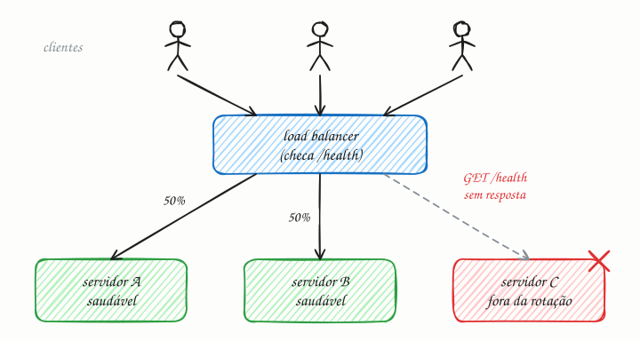

## O essencial

O balanceamento de carga (load balancing) distribui o tráfego que chega entre vários servidores, para que nenhum deles fique sobrecarregado. Ele melhora tanto a confiabilidade quanto o desempenho, já que a falha de um único servidor não derruba o sistema inteiro.

Os balanceadores de carga (load balancers) podem ser equipamentos de hardware ou serviços de software. Eles costumam oferecer **health checks** (verificações de saúde), para parar de mandar tráfego para instâncias que não estão saudáveis. Do ponto de vista da entrevista, eles são o seu primeiro bloco de construção quando você escala horizontalmente.

## Aprofundando

O load balancer (LB) fica entre os clientes e um grupo de servidores iguais, o pool. Os clientes conhecem um único endereço, o do LB. Quantos servidores existem atrás dele, e quais, é problema do LB. A cada nova conexão ou requisição, ele escolhe um servidor saudável segundo um algoritmo (cap. 12) e encaminha o tráfego para lá.

### Health check

O LB pergunta a cada servidor, de tempos em tempos, se ele está bem. Uma configuração típica: a cada 5 segundos, um `GET /health` com timeout de 2 segundos; três falhas seguidas tiram o servidor da rotação, e duas respostas `200` seguidas o trazem de volta. Exigir falhas seguidas evita tirar alguém do ar por um soluço da rede. O preço é uma janela cega: nesse exemplo, um servidor que morre ainda recebe requisições por uns 15 segundos. Para encurtá-la, muitos LBs também observam o tráfego real e afastam quem começa a devolver erros (checagem passiva).

### Camada 4 ou camada 7

Um LB de camada 4 (transporte) enxerga só IPs e portas e repassa conexões TCP ou UDP inteiras, sem abrir o conteúdo. É rápido e barato. Um LB de camada 7 (aplicação) entende HTTP: lê caminho, cabeçalhos e cookies, então consegue mandar `/api` para um pool e `/imagens` para outro. Em troca, gasta mais CPU por requisição, inclusive para decifrar o TLS.

### Folga e redundância

Balancear não cria capacidade. Se cada servidor aguenta 2.000 req/s e o pico é de 9.000 req/s, cinco servidores dão conta, com 1.800 cada. Com seis, um pode cair sem que os outros passem do limite: é o dimensionamento N+1. E o próprio LB não pode virar o novo ponto único de falha. Rode dois, em par ativo-passivo com um IP flutuante (o keepalived faz isso com o protocolo VRRP), ou use o LB gerenciado do provedor de nuvem, que já é distribuído.

## Analogia

Pense na fila única de um supermercado grande. Você não escolhe o caixa: o painel chama "caixa 7" e você vai para lá. O painel é o load balancer, e os caixas são os servidores. Quando o caixa 3 fica sem sistema, a luzinha em cima dele apaga e o painel para de chamá-lo; quem já estava passando as compras termina normalmente. A fila continua andando, só que com um caixa a menos.

## No mundo real

- **NGINX** e **HAProxy** são os load balancers de software mais conhecidos. Os dois trabalham tanto na camada 4 quanto na 7.
- Na AWS, o **Application Load Balancer** atua na camada 7, roteando por caminho e por host, e o **Network Load Balancer** atua na camada 4 (TCP, UDP e TLS). Os dois tiram da rotação os alvos que falham no health check.
- No **Kubernetes**, um Service distribui as conexões entre os pods, e a readiness probe faz o papel de health check: o pod que falha sai da lista de endpoints do Service.
- Do lado do hardware, appliances como o **F5 BIG-IP** ainda aparecem em datacenters próprios.

## Trade-offs

| | Camada 4 (transporte) | Camada 7 (aplicação) |
|---|---|---|
| Enxerga | IP, porta e protocolo | URL, cabeçalhos, cookies e método HTTP |
| Decide por | conexão | requisição |
| Pode fazer | repassar qualquer protocolo sobre TCP ou UDP | rotear por caminho, terminar TLS, reescrever cabeçalhos, afinidade por cookie |
| Custo | pouca CPU, latência mínima | mais CPU por requisição (decifra o TLS e interpreta o HTTP) |
| Exemplos | AWS NLB, HAProxy em modo TCP | AWS ALB, NGINX, Envoy |

## Na entrevista

- Ponha o LB assim que o desenho tiver mais de um servidor de aplicação e diga o que ele checa: *"LB de camada 7 com health check em /health; como os servidores são stateless (cap. 8), qualquer um atende qualquer requisição."*
- Antecipe o "e se o LB cair?": dois LBs com IP flutuante, ou o LB gerenciado da nuvem, em mais de uma zona.
- Fale de deploy sem queda: o LB tira o servidor da rotação, espera as requisições em andamento terminarem (connection draining) e só então o servidor é desligado.

## Cuidado com

- **Atualização:** o artigo diz que a falha de um servidor não derruba o sistema. Só é verdade se os outros tiverem folga para absorver a parte dele; sem folga, a carga extra derruba o próximo, num efeito dominó.
- **Health check raso ou fundo demais.** Um `/health` que sempre devolve 200 não percebe que o app perdeu o banco. O oposto também machuca: se o check depende do banco e o banco oscila, todos os servidores reprovam juntos. Por isso o Envoy tem um "limiar de pânico": por padrão, com menos da metade dos servidores saudáveis, ele ignora o health check e distribui entre todos.
- **Sticky session é muleta.** Prender cada usuário a um servidor desequilibra a carga e, quando ele cai, leva as sessões junto. Guarde o estado fora do servidor (cap. 8).

## Teste-se

**P:** O que acontece com um servidor que falha no health check?

**R:** Depois de um número combinado de falhas seguidas, o load balancer para de mandar tráfego novo para ele, mas continua checando. Quando o servidor volta a responder bem algumas vezes seguidas, retorna à rotação.

**P:** Você precisa mandar `/api` para um grupo de servidores e `/imagens` para outro. LB de camada 4 ou de camada 7?

**R:** Camada 7. Só ele interpreta o HTTP e enxerga o caminho da URL; um LB de camada 4 vê apenas IP e porta.

**P:** Três servidores rodam a 70% de CPU no pico, atrás de um load balancer. Um cai. O LB resolve?

**R:** Não. Os dois restantes passam a receber metade do tráfego cada um, cerca de 105% da capacidade, e tendem a cair também. O LB só protege se houver folga para absorver a falha (N+1).
