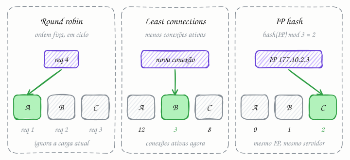

## O essencial

Os algoritmos de balanceamento de carga mais comuns são Round Robin, Least Connections e IP Hash.

- **Round Robin** percorre os servidores em ordem, em ciclo, e é simples de implementar.
- **Least Connections** (menos conexões) envia o tráfego para o servidor com menos conexões ativas, o que ajuda quando as requisições têm durações diferentes.
- **IP Hash** usa um hash do IP do cliente para que o mesmo usuário geralmente caia no mesmo servidor, o que ajuda a manter uma afinidade de sessão (session stickiness) simples.

Escolher o algoritmo certo afeta a justiça da distribuição, o uso de recursos e a experiência do usuário.

## Aprofundando

Os três respondem à mesma pergunta, a cada requisição ou conexão nova: para qual servidor mando esta? O que muda é a informação usada para decidir: nenhuma, a carga do momento ou a identidade do cliente.

### Round robin: só a ordem

O balanceador guarda um ponteiro e o avança a cada requisição: A, B, C, A, B, C... Não pergunta nada a ninguém. Funciona bem quando os servidores são iguais e as requisições custam parecido. Se as máquinas são diferentes, entra o round robin ponderado (weighted round robin): com pesos 2, 1 e 1, o servidor A recebe metade das requisições.

O ponto fraco é que ele distribui requisições, não trabalho. Se A está processando três relatórios pesados enquanto B e C estão ociosos, A continua recebendo uma em cada três requisições.

### Least connections: a carga do momento

O balanceador mantém um contador de conexões abertas por servidor e escolhe o menor. Com A em 12, B em 3 e C em 8, a próxima vai para B. Um servidor travado em requisições lentas acumula conexões e, por isso, para de receber novas: o algoritmo se corrige sozinho. É a escolha natural para conexões longas e de duração desigual, como WebSocket (cap. 20), uploads e streaming. Também existe a versão ponderada, que divide as conexões pelo peso de cada servidor.

### IP hash: quem está pedindo

A conta é `servidor = hash(IP do cliente) mod N`. Se o hash do IP dá 1.234.568 e há 3 servidores, 1.234.568 mod 3 = 2: o cliente vai sempre para o servidor de índice 2, o C. Sem guardar estado nenhum, o mesmo cliente volta ao mesmo servidor, o que preserva uma sessão em memória ou um cache local.

O preço aparece quando N muda. Com um quarto servidor, 1.234.568 mod 4 = 0, e o cliente pula para A, perdendo a sessão. Na média, passar de 3 para 4 servidores muda o destino de 75% dos clientes. O hashing consistente (cap. 25) reduz isso para cerca de 25%.

## Analogia

Num salão de beleza movimentado, a recepcionista pode distribuir as clientes de três jeitos. Pela vez, em rodízio: cada cabeleireira pega a próxima que chegar, na ordem combinada (round robin). Olhando quem tem menos clientes na cadeira e na espera (least connections). Ou mandando cada cliente sempre para a mesma profissional, que já conhece o cabelo dela (IP hash). Esse último funciona muito bem, até o dia em que a cabeleireira falta.

## No mundo real

- **NGINX**: o padrão é round robin ponderado; `least_conn` e `ip_hash` são diretivas do bloco `upstream`. O `ip_hash` usa só os três primeiros octetos do IPv4 como chave, então uma sub-rede /24 inteira cai no mesmo servidor.
- **HAProxy**: `balance roundrobin`, `leastconn` ou `source` (hash do IP de origem). A documentação recomenda o `leastconn` para sessões muito longas, como LDAP e conexões de banco de dados, e não para protocolos de sessões curtas, como HTTP.
- **Envoy**: o algoritmo de least request sorteia dois servidores e manda para o que tem menos requisições ativas, a técnica conhecida como "power of two choices". Equilibra quase tão bem quanto comparar todos, a um custo fixo por decisão.

## Trade-offs

| | Round robin | Least connections | IP hash |
|---|---|---|---|
| Decide com base em | a ordem | as conexões abertas agora | o IP do cliente |
| Estado no balanceador | um ponteiro | um contador por servidor | nenhum, só a conta |
| Bom para | requisições curtas e parecidas | conexões longas e desiguais | afinidade simples, cache local por cliente |
| Ponto fraco | ignora a carga real | conexão aberta nem sempre mede trabalho | NAT concentra usuários; mudar N remaneja quase todos |

## Na entrevista

- Comece pelo simples: round robin, ou ponderado, para serviços stateless com requisições curtas. Troque com motivo: *"as conexões do chat duram horas, então uso least connections."*
- Se o assunto for sessão, prefira tirar o estado do servidor (cap. 8) a depender de IP hash. Se a afinidade for mesmo necessária, um cookie no LB de camada 7 é mais preciso que o IP.
- Em caches distribuídos, onde a mesma chave precisa cair sempre no mesmo nó, cite o hashing consistente (cap. 25) e explique por que `hash mod N` sofre quando N muda.

## Cuidado com

- **Afinidade não é garantia.** O "geralmente" do IP hash tem motivo: o celular troca de IP ao sair do Wi-Fi para o 4G, servidores entram e saem, e o CGNAT das operadoras põe muitos clientes atrás de um mesmo IP.
- **Conexão longa engana o balanceamento de camada 4.** Com HTTP/2 e gRPC (caps. 18 e 19), o cliente abre uma única conexão e multiplexa milhares de requisições nela. Quem escolhe o servidor por conexão manda tudo para o mesmo. A saída é balancear por requisição, na camada 7.
- **Atualização:** os três algoritmos do artigo são o básico. Proxies modernos oferecem least request com duas escolhas aleatórias, balanceamento pela latência observada (o Linkerd usa uma média móvel exponencial) e hash consistente (ring hash e Maglev, no Envoy).

## Teste-se

**P:** O que o least connections leva em conta que o round robin ignora?

**R:** A carga do momento: quantas conexões cada servidor tem abertas. O round robin só segue a ordem, mesmo que um servidor esteja atolado.

**P:** Um serviço de chat mantém conexões WebSocket abertas por horas. Qual algoritmo você escolhe?

**R:** Least connections. As conexões duram muito e têm durações diferentes; contar as conexões abertas evita que alguns servidores acumulem muito mais que outros, e manda as novas para quem acabou de reiniciar e está vazio.

**P:** Uma empresa com 2.000 funcionários acessa seu sistema por um único IP de saída (NAT). Com IP hash, como essa carga se distribui entre seus 4 servidores?

**R:** Não se distribui: os 2.000 têm o mesmo IP, então o hash manda todos para o mesmo servidor. IP hash só equilibra bem quando há muitos IPs diferentes.
