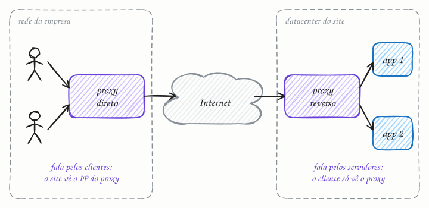

## O essencial

- Um **proxy reverso** (reverse proxy) fica na frente dos servidores e os representa perante os clientes. Ele esconde a topologia interna e pode fazer terminação TLS, cache, compressão e roteamento.
- Um **proxy direto** (forward proxy) fica na frente dos clientes e os representa perante o mundo externo, muitas vezes por segurança, cache ou filtragem de conteúdo.

Pense no proxy reverso como a recepção de uma empresa, que esconde todas as salas internas, e no proxy direto como um portão pelo qual o seu notebook precisa passar para chegar à internet. Saber a diferença ajuda quando você fala de API gateways e de proxies corporativos.

## Aprofundando

Os dois são intermediários: recebem a conexão de um lado, abrem outra do outro lado e repassam as mensagens. O que muda é para quem trabalham, e isso define quem os configura e quem fica escondido.



### Proxy direto: escolhido pelo cliente

Quem configura é o lado do cliente: o navegador, o sistema operacional ou a rede da empresa, que bloqueia qualquer saída que não passe pelo proxy. O site de destino vê o IP do proxy, não o seu. Com HTTPS, o navegador pede ao proxy que abra um túnel:

```http
CONNECT www.loja.com.br:443 HTTP/1.1
Host: www.loja.com.br:443
```

O proxy responde `200` e passa a copiar bytes cifrados de um lado para o outro. Ele sabe *aonde* você foi, mas não *o que* trafegou. Isso basta para bloquear domínios e registrar acessos.

### Proxy reverso: escolhido pelo dono do site

Quem configura é o dono dos servidores. O DNS do site aponta para o proxy, e o cliente nem sabe que ele existe. Exemplo: uma requisição a `https://www.loja.com.br/api/pedidos` chega ao NGINX. Ele termina o TLS com o certificado da loja, vê que o caminho começa com `/api` e repassa a requisição para `10.0.1.12:8080` pela rede interna. No caminho, acrescenta o cabeçalho `X-Forwarded-For: 177.20.4.9`, para a aplicação saber quem é o cliente de verdade. Respostas grandes saem comprimidas, e arquivos estáticos podem sair direto do cache do proxy, sem incomodar a aplicação. O cliente nunca fica sabendo do endereço `10.0.1.12`.

Load balancer (cap. 11), API gateway (cap. 14) e CDN (cap. 15) são, todos, proxies reversos especializados.

## Analogia

Um despachante trabalha para você: vai ao Detran no seu lugar, e o Detran lida com ele, não com você. Esse é o proxy direto. O garçom trabalha para o restaurante: você faz o pedido a ele e nunca vê qual cozinheiro preparou o prato nem como a cozinha se organiza. Se você pede só uma água, ele pega na geladeira do salão sem incomodar a cozinha. Esse é o proxy reverso, com cache. A pergunta que separa os dois: para quem o intermediário trabalha?

## No mundo real

- **NGINX** e **HAProxy** são proxies reversos clássicos: terminam TLS, servem arquivos estáticos e repassam o resto para os servidores de aplicação.
- A **Cloudflare** funciona como proxy reverso dos sites que a usam: o DNS do domínio aponta para ela, que filtra ataques, guarda cache e repassa o restante para a origem.
- O **Squid** é o proxy direto clássico de empresas e escolas, usado para cache e controle de acesso. O mesmo software também pode trabalhar como proxy reverso, prova de que a diferença está na posição, não no programa.

## Trade-offs

| | Proxy direto (forward) | Proxy reverso (reverse) |
|---|---|---|
| Trabalha para | os clientes | os servidores |
| Quem configura | o cliente ou a rede dele | o dono do site |
| Quem fica escondido | o cliente: o site vê o IP do proxy | os servidores: o cliente só vê o proxy |
| Usos típicos | filtrar e auditar acessos, controlar a saída de uma rede | terminar TLS, cache, compressão, balanceamento, roteamento |
| Exemplo | Squid na rede de uma empresa | NGINX na frente de uma aplicação |

## Na entrevista

- Num desenho de sistema, quase todo proxy é reverso. Diga isso com todas as letras: *"LB, API gateway e CDN são proxies reversos especializados."*
- O proxy direto aparece em perguntas de segurança: servidores internos que só saem para a internet por um proxy de saída (egress) com uma lista de domínios liberados, o que dificulta vazar dados para o servidor de um atacante.
- Lembre do IP real do cliente. Atrás de um proxy reverso, a aplicação vê o IP do proxy; rate limit e logs precisam ler o `X-Forwarded-For` ou o cabeçalho padronizado `Forwarded`.

## Cuidado com

- **`X-Forwarded-For` pode ser forjado.** O cliente pode mandar o cabeçalho já preenchido. Confie só na parte acrescentada pelos seus próprios proxies.
- **Esconder não é proteger.** Se o servidor de origem também tem IP público, um atacante que o descubra contorna o proxy reverso e todas as defesas dele. Feche a origem para aceitar só o tráfego que vem do proxy.
- **Atualização:** o cache em proxy direto perdeu quase todo o valor com a web em HTTPS. Num túnel `CONNECT`, o proxy vê o domínio, mas não o conteúdo, então não tem o que guardar. Filtrar por domínio continua possível; inspecionar o conteúdo exige interceptar o TLS com um certificado da empresa instalado nas máquinas.

## Teste-se

**P:** Qual a diferença essencial entre um proxy direto e um proxy reverso?

**R:** Para quem eles trabalham. O direto age em nome dos clientes e esconde quem eles são; o reverso age em nome dos servidores e esconde como eles estão organizados.

**P:** Você quer tirar dos servidores de aplicação o trabalho com certificados TLS e compressão. O que você põe na frente deles?

**R:** Um proxy reverso, como o NGINX. Ele termina o TLS, comprime as respostas e repassa as requisições aos servidores pela rede interna.

**P:** Atrás de um proxy reverso, o seu app registra que todos os acessos vêm do mesmo IP. Por quê, e como corrigir?

**R:** Porque quem abre a conexão com o app é o proxy, então o IP de origem é o dele. O proxy deve repassar o IP do cliente no `X-Forwarded-For` (ou `Forwarded`), e o app deve ler esse cabeçalho, confiando só no valor escrito pelo próprio proxy.
