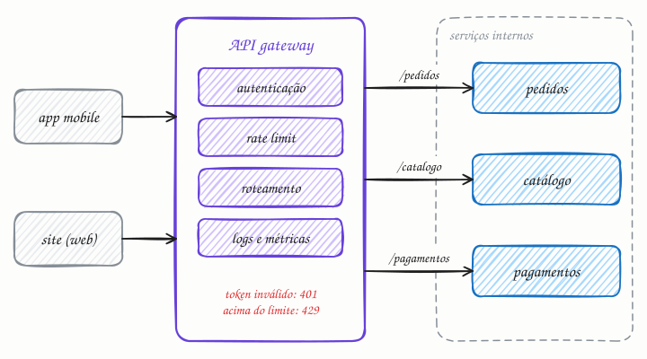

## O essencial

Um API gateway é um proxy reverso especial que funciona como ponto único de entrada para todas as chamadas de API num sistema de microsserviços. Ele cuida do roteamento para o serviço certo, do rate limiting (limite de requisições), da autenticação, dos logs e, às vezes, da adaptação do formato das respostas. Isso reduz a complexidade do lado do cliente, já que os clientes só conversam com um único endpoint.

Se você puser lógica demais no gateway, ele pode virar um gargalo ou um minimonólito por si só. Bons designs o mantêm focado e enxuto.

## Aprofundando

Sem gateway, o app precisaria saber o endereço de cada microsserviço, e cada serviço repetiria a mesma checagem de token, o mesmo limite de requisições e o mesmo formato de log. O gateway puxa essas preocupações transversais, as que valem para todas as rotas, para um lugar só.



Acompanhe uma chamada do app, `GET /pedidos/123`, com um token no cabeçalho `Authorization`:

1. **TLS:** o gateway termina a conexão segura.
2. **Autenticação:** valida a assinatura e a validade do token (um JWT, por exemplo) com a chave pública do provedor de identidade, sem consultar outro serviço a cada chamada. Token inválido volta com `401` ali mesmo.
3. **Rate limit:** confere a cota do cliente (cap. 32). Passou de 100 chamadas por minuto? Volta `429 Too Many Requests`.
4. **Roteamento:** consulta a tabela de rotas e encaminha ao serviço de pedidos, levando a identidade do usuário num cabeçalho interno.
5. **Observabilidade:** registra latência e status e propaga um ID de rastreamento para o tracing distribuído (cap. 47).

A tabela de rotas costuma ser declarativa:

```text
/pedidos/*     -> servico-pedidos      exige token    100 req/min
/catalogo/*    -> servico-catalogo     público       1000 req/min
/pagamentos    -> servico-pagamentos   exige token     10 req/min
```

Se amanhã o catálogo for dividido em dois serviços, muda a tabela, não o app.

Quando clientes diferentes precisam de respostas muito diferentes, entra o padrão BFF (Backend for Frontend): um backend por tipo de cliente, que junta várias chamadas internas numa resposta sob medida para cada tela. É ali que a adaptação das respostas deve morar, e não no gateway compartilhado.

## Analogia

Pense na central telefônica do seu banco. Você liga para um número só. A URA pede o CPF e a senha (autenticação), avisa que a ligação poderá ser gravada (logs), diz que todas as linhas estão ocupadas quando há gente demais (rate limit) e transfere para cartões, conta ou seguros (roteamento). Quem resolve o seu problema é o setor certo, não a URA. Quando ela tenta resolver tudo sozinha, com menus e mais menus, vira o gargalo que todo mundo detesta.

## No mundo real

- O **Amazon API Gateway** é o serviço gerenciado da AWS: autentica com IAM, Cognito ou autorizadores em Lambda, aplica throttling e encaminha para funções Lambda ou serviços HTTP.
- **Kong**, construído sobre o NGINX, e **Apigee**, do Google Cloud, são gateways populares, com plugins ou políticas de autenticação, rate limiting e logs.
- O **Zuul** é o gateway de borda que a Netflix liberou como código aberto em 2013, feito para receber o tráfego de todos os dispositivos e encaminhá-lo aos serviços internos.

## Trade-offs

| | Clientes chamam os serviços direto | Com API gateway |
|---|---|---|
| O cliente conhece | o endereço de cada serviço | um único endpoint |
| Autenticação e rate limit | repetidos em cada serviço | num lugar só |
| Reorganizar os serviços internos | quebra os clientes | muda só a tabela de rotas |
| Latência | uma ida direta | um salto a mais, em geral de poucos milissegundos |
| Risco principal | regras inconsistentes entre serviços | gargalo e ponto único de falha, se não for redundante e enxuto |

## Na entrevista

- Desenhe o gateway na borda assim que houver vários serviços e clientes externos, e liste o que ele faz: TLS, autenticação, rate limit, roteamento e logs.
- Diga também o que ele *não* faz: regra de negócio e orquestração de fluxos ficam nos serviços. *"O gateway cuida do que vale para todas as rotas; o que é de um domínio fica no serviço."*
- Diferencie do load balancer: o LB reparte o tráfego entre cópias do mesmo serviço; o gateway escolhe *qual* serviço atende e aplica políticas. Na prática, há LBs na frente das instâncias do gateway e atrás dele.

## Cuidado com

- **Autenticar não é autorizar.** O gateway confirma *quem* é o usuário. Se o pedido 123 pertence a ele, só o serviço de pedidos sabe. Esquecer essa checagem no serviço gera a falha que lidera o OWASP API Security Top 10: trocar o ID na URL e ver o pedido de outra pessoa.
- **Ponto único de falha.** Se o gateway cai, todas as APIs caem juntas. Rode várias instâncias, atrás de um LB, em mais de uma zona.
- **Gateway não é service mesh.** O gateway cuida do tráfego que entra no sistema (norte-sul). A comunicação entre serviços (leste-oeste) passa direto ou por um service mesh, como Istio ou Linkerd.

## Teste-se

**P:** Que problemas um API gateway resolve para os clientes?

**R:** Os clientes falam com um único endpoint, sem conhecer os serviços internos, e autenticação, rate limit e logs ficam num lugar só, em vez de repetidos em cada serviço.

**P:** Uma tela do app mobile junta perfil, pedidos e recomendações, e a rede do celular é lenta. Onde você monta essa resposta?

**R:** Num BFF (Backend for Frontend) do mobile: ele faz as três chamadas internas, que são rápidas, e devolve uma resposta só, enxuta para a tela. O app faz uma ida e volta pela rede lenta em vez de três, e o gateway geral continua enxuto.

**P:** O gateway já validou o token. O serviço de pedidos ainda precisa checar alguma coisa antes de devolver o pedido 123?

**R:** Sim: se o pedido 123 pertence a esse usuário. O gateway garante quem é a pessoa (autenticação); se ela pode ver aquele recurso (autorização) depende de dados que só o serviço tem.
