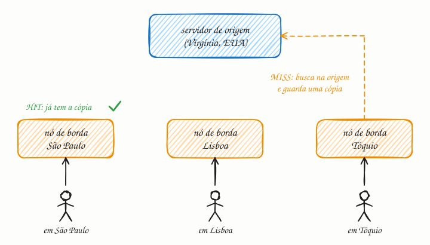

## O essencial

Uma CDN (rede de distribuição de conteúdo) é uma rede de servidores distribuídos geograficamente que guardam em cache conteúdo estático, como imagens, vídeos e scripts, mais perto dos usuários. Quando um usuário pede um conteúdo, ele é direcionado ao nó da CDN mais próximo, o que reduz muito a latência. Isso também tira tráfego dos seus servidores de origem, melhorando a escalabilidade e a resiliência.

CDNs são essenciais para aplicações globais e para o desempenho do front-end. Pense nelas como "cópias locais" dos arquivos pesados do seu site espalhadas pelo mundo.

## Aprofundando

A distância custa caro: a luz na fibra percorre uns 200 km por milissegundo, e nenhuma otimização muda isso. Uma ida e volta entre São Paulo e a Virgínia, nos EUA, leva uns 120 ms. Abrir uma conexão HTTPS nova (TCP com TLS 1.3) custa três idas e voltas até a primeira resposta: uma do TCP, uma do TLS e uma da requisição. São ~360 ms só de espera. Com um nó da CDN na mesma cidade, a ~10 ms de distância, a conta cai para ~30 ms. Até num miss há ganho: a borda mantém conexões já abertas com a origem, então só a requisição faz a viagem longa, sem os handshakes.



### Como o usuário chega ao nó certo

Há duas técnicas principais. No **roteamento por DNS**, o servidor DNS da CDN devolve o IP de um nó próximo de quem perguntou (cap. 16). No **anycast**, muitos nós anunciam o mesmo IP, e o próprio roteamento da internet entrega cada pacote ao nó mais próximo em termos de rede.

### Hit, miss e TTL

O nó de borda procura a URL no seu cache. Se acha (**hit**), responde na hora. Se não acha (**miss**), busca na origem, entrega ao usuário e guarda uma cópia pelo tempo que a origem mandou no cabeçalho `Cache-Control`:

```http
HTTP/1.1 200 OK
Content-Type: text/javascript
Cache-Control: public, max-age=31536000, immutable
```

Esse arquivo pode ficar um ano em cache (31.536.000 segundos). Isso só é seguro porque o nome muda a cada versão (`app.3f9a2c.js`): publicar uma versão nova é trocar o nome no HTML, sem apagar nada da CDN. Já o HTML costuma ter TTL curto ou nenhum.

A métrica que importa é a **taxa de acerto** (hit ratio). Com 95% de hits, a origem atende 1 em cada 20 requisições: 20 vezes menos carga. E, para que centenas de nós em miss não corram todos à origem ao mesmo tempo, muitas CDNs põem uma camada intermediária (origin shield) que concentra os misses.

## Analogia

Uma grande loja online não despacha tudo da fábrica. Ela mantém os produtos mais vendidos em centros de distribuição regionais, perto dos clientes. Se o seu pedido está no CD da sua região, chega amanhã (hit). Se não está, o CD pede à central, a entrega demora mais, e ele aproveita para estocar algumas unidades para os próximos pedidos (miss). Quando um produto sai de linha, alguém precisa recolhê-lo de todos os CDs (invalidação).

## No mundo real

- A **Netflix** tem a própria CDN, a **Open Connect**: instala servidores dentro de provedores de internet e em pontos de troca de tráfego e os abastece com o catálogo fora do horário de pico. O vídeo sai de perto do assinante.
- A **Cloudflare** usa anycast: o mesmo IP é anunciado por todos os seus data centers, e cada usuário cai, em geral, no mais próximo.
- **Amazon CloudFront**, **Akamai** e **Fastly** são outras CDNs comerciais. Em junho de 2021, um bug na Fastly, disparado pela mudança de configuração de um cliente, tirou do ar por quase uma hora sites como o do governo britânico e os de grandes jornais: a CDN vira uma dependência crítica.

## Trade-offs

**Você ganha**

- Latência menor: o usuário fala com um servidor a poucos milissegundos dele.
- Menos carga e menos tráfego na origem: com 95% de hits, ela atende 1 requisição em 20.
- Proteção: a CDN absorve picos e ataques DDoS antes que cheguem à origem.

**Você paga**

- Conteúdo que pode ficar velho até o TTL vencer ou até você invalidar.
- Custo por GB entregue e mais uma dependência externa.
- Configuração delicada: um erro na chave de cache ou no `Cache-Control` pode servir a página de um usuário para outro.

## Na entrevista

- Em sistemas com usuários espalhados e conteúdo pesado, ponha a CDN logo na frente: *"imagens, vídeos e JS saem da CDN; a origem só atende a API."*
- Fale de invalidação: nomes versionados com TTL longo para estáticos, TTL curto para o que muda, purge só em emergência.
- Mencione push vs. pull. Na CDN pull, a mais comum, a borda busca na origem no primeiro miss. Na push, você publica os arquivos na CDN antes, o que serve para conteúdo grande e previsível, como um catálogo de vídeos.

## Cuidado com

- **Atualização:** "CDN é só para estático" ficou para trás. Hoje as CDNs também aceleram conteúdo dinâmico, mantendo conexões abertas e aquecidas com a origem, guardam respostas de API por alguns segundos, filtram ataques e rodam código na borda, como os Cloudflare Workers e o Lambda@Edge.
- **Não faça cache do que é privado.** Uma resposta com dados de um usuário marcada como `public` pode ser servida a outra pessoa. Use `Cache-Control: private` ou `no-store` nas respostas personalizadas.
- **"Nó mais próximo" é aproximado.** No roteamento por DNS, a CDN enxerga a localização do resolvedor, não a do usuário. Quem usa um resolvedor público distante pode cair num nó longe; a extensão EDNS Client Subnet ameniza isso.

## Teste-se

**P:** O que acontece num cache miss da CDN?

**R:** O nó de borda não tem o arquivo: busca na origem, entrega ao usuário e guarda uma cópia pelo tempo do `Cache-Control`, para que os próximos usuários da região tenham um hit.

**P:** Você publicou uma nova versão do `app.js`, mas os usuários continuam recebendo a antiga pela CDN. Como evitar isso nas próximas versões?

**R:** Coloque a versão no nome do arquivo (`app.3f9a2c.js`) a cada deploy e sirva com TTL longo. O HTML, com TTL curto, aponta para o nome novo, e a versão antiga simplesmente deixa de ser pedida. O purge fica para emergências.

**P:** Pôr uma CDN na frente de uma API que devolve o extrato bancário de cada usuário alivia a origem?

**R:** Quase nada. Cada resposta é única e privada e não deve ficar no cache da borda, então toda requisição continua chegando à origem. A CDN ainda pode acelerar a abertura das conexões, que passa a acontecer perto do usuário, mas não tira carga da origem.
