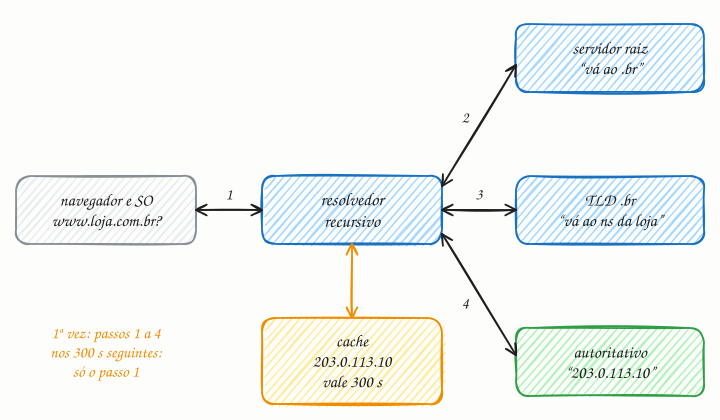

## O essencial

O DNS (sistema de nomes de domínio) associa nomes de domínio legíveis por humanos a endereços IP. Quando você digita o nome de um site, o seu dispositivo consulta o DNS para descobrir o endereço numérico do servidor. O DNS tem várias camadas de cache, então as respostas são rápidas depois da primeira consulta.

Ele também pode ser usado para fazer um balanceamento de carga simples, devolvendo IPs diferentes para o mesmo nome. Entender o DNS ajuda você a raciocinar sobre por que mudanças de DNS levam tempo para se propagar e por que algumas quedas são causadas por DNS mal configurado.

## Aprofundando

O DNS é um banco de dados distribuído e hierárquico. Ninguém tem a lista inteira: cada nível só sabe a quem delegar o próximo. Veja a primeira visita a `www.loja.com.br`, com todos os caches vazios:



1. O navegador e o sistema operacional olham seus caches locais. Nada. O SO pergunta ao **resolvedor recursivo**, em geral o do provedor de internet ou um público, como o 8.8.8.8.
2. O resolvedor pergunta a um **servidor raiz**. A raiz não sabe o IP, mas sabe quem cuida do `.br` e devolve essa indicação.
3. O resolvedor pergunta aos servidores do **TLD** `.br`, mantidos pelo Registro.br. Eles indicam os servidores de nomes (registros NS) que a loja cadastrou.
4. O resolvedor pergunta ao **servidor autoritativo** da loja, a fonte oficial, que responde:

```text
www.loja.com.br.   300   IN   A   203.0.113.10
```

O `300` é o **TTL**: por 300 segundos, quem guardou essa resposta pode reutilizá-la sem perguntar de novo. O resolvedor guarda, devolve o IP ao SO, e o navegador enfim abre a conexão.

A resolução completa custa várias idas e voltas, de dezenas a centenas de milissegundos. Nos 300 segundos seguintes, qualquer cliente desse resolvedor recebe o IP direto do cache, em poucos milissegundos. Os passos 2 e 3 são ainda mais raros, porque as indicações da raiz e do TLD ficam em cache por horas ou dias.

### Balanceamento e "propagação"

Um nome pode ter vários registros A. O servidor alterna a ordem ou escolhe por região, e os clientes costumam tentar o primeiro da lista. É um balanceamento grosseiro: o DNS simples não sabe se um servidor caiu, e a resposta fica nos caches até o TTL vencer. Pelo mesmo motivo, ninguém "propaga" uma mudança. Com TTL de um dia, alguns resolvedores ainda vão servir o IP antigo por até um dia, até seus caches expirarem.

## Analogia

Imagine procurar um paciente num hospital enorme. A recepção da entrada não sabe o leito, mas sabe que a cardiologia fica no bloco B. A recepção do bloco B manda você ao posto de enfermagem do quarto andar, e o posto diz: leito 412. Você anota no celular e, na visita de amanhã, vai direto. Só que, se o paciente trocar de leito, a anotação fica errada até você perguntar de novo. Por isso o DNS põe prazo de validade em cada resposta.

## No mundo real

- **Raiz e resolvedores públicos:** existem 13 identidades de servidores raiz, de a.root-servers.net a m.root-servers.net, cada uma replicada por anycast em vários pontos do mundo, num total de mais de mil instâncias. Resolvedores públicos como o 8.8.8.8 (Google) e o 1.1.1.1 (Cloudflare) substituem o do provedor para muita gente.
- **Amazon Route 53:** DNS gerenciado que escolhe a resposta por latência, geolocalização ou peso e faz failover com health checks.
- **Queda do Facebook, em outubro de 2021:** um comando de manutenção derrubou a rede que liga os datacenters da empresa. Sem enxergá-los, os servidores DNS do Facebook retiraram os próprios anúncios de rota (BGP), e o resto da internet passou cerca de seis horas sem conseguir resolver facebook.com.

## Trade-offs

| | TTL curto (ex.: 60 s) | TTL longo (ex.: 1 dia) |
|---|---|---|
| Uma troca de IP chega a todos | em cerca de 1 minuto | em até 1 dia |
| Consultas ao seu servidor autoritativo | muitas | poucas |
| Para o usuário | mais resoluções completas, mais lentas | quase sempre resposta de cache |
| Se o seu DNS autoritativo cair | os caches expiram logo e o nome para de resolver | os caches seguram as respostas por mais tempo |
| Bom para | failover, migrações, balanceamento por DNS | registros estáveis, como NS e MX |

## Na entrevista

- Em "o que acontece quando você digita uma URL?", o DNS é o primeiro passo. Saiba a ordem: cache local, resolvedor recursivo, raiz, TLD, autoritativo.
- Em desenhos globais, use DNS com roteamento por latência ou geografia para mandar cada usuário à região mais próxima. Mas diga que o failover por DNS é lento, porque depende do TTL e de clientes que nem sempre o respeitam. Para failover rápido, use anycast ou um load balancer.
- Tenha o roteiro de migração pronto: *"baixo o TTL para 60 s com antecedência, troco o IP, mantenho o servidor antigo até o tráfego zerar e depois subo o TTL de novo."*

## Cuidado com

- **Baixar o TTL na hora da troca não adianta.** Os caches ainda guardam a resposta antiga com o TTL antigo. Baixe-o pelo menos um TTL antigo antes da troca: com TTL de um dia, um dia antes.
- **Nem todo cliente respeita o TTL.** Algumas aplicações e bibliotecas guardam o IP por mais tempo, às vezes até reiniciar. Mantenha o servidor antigo respondendo por um tempo depois da troca.
- **Atualização:** o "balanceamento simples" do artigo evoluiu. Serviços de DNS gerenciado, como o Route 53 e o da Cloudflare, combinam health checks, geolocalização e latência medida, e a resposta muda conforme a saúde dos servidores. Mesmo assim, ela continua sujeita aos caches e ao TTL.

## Teste-se

**P:** Qual a diferença entre o resolvedor recursivo e o servidor autoritativo?

**R:** O recursivo faz o trabalho de perguntar à raiz, ao TLD e ao autoritativo em nome do cliente, e guarda as respostas em cache. O autoritativo é a fonte oficial de um domínio: responde com os registros que o dono configurou.

**P:** Você vai migrar o site para um servidor com outro IP, e o registro tem TTL de 86.400 s (um dia). Como planeja a troca?

**R:** Pelo menos um dia antes, baixe o TTL para 60 ou 300 s e espere o TTL antigo vencer. Aí troque o IP, mantenha o servidor antigo no ar até o tráfego zerar e, por fim, suba o TTL de novo.

**P:** Seu DNS devolve três IPs para o mesmo nome. Um dos servidores cai. O tráfego para de ir para ele?

**R:** Não necessariamente. O DNS simples não sabe que o servidor caiu e continua devolvendo os três IPs, e os clientes ainda guardam respostas antigas até o TTL vencer. Para tirá-lo da rotação rápido, você precisa de health check, no DNS gerenciado ou num load balancer.
