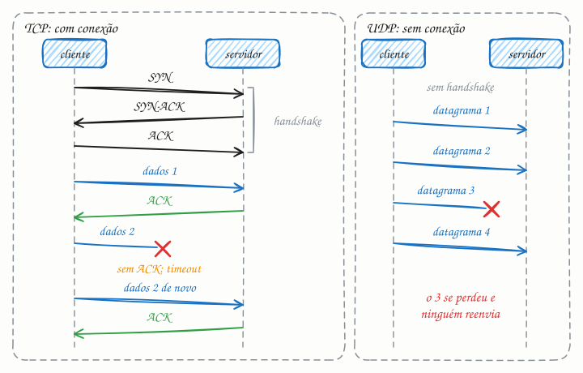

## O essencial

- O **TCP** é um protocolo confiável e orientado a conexão. Ele garante a entrega em ordem e com verificação de erros usando confirmações de recebimento (acknowledgments) e retransmissões.
- O **UDP** não usa conexão e não garante nem a entrega nem a ordem, o que o torna muito mais rápido e leve.

O TCP é indicado para APIs, páginas web e transferências de arquivos, em que a exatidão importa. O UDP funciona bem em aplicações de tempo real, como chamadas de vídeo ou jogos, em que perder um pacote de vez em quando é aceitável. Pense no TCP como uma carta registrada e no UDP como cartões-postais rápidos.

## Aprofundando

Os dois protocolos ficam na camada de transporte, logo acima do IP. O IP só sabe levar um pacote de uma máquina a outra, sem promessa nenhuma: pacotes se perdem, chegam duplicados ou fora de ordem. TCP e UDP são duas respostas opostas a essa bagunça.

### TCP: conexão, confirmação e ordem

Antes de qualquer dado, cliente e servidor fazem o three-way handshake (aperto de mão em três etapas): SYN ("quero conversar; meu número inicial é x"), SYN-ACK ("combinado; o meu é y") e ACK. Isso custa uma ida e volta (1 RTT) antes do primeiro byte útil. Com 100 ms de RTT, são 100 ms só para começar, e o TLS ainda soma mais uma ou duas idas e voltas (cap. 50).

Depois, cada byte enviado ganha um número de sequência. O receptor confirma o que chegou (ACK) e reordena o que veio fora de ordem. Se um segmento some, o emissor percebe, porque o ACK não chega antes de o timer estourar (ou chegam ACKs repetidos), e retransmite. Enquanto isso, o que chegou depois do segmento perdido espera no buffer, porque a aplicação só recebe bytes em ordem. Esse efeito se chama head-of-line blocking (bloqueio pelo primeiro da fila) e é um dos motivos da existência do HTTP/3 (cap. 18).

O TCP ainda faz controle de fluxo (não afoga um receptor lento) e controle de congestionamento: uma conexão nova começa enviando cerca de 10 segmentos (~14 KB) e dobra esse volume a cada ida e volta, até encontrar o limite da rede. Por isso reaproveitar conexões abertas vale tanto.

### UDP: cada datagrama por si

O UDP quase não faz nada, e esse é o ponto. O cabeçalho tem 8 bytes (portas de origem e destino, tamanho e checksum), contra no mínimo 20 do TCP. Não há handshake, ACK, retransmissão nem ordem: se o datagrama 3 se perde, o 4 é entregue mesmo assim. Quem precisa de alguma garantia a implementa na aplicação, só a que fizer sentido.

Em tempo real, isso é vantagem. Numa chamada de voz, cada pacote costuma levar 20 ms de áudio; se ele chega 300 ms atrasado, já não serve para nada. Melhor tocar um chiado e seguir em frente do que congelar a conversa esperando uma retransmissão.

## Analogia

O TCP é ditar a linha digitável de um boleto por telefone. Primeiro vem o "alô?", "alô, pode falar"; depois, a cada bloco, a outra pessoa repete para conferir, e o número que ela não ouviu você dita de novo. Demora, mas o pagamento sai certo. O UDP é a narração do jogo no rádio: se o sinal chia na hora do lance, ninguém volta a fita. O jogo já seguiu, e o que interessa é o lance de agora.

## No mundo real

- **DNS:** a maioria das consultas vai por UDP, na porta 53: uma pergunta, uma resposta, sem handshake. Se a resposta não cabe no datagrama, o servidor avisa que a truncou e o cliente refaz a consulta por TCP.
- **Videochamadas no navegador (WebRTC):** áudio e vídeo trafegam sobre UDP. Só quando a rede bloqueia UDP a mídia cai para TCP, por um servidor TURN, com mais atraso.
- **Jogos online em tempo real** costumam enviar o estado da partida por UDP várias vezes por segundo: se uma atualização de posição se perde, a próxima a substitui.
- **Sobre TCP** rodam o HTTP/1.1, o HTTP/2, o SSH, o e-mail (SMTP) e os protocolos de bancos como PostgreSQL e MySQL.

## Trade-offs

| | TCP | UDP |
|---|---|---|
| Conexão | handshake antes de enviar (1 RTT) | nenhuma: envia na hora |
| Garantias | entrega, ordem e sem duplicatas | nenhuma (só o checksum) |
| Pacote perdido | retransmite; o que vem depois espera | segue em frente; a perda fica |
| Cabeçalho | 20 a 60 bytes | 8 bytes |
| Congestionamento | controlado pelo protocolo | problema da aplicação |
| Bom para | APIs, páginas, arquivos, bancos | voz, vídeo, jogos, DNS |

## Na entrevista

- Traga o UDP quando o problema for tempo real (voz, vídeo, jogos, telemetria) e diga o porquê: *"Um pacote de áudio que chega atrasado já não serve; retransmitir só aumenta o atraso."*
- Para o resto (APIs, pagamentos, uploads), o padrão é TCP, e ninguém vai pedir justificativa longa.
- Mostre que confiabilidade não é tudo ou nada: o QUIC (cap. 18) e o WebRTC constroem sobre o UDP só as garantias de que precisam.
- Ao falar de latência, lembre o custo de abrir conexão: TCP mais TLS são 2 ou 3 idas e voltas antes do primeiro byte. Pool de conexões e keep-alive evitam pagar isso a cada requisição.

## Cuidado com

- **Atualização:** "páginas web vão por TCP" ficou datado. O HTTP/3 roda sobre QUIC, que usa UDP e refaz por cima dele a entrega confiável e o controle de congestionamento. E o UDP não é mais rápido no fio: ele só não espera handshake nem retransmissão.
- **TCP é um fluxo de bytes, não de mensagens.** Dois envios podem chegar numa única leitura, ou um envio chegar picado. A aplicação precisa delimitar as mensagens.
- **ACK não é "pedido processado".** Ele só diz que o sistema operacional do outro lado recebeu os bytes. Daí retries (cap. 35) e idempotência (cap. 36).
- **O UDP também tem checksum.** Datagrama corrompido é descartado; o que o UDP não faz é pedir de novo.

## Teste-se

**P:** O que o three-way handshake do TCP estabelece, e quanto ele custa?

**R:** Que os dois lados se alcançam e quais são os números de sequência iniciais de cada um. Custa uma ida e volta (1 RTT) antes de o cliente poder enviar dados, sem contar o TLS.

**P:** Num app de videochamada com chat ao lado, o que vai por UDP e o que vai por TCP?

**R:** Áudio e vídeo por UDP: um quadro atrasado é inútil e retransmitir só aumenta o atraso. O chat vai por TCP (ou outro canal confiável), porque nenhuma mensagem pode sumir.

**P:** Se o TCP garante a entrega, por que a aplicação ainda precisa de retry e idempotência?

**R:** Porque o ACK confirma só a chegada dos bytes ao sistema operacional do outro lado, não o processamento. Se a conexão cai no meio, o cliente não sabe se o pedido foi executado e precisa poder repeti-lo sem efeito duplicado.
