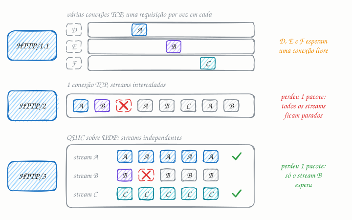

## O essencial

- O **HTTP/2** introduziu a multiplexação, que permite que várias requisições compartilhem uma única conexão TCP, reduzindo o overhead. Ele também trouxe recursos como compressão de cabeçalhos e server push.
- O **HTTP/3** roda sobre o QUIC, que é construído sobre UDP, reduz o tempo para estabelecer a conexão e melhora o desempenho em redes instáveis. Essas versões têm como objetivo principal reduzir a latência e aproveitar melhor as condições das redes modernas.

Para você, como engenheiro, a ideia principal é: abrir menos conexões e aproveitar melhor uma única conexão.

## Aprofundando

### O problema do HTTP/1.1

No HTTP/1.1, uma conexão TCP carrega uma requisição por vez: a próxima só sai quando a resposta anterior termina. (O pipelining existe na especificação, mas ficou desligado nos navegadores.) Para não enfileirar tudo, o navegador abre até 6 conexões por domínio, cada uma com seu handshake TCP, seu TLS e seu slow start (cap. 17). Uma página com 80 arquivos espera nessas 6 filas.

### HTTP/2: uma conexão, vários streams

O HTTP/2 troca o texto por frames binários. Cada requisição vira um stream numerado, e frames de streams diferentes se intercalam na mesma conexão: o CSS, o JavaScript e as imagens vão e voltam ao mesmo tempo. Os cabeçalhos são comprimidos com o HPACK, que guarda numa tabela o que já foi enviado; o cookie de 1 KB que se repetia em toda requisição passa a custar poucos bytes.

O defeito ficou embaixo. O TCP entrega bytes estritamente em ordem e não sabe que existem streams. Se um único pacote se perde, todos os streams esperam a retransmissão, mesmo os que não tinham nada a ver com ele: é o head-of-line blocking do TCP. E ele aparece justamente onde perda é comum, em Wi-Fi lotado e rede móvel.

### HTTP/3: QUIC e streams independentes

O QUIC reimplementa sobre UDP o que o TCP fazia (confirmação, retransmissão, controle de congestionamento), mas garante a ordem dentro de cada stream, e não da conexão inteira. Um pacote perdido com dados da imagem trava só a imagem.

Ele também funde transporte e criptografia: o TLS 1.3 vem embutido, e uma conexão nova fica pronta em 1 RTT, contra 2 do TCP com TLS 1.3. Num celular com 150 ms de RTT, são 150 ms a menos em cada conexão nova. Ao voltar a um servidor conhecido, o cliente pode mandar a requisição já no primeiro pacote (0-RTT). E como a conexão é identificada por um ID, e não pelo par IP e porta, ela sobrevive quando o celular troca do Wi-Fi para o 4G.

## Analogia

Pense em caminhões levando carga de uma fábrica até o porto. No HTTP/1.1, cada caminhão tem uma estradinha só dele, e o próximo só sai quando o anterior volta. No HTTP/2, todos dividem uma rodovia de faixa única: passa muito mais carga, mas se um caminhão quebra, a fila inteira para atrás dele, até quem ia para outro armazém. No HTTP/3, cada pedido ganha sua faixa na mesma rodovia, e o caminhão quebrado só trava a dele.

## No mundo real

- **Google:** criou o QUIC e o usa há anos no Chrome, na Busca e no YouTube. A IETF padronizou o QUIC em 2021 (RFC 9000) e o HTTP/3 em 2022 (RFC 9114).
- **Meta:** contou em 2020 que mais de 75% do seu tráfego de internet já usava QUIC e HTTP/3.
- **CDNs** como a Cloudflare oferecem HTTP/3 na borda: o site ganha o protocolo novo sem mexer no servidor de origem (cap. 15).
- **gRPC** (cap. 19) se apoia na multiplexação do HTTP/2 para fazer muitas chamadas simultâneas numa mesma conexão.

## Trade-offs

| | HTTP/1.1 | HTTP/2 | HTTP/3 |
|---|---|---|---|
| Transporte | TCP | TCP | QUIC, sobre UDP |
| Requisições por conexão | uma por vez | muitas, intercaladas | muitas, independentes |
| Cabeçalhos | texto, repetidos | comprimidos (HPACK) | comprimidos (QPACK) |
| Um pacote perdido | trava aquela conexão | trava todos os streams | trava só o stream afetado |
| Conexão nova com TLS 1.3 | 2 RTT | 2 RTT | 1 RTT (0-RTT na volta) |
| Troca de rede (Wi-Fi para 4G) | reconecta | reconecta | a conexão continua |

## Na entrevista

- Traga o assunto quando o requisito for latência para usuários móveis ou distantes, ou páginas com muitos recursos pequenos.
- Resuma assim: *"O HTTP/2 resolveu o head-of-line blocking do HTTP; o HTTP/3 resolveu o do TCP."*
- Diga onde isso se liga na prática: na borda (CDN, load balancer, proxy reverso). Atrás dela, os serviços podem continuar em HTTP/1.1 ou HTTP/2.
- Se citar 0-RTT, mencione o risco de replay: um atacante pode reenviar aquele primeiro pacote, então ele só serve para requisições idempotentes (cap. 36).

## Cuidado com

- **Atualização:** o server push, citado no artigo, foi abandonado. Era pouco usado e fácil de errar (empurrava arquivos que o navegador já tinha em cache), e o Chrome o desligou em 2022. Hoje, para adiantar recursos, usa-se a resposta `103 Early Hints`, que só sugere ao navegador o que começar a baixar.
- **HTTP/2 não acabou com o head-of-line blocking**, só o tirou da camada HTTP. Com perda alta, uma conexão HTTP/2 pode render menos que seis conexões HTTP/1.1.
- **HTTP/3 depende de UDP liberado.** Redes que bloqueiam UDP fazem o navegador voltar ao HTTP/2. E a primeira visita costuma ir por HTTP/2, até o navegador receber o cabeçalho `Alt-Svc`, que anuncia o HTTP/3.

## Teste-se

**P:** O que é a multiplexação do HTTP/2?

**R:** É enviar várias requisições e respostas ao mesmo tempo pela mesma conexão TCP, quebradas em frames intercalados. Cada uma vive num stream com seu próprio número.

**P:** Seu app tem milhões de usuários em redes móveis instáveis. Vale ativar HTTP/3?

**R:** Sim. Perdas de pacote só travam o stream afetado, a conexão abre em 1 RTT em vez de 2 e sobrevive à troca de Wi-Fi para 4G. Em geral, basta ligar no CDN ou no load balancer.

**P:** O HTTP/2 eliminou o head-of-line blocking?

**R:** Só na camada HTTP. Como todos os streams passam por uma única conexão TCP, que entrega bytes em ordem, um pacote perdido trava todos até a retransmissão. Quem elimina isso é o QUIC, no HTTP/3.
