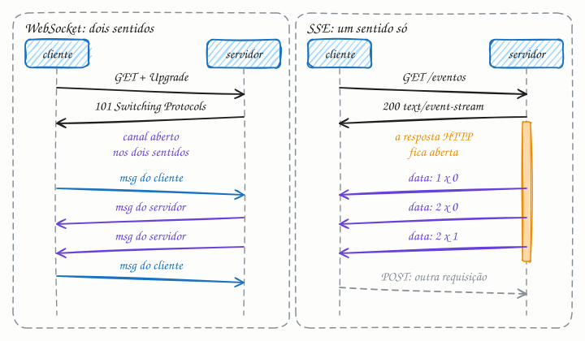

## O essencial

O **WebSocket** cria uma conexão full-duplex, em que cliente e servidor podem enviar mensagens um ao outro a qualquer momento. O **SSE** (Server-Sent Events) permite que o servidor envie eventos ao cliente por um canal de mão única, usando HTTP. WebSockets são ótimos para chats, jogos multiplayer e colaboração ao vivo. O SSE é mais simples e se encaixa em casos como placares ao vivo ou notificações, em que só o servidor precisa enviar atualizações. Os dois resolvem problemas de comunicação em tempo real que o HTTP comum não resolve bem.

## Aprofundando

### WebSocket: um upgrade e depois outro protocolo

O WebSocket começa como uma requisição HTTP comum, que pede para trocar de protocolo:

```http
GET /chat HTTP/1.1
Host: chat.loja.example
Upgrade: websocket
Connection: Upgrade
Sec-WebSocket-Key: dGhlIHNhbXBsZSBub25jZQ==
Sec-WebSocket-Version: 13
```

Se o servidor aceita, responde `101 Switching Protocols` e, daí em diante, aquela conexão TCP deixa de falar HTTP. Os dois lados trocam frames (texto, binário, ping/pong e fechamento) quando quiserem, com 2 a 14 bytes de cabeçalho por mensagem, contra as centenas de bytes de cabeçalhos de uma requisição HTTP típica.

### SSE: uma resposta HTTP que não termina

No SSE, o cliente faz um `GET` comum e o servidor responde com `Content-Type: text/event-stream`, mas não fecha a resposta. Vai escrevendo eventos em texto, separados por uma linha em branco:

```text
id: 41
data: {"jogo": "BRA x ARG", "placar": "1 x 0"}

id: 42
data: {"jogo": "BRA x ARG", "placar": "2 x 0"}
```

No navegador, a API `EventSource` cuida do resto: se a conexão cai, ela reconecta sozinha e envia o cabeçalho `Last-Event-ID: 42`, para o servidor continuar de onde parou. Tudo é HTTP: a mesma autenticação por cookie, os mesmos proxies e, sobre HTTP/2 (cap. 18), só mais um stream na conexão que a página já tem.



### Conexões abertas mudam a arquitetura

Nos dois casos, cada cliente ocupa uma conexão aberta por minutos ou horas. O servidor passa a guardar estado (cap. 8): o load balancer (cap. 11) precisa aceitar conexões longas, um deploy derruba milhares de clientes de uma vez, e uma mensagem gerada no servidor B para alguém conectado ao servidor A precisa de um pub/sub (cap. 45) entre eles. A conta de capacidade também muda: se cada servidor segura 50 mil conexões, 1 milhão de usuários online exigem 20 servidores só para manter os canais abertos.

## Analogia

O WebSocket é a conversa no privado do WhatsApp: depois que ela começa, qualquer um dos dois escreve quando quiser, sem esperar a vez. O SSE é o grupo de avisos do condomínio em que só o síndico pode postar: os moradores recebem tudo na hora em que ele manda. Se um morador quiser reclamar do barulho, não escreve no grupo; manda mensagem no privado, que é outro canal.

## No mundo real

- **Discord:** os clientes recebem mensagens, presença e outros eventos em tempo real por uma conexão WebSocket com o gateway da plataforma.
- **Figma:** a edição multiplayer sincroniza as alterações de todos os participantes de um arquivo por WebSockets.
- **APIs de LLM (OpenAI, Anthropic):** com streaming ligado, a resposta chega aos pedaços, token a token, como Server-Sent Events.
- **Placares e painéis ao vivo** são o caso típico de SSE: muita gente lendo, só o servidor escrevendo.

## Trade-offs

| | WebSocket | SSE |
|---|---|---|
| Direção | os dois sentidos | só do servidor para o cliente |
| Protocolo | próprio, depois de um upgrade do HTTP | HTTP comum (`text/event-stream`) |
| Dados | texto ou binário | só texto (UTF-8) |
| Reconexão | por sua conta | automática, com `Last-Event-ID` |
| Infraestrutura no caminho | proxies e LBs precisam suportar o upgrade | passa por quase tudo que fala HTTP |
| Bom para | chat, jogos, edição colaborativa | notificações, placar, feed, tokens de LLM |

## Na entrevista

- Comece pela pergunta certa: *"Quem precisa falar com quem, e com que frequência?"* Só o servidor fala: SSE. Os dois falam o tempo todo: WebSocket.
- Mostre que pensou na escala: quantas conexões por servidor, pub/sub para entregar a mensagem no servidor certo e reconexão com backoff e jitter (cap. 35), para que um deploy não vire uma avalanche de reconexões.
- Lembre do heartbeat (cap. 37): ping/pong no WebSocket e um comentário vazio no SSE, em intervalos menores que o timeout de ociosidade dos proxies (60 s é um padrão comum), mantêm a conexão viva.

## Cuidado com

- **SSE sobre HTTP/1.1 esbarra no limite de 6 conexões por domínio**, somando as abas do navegador: a sétima aba fica esperando. Com HTTP/2, os eventos viram streams de uma única conexão e o problema praticamente some.
- **`EventSource` não envia cabeçalhos próprios nem faz POST.** Para autenticar com token, use cookie ou leia o stream com `fetch`, como fazem os clientes das APIs de LLM.
- **Proxies com buffer** seguram os eventos e entregam tudo de uma vez. No Nginx, desligue o buffer dessa rota.
- **Depois do 101, não é mais HTTP.** Cache, códigos de status e ferramentas HTTP não enxergam as mensagens; a autenticação precisa acontecer no handshake ou na primeira mensagem.

## Teste-se

**P:** Qual a diferença fundamental entre WebSocket e SSE?

**R:** O WebSocket é full-duplex: depois do upgrade, os dois lados enviam mensagens quando quiserem, num protocolo próprio. O SSE é de mão única, do servidor para o cliente, dentro de uma resposta HTTP comum que não termina.

**P:** Placar ao vivo de um campeonato, com milhões de leitores: WebSocket ou SSE?

**R:** SSE. Só o servidor fala, tudo continua sendo HTTP (aproveitando HTTP/2 e a infraestrutura existente) e o navegador reconecta sozinho, retomando do último evento. WebSocket traria complexidade sem ganho.

**P:** Com SSE, como o cliente envia dados ao servidor?

**R:** Não pelo canal SSE, que só desce. O cliente faz outra requisição HTTP comum, como um `POST`, e o servidor responde pelo stream se precisar.
