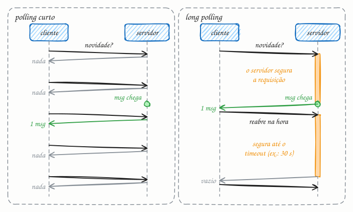

## O essencial

Long polling é uma técnica em que o cliente envia uma requisição e o servidor a mantém aberta até haver dados novos ou estourar um timeout. Quando a resposta volta, o cliente abre outra requisição imediatamente. Isso simula atualizações em tempo real sobre HTTP comum, sem protocolos especiais. É menos eficiente que WebSockets, mas é mais fácil de implementar e passa pela maioria dos proxies e firewalls. Pense nele como perguntar "alguma novidade?" e esperar em silêncio até que haja uma resposta.

## Aprofundando

### Polling curto vs. long polling

No polling curto (short polling), o cliente pergunta em intervalos fixos: "tem novidade?" a cada 2 segundos. Quase sempre a resposta é "não". Faça a conta: com 100 mil usuários, são 50 mil requisições por segundo, a maioria vazia, e ainda assim uma novidade espera em média 1 segundo para ser vista (metade do intervalo).

O long polling inverte a lógica: o servidor só responde quando tem o que dizer.

1. O cliente faz `GET /mensagens?depois=1234`.
2. Se já há mensagens depois da 1234, o servidor responde na hora.
3. Se não há, ele segura a requisição aberta, sem responder.
4. Quando chega uma mensagem, responde imediatamente com ela.
5. Se nada chega em, digamos, 30 segundos, responde vazio (por exemplo, `204 No Content`).
6. Em qualquer caso, o cliente processa a resposta e abre a próxima requisição na hora.

Com os mesmos 100 mil usuários e nenhuma novidade, o tráfego cai para cerca de 3.300 requisições por segundo (uma a cada 30 s por usuário), e a novidade chega em uma viagem de rede, não em segundos.

### O que o servidor precisa aguentar

- **Muitas requisições paradas ao mesmo tempo.** São 100 mil conexões abertas esperando. Num servidor que dedica uma thread a cada requisição, as threads acabam; o long polling pede um modelo assíncrono (Node.js, Go, Netty, asyncio), em que esperar custa só um pouco de memória.
- **Timeouts em toda a cadeia.** O timeout do long polling precisa ser menor que o de tudo no meio do caminho: por padrão, o Nginx desiste do servidor de trás depois de 60 s sem receber nada (`proxy_read_timeout`), e o load balancer de aplicação da AWS (ALB) fecha conexões ociosas em 60 s. Um timeout de uns 30 s fica longe desses limites.
- **O buraco entre duas requisições.** Entre uma resposta e a próxima requisição, o cliente não está ouvindo. Por isso a requisição leva um cursor (`depois=1234`): o servidor guarda as mensagens recentes e entrega tudo o que veio depois dele, e nada se perde.

## Analogia

Polling curto é ir à padaria a cada dez minutos perguntar se a fornada das cinco já saiu: quase sempre a resposta é "ainda não", e você gasta sola de sapato à toa. Long polling é perguntar uma vez e ficar esperando no balcão: o padeiro só fala com você quando o pão sai do forno. Se demorar demais, ele avisa "hoje atrasou" (o timeout), e você pergunta de novo na hora.

## No mundo real

- **Telegram:** na Bot API, o método `getUpdates` é long polling: o bot passa um `timeout`, e o servidor segura a chamada até chegar uma mensagem ou o tempo acabar.
- **Amazon SQS:** com `WaitTimeSeconds` (até 20 s), o `ReceiveMessage` espera chegar mensagem em vez de responder vazio na hora, o que corta requisições vazias e custo (cap. 44).
- **Consul:** as blocking queries seguram uma consulta até o dado mudar ou até o `wait` acabar (o padrão é 5 minutos).
- **Socket.IO:** por padrão, abre a conexão com long polling e depois tenta passar para WebSocket; se a rede não deixar, segue no long polling.

## Trade-offs

| | Polling curto | Long polling | SSE ou WebSocket (cap. 20) |
|---|---|---|---|
| Atraso para ver a novidade | até um intervalo inteiro | uma viagem de rede | uma viagem de rede |
| Requisições vazias | a maioria | só nos timeouts | nenhuma |
| Conexões presas no servidor | poucas e curtas | uma por cliente, quase sempre | uma por cliente, sempre |
| Cabeçalhos HTTP por mensagem | sim | sim | não, só na abertura |
| Implementação | trivial | simples, mas pede cursor e servidor assíncrono | SSE simples; WebSocket com infraestrutura própria |

## Na entrevista

- Traga o long polling quando o tempo real for desejável mas não crítico, ou quando algo no caminho (proxy corporativo, firewall, plataforma antiga) não deixar abrir WebSocket.
- Mostre que conhece o mecanismo inteiro: timeout abaixo do limite dos intermediários, cursor para não perder mensagens e servidor assíncrono para segurar milhares de requisições paradas.
- Frase pronta: *"Começo com SSE; se algo no caminho atrapalhar, long polling com timeout de 30 s e cursor resolve sem mudar o resto do desenho."*

## Cuidado com

- **Atualização:** o artigo compara o long polling só com WebSockets. Hoje, quando só o servidor precisa avisar o cliente, o SSE (cap. 20) costuma ser o meio-termo natural: também é HTTP comum, mas sem uma requisição nova a cada mensagem. O long polling ficou mais como plano B, como no Socket.IO.
- **Avalanche de reconexões:** um aviso para todos faz todos os clientes receberem a resposta e voltarem no mesmo instante. Espalhe com um atraso aleatório (jitter, cap. 35).
- **Rajadas:** se chegam 50 mensagens em um segundo, devolva todas numa resposta só, não 50 idas e voltas.
- **No HTTP/1.1, cada long poll ocupa uma das 6 conexões** que o navegador abre por domínio; com várias abas abertas, falta conexão para o resto da página.

## Teste-se

**P:** O que acontece quando o long polling chega ao timeout sem nenhum dado novo?

**R:** O servidor responde vazio (por exemplo, `204 No Content`) e o cliente abre outra requisição imediatamente, recomeçando a espera.

**P:** Um painel interno recebe atualizações algumas vezes por hora, para 1.000 usuários, e a rede da empresa bloqueia WebSocket. O que você usa?

**R:** Long polling (ou SSE, se nada no caminho atrapalhar). Polling curto a cada 2 s geraria 500 requisições por segundo quase sempre vazias; long polling com timeout de 30 s fica em cerca de 33 por segundo e entrega as novidades na hora.

**P:** O long polling, sozinho, garante que o cliente não perca nenhuma mensagem?

**R:** Não. Entre uma resposta e a próxima requisição o cliente não está ouvindo. O servidor precisa guardar as mensagens recentes, e o cliente precisa dizer a partir de qual quer receber (um cursor ou o ID da última).
