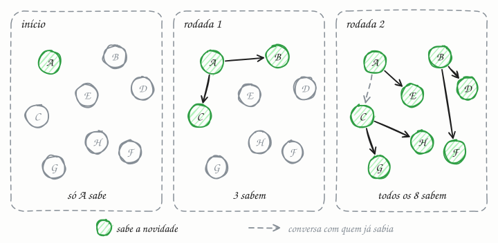

## O essencial

Um protocolo gossip ("fofoca") permite que os nós de um sistema distribuído compartilhem informações conversando periodicamente com pares escolhidos ao acaso. Com o tempo, a informação se espalha como fofoca num grupo de pessoas, até que todos tenham mais ou menos a mesma visão. Ele é usado para compartilhar quem faz parte do cluster (membership), o estado de saúde dos nós ou configurações, de forma tolerante a falhas. O protocolo é eventualmente consistente e não depende de uma autoridade central. Isso o torna ideal para clusters grandes, em que nós entram e saem com frequência.

## Aprofundando

### Uma rodada

A cada intervalo fixo (no Cassandra, 1 segundo), cada nó:

1. sorteia alguns pares (o fanout, normalmente de 1 a 3);
2. envia um resumo do que sabe: para cada nó do cluster, uma versão, como um contador de heartbeat que o próprio nó incrementa;
3. compara com o resumo do outro lado, e cada um envia ao outro o que tiver de mais novo (o estilo push-pull).

Como toda informação tem versão, conflito se resolve sozinho: vale a mais nova. Ninguém coordena nada.

### Por que espalha tão rápido

No começo, um nó sabe. Na rodada seguinte, ele e os pares que ouviram dele; depois, cada um desses conta para outros. O número de informados cresce de forma exponencial, como numa epidemia. Não por acaso, a literatura chama essa família de protocolos epidêmicos, desde um artigo de 1987 da Xerox PARC sobre replicação de bancos de dados. Por isso a novidade alcança N nós em cerca de log N rodadas. Numa simulação simples, com cada nó conversando com um par sorteado por rodada (push-pull), 1.000 nós ficam todos sabendo em cerca de 9 rodadas, e 10.000 nós em cerca de 12: dez vezes mais nós custam só umas 3 rodadas a mais.

### O mesmo mecanismo detecta falhas

Se o contador de heartbeat de um nó para de subir por tempo demais, os outros o marcam como suspeito e, depois, como morto. O SWIM (2002), usado pelo Consul, troca os contadores por sondagens: um nó pinga um par sorteado e, sem resposta, pede a alguns outros nós que tentem também antes de levantar suspeita. Assim, um nó com um único link ruim não é declarado morto por engano.

### O custo

Cada nó envia poucas mensagens por rodada, não importa o tamanho do cluster: a carga é igual para todos, e não há gargalo nem ponto único de falha. Em troca, muitas conversas repetem o que o outro já sabia, e, enquanto a novidade se espalha, os nós discordam entre si.

## Analogia

Pense em como uma música chiclete se espalha no Carnaval. Ninguém marca reunião para ensinar a letra: quem ouviu canta perto de dois ou três amigos, cada um deles canta para outros, e na Quarta-Feira de Cinzas o país inteiro sabe o refrão. Se um folião vai embora mais cedo, a música chega pelos outros. Não existe um ponto central que, se cair, interrompe tudo.

## No mundo real

- **Cassandra:** o gossip roda a cada segundo e troca estado com até três outros nós. É assim que cada nó sabe quem está no anel (cap. 25), quem está vivo e como os outros estão.
- **Consul (HashiCorp):** usa o Serf, baseado no SWIM, para manter a lista de membros do cluster e detectar falhas.
- **Redis Cluster:** os nós trocam pings e pongs que carregam informações sobre outros nós; quando a maioria dos mestres considera um nó inacessível, ele é marcado como falho e o failover começa.
- **Amazon Dynamo:** o artigo de 2007 descreve gossip para propagar a lista de membros e as mudanças no anel.

## Trade-offs

| | Gossip | Coordenador central |
|---|---|---|
| Ponto único de falha | não existe | o coordenador (ou o cluster dele) |
| Carga | igual em todos os nós | concentrada no coordenador |
| Tempo até todos saberem | ~log N rodadas (segundos) | uma rodada de mensagens |
| Consistência | eventual: por um tempo, nós discordam | pode ser forte, com consenso |
| Mensagens | muitas repetidas | uma por nó |
| Bom para | membership, saúde, metadados | líder, locks, configuração crítica |

## Na entrevista

- Traga o gossip quando o desenho tiver um cluster grande e dinâmico (banco distribuído, cache, service discovery) e surgir a pergunta: *"Como cada nó sabe quem está vivo?"*
- Descreva os parâmetros: intervalo da rodada, fanout, push-pull e informação versionada. Cite a convergência em O(log N) rodadas.
- Deixe claro o limite: gossip espalha estado, não decide nada. Para eleger líder ou travar um recurso, use consenso (cap. 38). Os dois convivem bem: o Consul usa gossip para membership e Raft para replicar o catálogo.

## Cuidado com

- **Gossip não é consenso.** Durante a propagação, dois nós podem discordar sobre quem está vivo, e nada garante uma decisão única.
- **Lento não é morto.** Um nó numa pausa longa de garbage collection parece morto por alguns segundos. Use detectores pacientes, como o phi accrual do Cassandra, que se adapta ao histórico de atrasos, ou uma fase de suspeita antes da sentença, como no SWIM.
- **O estado cresce com o cluster.** Se cada mensagem levar tudo sobre todos, o tráfego explode; por isso se trocam primeiro só as versões, e depois o que mudou.
- **Partição não se cura com fofoca.** Cada lado converge para a própria visão e acha que o outro morreu.

## Teste-se

**P:** Em quantas rodadas uma novidade chega a todos os N nós num protocolo gossip?

**R:** Em cerca de log N rodadas, porque o número de nós informados cresce de forma exponencial: cada nó que sabe conta para outros a cada rodada.

**P:** Num cluster de 500 nós em que máquinas entram e saem o tempo todo, como cada nó descobre quem está vivo sem um servidor central?

**R:** Com gossip: a cada segundo, cada nó troca com alguns pares sorteados a lista de membros e os contadores de heartbeat. Não há ponto único de falha, e cada nó envia o mesmo punhado de mensagens por rodada, tenha o cluster 50 ou 500 nós.

**P:** Dá para usar gossip para eleger o líder do cluster?

**R:** Não. Gossip é eventualmente consistente: durante a propagação, nós diferentes podem ter visões diferentes e "eleger" líderes diferentes. Eleição de líder exige consenso, como Raft ou Paxos.
