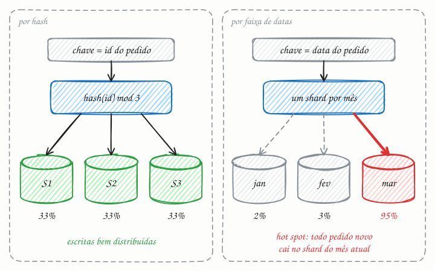

## O essencial

Sharding divide os dados entre várias máquinas, e cada uma guarda um subconjunto deles. As estratégias mais comuns são o sharding por faixa (range-based), o sharding por hash (hash-based) e o sharding por diretório (directory-based). O objetivo principal é escalar o armazenamento e o throughput, evitando um único nó de banco de dados gigante. A parte difícil é escolher uma chave de shard (shard key) que evite hot spots, em que um shard recebe a maior parte do tráfego. Depois que você faz sharding, mover dados entre shards (resharding) se torna um desafio operacional importante.

## Aprofundando

Cada linha tem uma **chave de shard**, uma coluna como `cliente_id`. Uma função transforma essa chave no número do shard, e um roteador (na aplicação, num proxy ou no próprio banco) manda a consulta para lá. A função define o comportamento:

- **Por faixa:** cada shard guarda um intervalo contíguo de chaves (clientes de A a F no shard 1, de G a M no shard 2...). Consultas por intervalo ficam baratas, porque vizinhos moram juntos. O risco são chaves que crescem em sequência, como datas e IDs autoincrementais: toda escrita nova cai no último shard.
- **Por hash:** o shard é `hash(chave) mod N`. A distribuição fica uniforme, mas uma consulta por intervalo precisa perguntar a todos os shards e juntar as respostas (scatter-gather).
- **Por diretório:** uma tabela de consulta diz em que shard está cada chave ou grupo de chaves. É a mais flexível (dá para mover um cliente gigante para um shard só dele), mas o diretório vira uma peça crítica, que precisa ser rápida e altamente disponível.

Um exemplo hipotético: um sistema de pedidos com 2 TB de dados e 40 mil escritas por segundo, dividido em 8 shards por hash de `cliente_id`, deixa cada máquina com uns 250 GB e 5 mil escritas por segundo. E a consulta mais comum, "pedidos deste cliente", toca um shard só.

Só que hash espalha chaves, não acessos. Se uma única chave é muito acessada (a conta de uma celebridade, um cliente que é metade do faturamento), o shard dela sofre de qualquer jeito. As saídas são dividir essa chave (acrescentar um sufixo aleatório na escrita e juntar as partes na leitura) ou dar a ela um shard próprio.

O **resharding** dói porque `mod N` é frágil: passar de 4 para 5 shards muda o shard de cerca de 80% das chaves. Por isso, muitos sistemas criam de início muito mais **partições lógicas** do que máquinas (por exemplo, 1.024 partições em 8 servidores) e, para crescer, movem partições inteiras; outros usam hashing consistente (cap. 25). Mover dados com o sistema no ar exige copiar, acompanhar as escritas que chegam durante a cópia e só então virar o roteamento.

## Analogia

Um cartório com milhões de certidões não cabe numa sala só, então divide o arquivo por sobrenome: de A a F na sala 1, de G a M na sala 2, e assim por diante. É sharding por faixa. Só que a sala do S vive lotada, porque Silva, Santos e Souza estão entre os sobrenomes mais comuns do Brasil: um hot spot. Distribuir as certidões por um cálculo sobre o CPF (um hash) equilibraria as filas, mas aí achar "todos os Silva" exigiria visitar todas as salas.

## No mundo real

- O **MongoDB** faz sharding nativo por faixa ou por hash, e um balanceador move blocos de dados (chunks) entre os shards. Desde a versão 5.0, dá para trocar a chave de shard de uma coleção já em produção.
- O **Vitess**, criado no YouTube para fatiar o MySQL, roteia cada consulta ao shard certo e é usado pelo Slack, entre outros.
- O **Instagram** documentou, em 2012, milhares de shards lógicos no PostgreSQL mapeados para poucos servidores físicos, com o número do shard embutido em cada ID gerado.
- O **DynamoDB** divide as tabelas por hash da chave de partição. Cada partição aguenta até 1.000 WCU (cerca de mil escritas de 1 KB por segundo), então uma chave quente fica presa a esse teto, por maior que seja a capacidade da tabela.

## Trade-offs

| | Por faixa | Por hash | Por diretório |
|---|---|---|---|
| Distribuição | Depende dos dados | Uniforme por chave | Você decide, chave a chave |
| Consulta por intervalo | Barata: um ou poucos shards | Cara: todos os shards | Depende de como o diretório agrupa |
| Risco de hot spot | Alto com datas e IDs crescentes | Só com chaves muito populares | Controlável, movendo chaves |
| Resharding | Dividir uma faixa ao meio | Difícil com `mod N`; use partições lógicas | Atualizar o diretório e mover os dados |
| Peça extra | Mapa de faixas | Nenhuma | O diretório, rápido e sempre disponível |

## Na entrevista

- Não comece por sharding. Diga antes o que se esgotou: "Já usei réplicas de leitura e cache; o problema agora é o volume de escritas, que não cabe num primário."
- Justifique a chave pelo **padrão de acesso**: "Faço sharding por `conversa_id`, porque a consulta mais comum é 'últimas mensagens desta conversa', e ela fica num shard só."
- Antecipe as perguntas difíceis: o que fazer com a chave quente, como ficam as consultas que cruzam shards e como crescer de 8 para 16 shards sem parar o sistema.

## Cuidado com

- **Sharding não é replicação.** Sharding divide os dados; replicação copia (cap. 24). Na prática, cada shard costuma ser um conjunto replicado.
- **Joins e transações entre shards** deixam de ser triviais. Uma transação que toca dois shards exige 2PC (cap. 40) ou SAGA (cap. 39), então escolha a chave para que as operações comuns fiquem num shard só.
- **"Partição" tem dois sentidos.** Aqui é um pedaço dos dados; no CAP (cap. 2), é uma falha de rede.
- **Atualização:** bancos distribuídos como Spanner, CockroachDB e TiDB dividem e movem faixas automaticamente conforme crescem. O resharding manual que o artigo descreve é a dor típica de quem faz sharding por conta própria sobre MySQL ou PostgreSQL.

## Teste-se

**P:** Qual a diferença entre sharding por faixa e por hash?

**R:** Por faixa, cada shard guarda um intervalo contíguo de chaves: consultas por intervalo são baratas, mas chaves sequenciais criam hot spots. Por hash, a distribuição é uniforme, mas uma consulta por intervalo precisa ir a todos os shards.

**P:** Num app de chat com bilhões de mensagens, qual chave de shard você usaria para a tabela de mensagens?

**R:** O id da conversa, com hash: a consulta dominante ("últimas mensagens desta conversa") fica num shard só, e as conversas se espalham. A data criaria um hot spot, e o id do remetente espalharia cada conversa por vários shards.

**P:** Com `hash(chave) mod N`, passar de 4 para 5 shards move só um quinto dos dados?

**R:** Não. Cerca de 80% das chaves mudam de shard, porque o resto da divisão muda para quase todas. Hashing consistente (cap. 25) ou partições lógicas fixas evitam isso.
