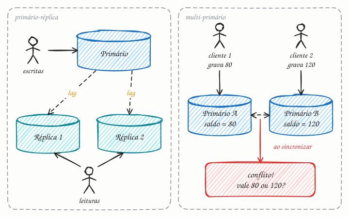

## O essencial

Replicação significa manter várias cópias dos dados em nós diferentes.

- No modelo master-slave (ou primário-réplica), um nó cuida das escritas e replica as mudanças para os outros, que atendem as leituras.
- No modelo master-master (multi-primário), vários nós aceitam escritas e reconciliam os conflitos.

A replicação melhora o desempenho de leitura e a disponibilidade, mas torna a consistência mais difícil, principalmente quando as escritas vão para vários nós. Em entrevistas, espere falar sobre como o atraso de replicação (replication lag) afeta as leituras e como funciona o failover quando um master cai.

## Aprofundando

### Primário-réplica

Toda escrita vai para o primário. Ele registra a mudança no próprio log (o WAL do cap. 27, ou o binlog no MySQL) e envia esse fluxo às réplicas, que aplicam as mudanças na mesma ordem. Como só existe um ponto de escrita, não há conflito. A questão é **quando** o primário confirma ao cliente:

- **Assíncrona:** confirma assim que grava localmente. É rápida, mas, se o primário morrer, as últimas escritas que ainda não chegaram às réplicas se perdem.
- **Síncrona:** só confirma depois que uma ou mais réplicas também confirmam. Não perde dados no failover, mas cada escrita paga um round trip a mais, e uma réplica lenta segura todo mundo.

O **replication lag** costuma ficar abaixo de um segundo, mas cresce para segundos ou minutos sob carga pesada. O sintoma clássico: o usuário troca a foto de perfil, a página recarrega lendo de uma réplica atrasada e mostra a foto antiga. A correção se chama read-your-writes: ler do primário os dados que o próprio usuário acabou de alterar, ou tudo dele por alguns segundos depois de cada escrita.

O **failover** tem três passos: detectar que o primário caiu (heartbeat, cap. 37), promover a réplica mais atualizada e redirecionar os clientes. O perigo é o split brain: o primário antigo volta achando que ainda manda, e passam a existir dois. Por isso, as ferramentas maduras usam consenso (cap. 38) e isolam (fencing) o nó antigo.

### Multi-primário

Aqui vários nós aceitam escritas. Faz sentido quando usuários em várias regiões precisam escrever com baixa latência, ou quando o app precisa funcionar offline. O preço são os conflitos: se o saldo é R$ 100 e, ao mesmo tempo, uma região grava 80 e outra grava 120, qual vale? As opções são last-write-wins (o timestamp mais recente vence e a outra escrita some), mesclar na aplicação, usar CRDTs ou evitar o conflito mandando cada registro sempre para o mesmo primário "dono".

## Analogia

Uma rede de lanchonetes tem o cardápio oficial na matriz (o primário). Só a matriz muda preços, e ela manda a tabela nova para as filiais (as réplicas). Até o e-mail chegar, quem pede um X-tudo na filial paga o preço antigo: é o replication lag. No modelo multi-primário, cada gerente pode mudar o preço e avisar os outros. É mais ágil, até o dia em que duas filiais mudam o preço do mesmo X-tudo na mesma hora.

## No mundo real

- O **PostgreSQL** replica enviando o WAL para os standbys (streaming replication). É assíncrona por padrão e vira síncrona com `synchronous_standby_names`. Ferramentas como o Patroni automatizam o failover apoiadas em etcd, Consul ou ZooKeeper.
- O **MySQL** replica pelo binlog, também de forma assíncrona por padrão, com opção semissíncrona. O Group Replication tem até um modo multi-primário.
- As **global tables do DynamoDB** aceitam escritas em várias regiões e, no modo padrão, resolvem conflitos por last-writer-wins.
- Em 2018, uma queda de rede de 43 segundos no **GitHub** disparou o failover do MySQL para a outra costa dos EUA. As duas costas ficaram com escritas que a outra não tinha, e o site passou mais de 24 horas degradado.

## Trade-offs

| | Primário-réplica | Multi-primário |
|---|---|---|
| Escritas | Passam todas por um nó | Aceitas em vários nós, perto do usuário |
| Conflitos | Não existem: há uma ordem única | Inevitáveis; exigem regra de resolução |
| Leituras | Escalam com réplicas, sujeitas a lag | Escalam também, sujeitas a lag |
| Se um primário cai | Failover: promover uma réplica | Os outros primários seguem escrevendo |
| Bom para | A grande maioria dos sistemas | Multirregião, apps offline, edição colaborativa |

## Na entrevista

- Se as leituras dominam (digamos, 100 leituras por escrita), proponha réplicas de leitura antes de qualquer coisa mais exótica.
- Fale do lag sem esperar a pergunta: "Logo depois de uma escrita, as leituras daquele usuário vão para o primário, para ele não ver o dado antigo."
- Explique o failover em termos de negócio: com replicação assíncrona, você pode perder os últimos segundos de escritas (o RPO, quanto dado você aceita perder, não é zero); com síncrona, cada escrita fica mais lenta.
- Só proponha multi-primário com um motivo claro, como escrita em várias regiões, e uma estratégia de conflito.

## Cuidado com

- **Replicação não é backup.** Um `DELETE` sem `WHERE` chega a todas as réplicas em milissegundos. Para isso existem backups e recuperação para um ponto no tempo.
- **Last-write-wins depende de relógios.** Com relógios dessincronizados, uma escrita mais antiga pode vencer, e a outra some sem erro nenhum.
- **Réplica que responde não é réplica em dia.** Um health check que só testa se ela está no ar pode mandar tráfego para uma cópia com minutos de atraso.
- **Atualização:** os termos master/slave caíram em desuso; hoje se diz primário/réplica ou líder/seguidor. O MySQL trocou `SHOW SLAVE STATUS` por `SHOW REPLICA STATUS`, e o Redis passou a usar `REPLICAOF`.

## Teste-se

**P:** O que é replication lag e qual o sintoma típico para o usuário?

**R:** É o atraso entre uma escrita no primário e sua aplicação numa réplica. O sintoma típico é salvar um dado, recarregar a página e ver o valor antigo, porque a leitura foi para uma réplica atrasada.

**P:** Um portal de notícias, numa única região, tem mil leituras para cada escrita. Que padrão de replicação você usa?

**R:** Primário-réplica, com várias réplicas de leitura e cache na frente. As escritas cabem folgadas num primário, e as leituras escalam adicionando réplicas.

**P:** "Tenho três réplicas, então não preciso de backup." Certo?

**R:** Errado. Réplicas copiam também os erros: um `DROP TABLE` acidental chega a todas. Só um backup com recuperação para um ponto no tempo desfaz isso.
