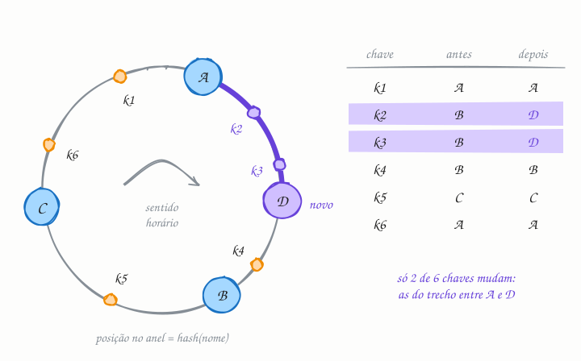

## O essencial

O hashing consistente é uma técnica para distribuir chaves entre nós de um jeito que minimiza a movimentação de dados quando nós são adicionados ou removidos. Chaves e nós são posicionados num anel lógico, e cada chave pertence ao próximo nó do anel. Quando um nó entra ou sai, só uma pequena parte das chaves precisa se mover. Essa propriedade é muito útil em caches e bancos de dados distribuídos. Pense nele como um mapeamento suave, que não se embaralha quando o tamanho do cluster muda.

## Aprofundando

O problema aparece com `hash(chave) mod N`. Com 4 servidores de cache e 1 milhão de chaves, passar para 5 servidores muda o dono de cerca de 800 mil chaves. Num cache, isso é uma onda de misses de uma vez só, e todas essas leituras caem no banco ao mesmo tempo.

O hashing consistente troca o `mod N` por um anel:

1. Pegue o espaço de saída da função de hash (por exemplo, de 0 a 2^32 − 1) e dobre-o num círculo.
2. Cada nó ganha uma posição no anel: `hash("servidor-A")`.
3. Cada chave também: `hash("usuario:42")`.
4. O dono da chave é o primeiro nó que você encontra andando no sentido horário a partir dela.

Quando o nó D entra, ele assume só as chaves entre o antecessor dele (A) e ele mesmo, que antes eram do sucessor (B). Nenhuma outra chave muda de dono. Quando um nó sai, as chaves dele vão para o próximo nó do anel. Em média, só K/N chaves se movem (K chaves, N nós): no exemplo do cache, uns 200 mil em vez de 800 mil.

Para achar o dono, basta guardar as posições dos nós numa lista ordenada e fazer uma busca binária, em O(log N).

### Nós virtuais

Com poucos nós em posições aleatórias, os trechos do anel ficam desiguais, e um nó pode carregar o dobro de outro. Pior: quando um nó sai, toda a carga dele cai num único vizinho. A solução são os **nós virtuais (vnodes)**: cada servidor físico aparece em dezenas ou centenas de posições do anel (`hash("A#1")`, `hash("A#2")`...). A carga se espalha melhor, a saída de um nó divide as chaves dele entre muitos vizinhos, e uma máquina maior pode receber mais vnodes.

Em bancos como o Cassandra, o anel também define a replicação: cada chave fica no seu dono e nos próximos nós distintos no sentido horário.

## Analogia

Imagine um condomínio com uma rua circular e algumas guaritas ao longo dela. Cada encomenda fica na primeira guarita que o entregador encontra andando no sentido horário a partir da casa do morador. Se o condomínio abre uma guarita nova, só as casas do trecho logo antes dela mudam de guarita; o resto dos moradores nem fica sabendo. Com a regra "casa número X vai para a guarita X mod N", abrir uma guarita mudaria o ponto de retirada de quase todo mundo.

## No mundo real

- A técnica nasceu num artigo de **Karger e colegas no MIT**, em 1997, pensado para caches distribuídos na web; dois dos autores fundaram a **Akamai** no ano seguinte.
- O **Dynamo** da Amazon (artigo de 2007) e o **Cassandra** usam um anel com nós virtuais para distribuir e replicar os dados.
- Clientes de **memcached** popularizaram o algoritmo **ketama**, que o **NGINX** usa na diretiva `hash ... consistent` para escolher servidores de upstream.
- O **Envoy** oferece as políticas de balanceamento ring hash e Maglev, esta inspirada no balanceador do Google: o mesmo cliente cai sempre no mesmo servidor, e quase nada muda quando servidores entram ou saem.

## Trade-offs

**Você ganha:**

- Adicionar ou remover um nó move só cerca de 1/N das chaves, em vez de quase todas.
- Crescer ou encolher o cluster sem invalidar o cache inteiro.
- Nenhum coordenador central: qualquer cliente que conheça a lista de nós calcula o dono.

**Você paga:**

- Distribuição desigual, se não houver nós virtuais.
- Mais complexidade que um `mod N`, e todos os clientes precisam ver a mesma lista de nós.
- Uma chave muito acessada continua sobrecarregando um nó só.

## Na entrevista

- Traga o conceito sempre que houver um cache distribuído ou um banco particionado que precisa crescer: "Vou distribuir as chaves com hashing consistente, para que adicionar um nó mova só uma fração delas."
- Mostre a conta: com `mod N`, ir de 4 para 5 nós move 80% das chaves; com o anel, uns 20%.
- Fale de nós virtuais antes que o entrevistador pergunte sobre carga desigual.
- Se houver replicação, diga que as réplicas ficam nos próximos nós do anel.

## Cuidado com

- **Hashing consistente não resolve chave quente.** Ele distribui chaves, não acessos: se uma chave recebe 30% do tráfego, um nó recebe esses 30%.
- **Nem todo sistema particionado usa anel.** O Redis Cluster, por exemplo, tem 16.384 hash slots fixos (`CRC16(chave) mod 16384`) e move slots inteiros entre os nós. Resolve o mesmo problema de outro jeito.
- **Atualização:** o anel de 1997 é a forma clássica, mas não a única. Rendezvous hashing, jump consistent hash (Google, 2014) e Maglev (Google, 2016) trazem distribuição mais uniforme ou consulta mais rápida e aparecem em sistemas modernos.

## Teste-se

**P:** Num anel de hashing consistente, a quem pertence uma chave?

**R:** Ao primeiro nó encontrado andando no sentido horário a partir da posição da chave no anel.

**P:** Seu cache distribuído tem 10 nós e vai ganhar mais 2 para a Black Friday. Por que usar hashing consistente em vez de `hash mod N`?

**R:** Com `mod N`, passar de 10 para 12 nós troca o dono de cerca de 83% das chaves, gerando uma tempestade de misses no banco justamente no pico. Com o anel, só as chaves que os nós novos assumem, cerca de 1/6, mudam de lugar.

**P:** Com hashing consistente e nós virtuais, uma chave muito popular deixa de ser problema?

**R:** Não. Todas as requisições daquela chave continuam indo para o mesmo nó. Chave quente pede outra técnica, como replicá-la em vários nós ou guardar uma cópia em cache local.
