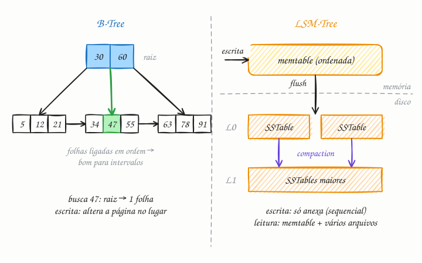

## O essencial

Índices aceleram consultas ao organizar os dados de um jeito que permite encontrá-los rápido. B-Trees são árvores balanceadas que mantêm os dados ordenados e permitem encontrar faixas (intervalos) com eficiência; são comuns em bancos relacionais. LSM-Trees acumulam as escritas em memória e, de tempos em tempos, as descarregam no disco, o que torna as escritas muito rápidas, mas as leituras mais complexas. O trade-off é entre cargas com muita escrita e cargas com muita leitura. A ideia-chave é que índices são uma estrutura separada, que precisa ser atualizada a cada escrita, e é por isso que índices demais prejudicam o desempenho das inserções.

## Aprofundando

Sem índice, achar um cliente pelo e-mail numa tabela de 10 milhões de linhas exige ler todas elas (full table scan). Com índice, bastam algumas leituras de página.

### B-Tree

O banco guarda o índice em **páginas** de tamanho fixo (8 KB no PostgreSQL, 16 KB no InnoDB do MySQL). Cada página interna tem centenas de chaves e ponteiros para as páginas filhas, então a árvore é larga e baixa: três ou quatro níveis bastam para centenas de milhões de linhas, e os níveis de cima quase sempre estão em memória. Buscar é descer da raiz até uma folha. As folhas são encadeadas em ordem, então uma consulta como `WHERE data BETWEEN ...` acha o começo da faixa e segue de folha em folha.

Escrever é atualizar a página certa **no lugar**; se ela enche, se divide em duas (page split). Cedo ou tarde, cada escrita vira a gravação de uma página inteira num ponto aleatório do disco, mesmo que a mudança seja de poucos bytes.

### LSM-Tree

A LSM-Tree (Log-Structured Merge-Tree) nunca altera um arquivo no lugar:

1. A escrita vai para o WAL (cap. 27) e para a **memtable**, uma estrutura ordenada em memória.
2. Quando a memtable atinge um limite (no RocksDB, 64 MB por padrão), ela é gravada inteira no disco como uma **SSTable**: um arquivo ordenado e imutável. É gravação sequencial, o que discos e SSDs fazem de mais rápido.
3. Em segundo plano, a **compaction** junta SSTables em arquivos maiores, organizados em níveis, e descarta valores sobrescritos e marcas de exclusão (tombstones).

O custo aparece na leitura: a chave pode estar na memtable ou em qualquer SSTable, da mais nova para a mais antiga. Para não abrir todos os arquivos, cada SSTable tem um índice esparso e um Bloom filter (cap. 30), que descarta na hora os arquivos que com certeza não têm a chave.

### Por que índices demais atrapalham

Cada índice secundário é mais uma árvore para atualizar. Uma tabela com seis índices secundários faz sete atualizações a cada `INSERT`: a tabela e os seis índices. O índice acelera a leitura que ele atende e encarece toda escrita.

## Analogia

Pense em dois jeitos de organizar as figurinhas do álbum da Copa. No primeiro, você cola cada figurinha no lugar certo assim que abre o pacote: dá trabalho a cada pacote, mas achar a número 237 é imediato (B-Tree). No segundo, você junta as figurinhas do dia num envelope, ordena e guarda; de vez em quando, junta os envelopes antigos num só e joga fora as repetidas (LSM-Tree). Abrir pacote fica rapidíssimo, mas achar a 237 exige olhar vários envelopes.

## No mundo real

- A **B-Tree**, na variante B+Tree, é o índice padrão do PostgreSQL, do MySQL, do SQL Server e do Oracle. No InnoDB, a própria tabela é guardada numa B+Tree ordenada pela chave primária.
- A **LSM-Tree** está no Cassandra, no ScyllaDB, no HBase e no RocksDB. O RocksDB, por sua vez, roda por baixo de outros sistemas, como o TiKV (do TiDB) e o MyRocks, motor de armazenamento do MySQL que a Meta usa no banco do seu grafo social.
- O artigo do **Bigtable** (Google, 2006) popularizou os termos memtable e SSTable.

## Trade-offs

| | B-Tree | LSM-Tree |
|---|---|---|
| Escrita | Atualiza páginas no lugar (I/O aleatório) | Só anexa e grava em lote (I/O sequencial) |
| Leitura de uma chave | Um caminho raiz → folha, previsível | Memtable e vários arquivos, com ajuda de Bloom filters |
| Consulta por faixa | Excelente: folhas encadeadas | Boa, mas junta dados de vários arquivos |
| Trabalho em segundo plano | Pouco | Compaction constante, que consome disco e CPU |
| Bom para | Leituras e transações (OLTP clássico) | Escrita intensa: logs, métricas, eventos, IoT |

## Na entrevista

- Num sistema com muita escrita (telemetria, logs, mensagens), diga: "Prefiro um motor LSM, como Cassandra ou RocksDB, porque ele transforma escritas aleatórias em sequenciais."
- Para leitura com consultas por faixa, B-Tree é o padrão seguro.
- Mostre que conhece o custo de cada índice: "Vou indexar só as colunas das consultas críticas, porque cada índice encarece todas as escritas."
- Ponto extra: citar os Bloom filters que poupam leituras inúteis nas LSM-Trees.

## Cuidado com

- **A ordem das colunas num índice composto importa.** Um índice em `(cliente_id, data)` serve para buscar por cliente, ou por cliente e data, mas ajuda pouco ou nada numa busca só por data.
- **Índice não é mágico.** Numa coluna com poucos valores distintos (um `status` com três valores bem distribuídos), o banco prefere ler a tabela inteira e ignora o índice.
- **Atualização:** "B-Tree para leitura, LSM para escrita" é uma regra de bolso, não uma lei. Com Bloom filters e cache, motores LSM atendem bem muitas cargas mistas (o MyRocks da Meta é um exemplo), e o custo que mais aparece na prática é a compaction, que disputa disco com o tráfego e causa picos de latência.

## Teste-se

**P:** O que é uma SSTable?

**R:** Um arquivo imutável, ordenado por chave, que a LSM-Tree grava no disco quando a memtable enche. Ele nunca é alterado; a compaction o junta com outros em arquivos novos.

**P:** Você vai guardar as leituras de 1 milhão de sensores, cada um enviando um valor por segundo. B-Tree ou LSM-Tree?

**R:** LSM-Tree. São um milhão de escritas por segundo, quase todas inserções, e transformá-las em gravações sequenciais em lote é exatamente o forte da LSM.

**P:** Criar um índice para cada coluna da tabela deixa o sistema mais rápido?

**R:** Só as leituras que usam esses índices. Cada `INSERT`, `UPDATE` e `DELETE` passa a manter todos eles em dia, o que deixa as escritas mais lentas e ocupa mais disco e memória.
