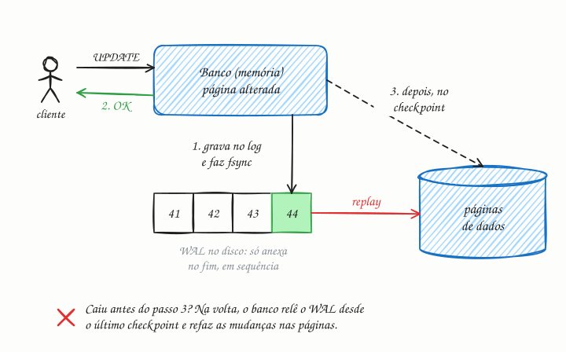

## O essencial

O Write-Ahead Logging registra as mudanças num log antes de aplicá-las ao banco de dados principal. Se uma queda acontecer no meio de uma transação, o sistema pode refazer (replay) o log para restaurar um estado consistente. O WAL garante a durabilidade e a atomicidade das transações. Ele também permite técnicas como a replicação a partir do fluxo do log. Vou explicar por que isso é importante: sem WAL, uma queda poderia deixar seus dados num estado corrompido, atualizado pela metade.

## Aprofundando

Um único `UPDATE` pode mexer em várias páginas: a da tabela e as de cada índice. Gravar essas páginas direto nos arquivos de dados a cada commit tem dois problemas. É lento, porque são escritas aleatórias em vários pontos do disco. E é perigoso: se a luz cai depois de gravar uma página e antes da outra, o índice aponta para uma linha que não existe.

O WAL resolve as duas coisas com uma regra: **nenhuma mudança chega aos arquivos de dados antes de estar descrita no log, no disco.** O caminho de uma escrita fica assim:

1. O banco altera a página **em memória** e anexa ao fim do log um registro descrevendo a mudança. No commit, força o log para o disco com `fsync`.
2. Só então confirma ao cliente. A transação já é durável, mesmo que nenhum arquivo de dados tenha mudado.
3. Mais tarde, num **checkpoint**, as páginas alteradas são gravadas nos arquivos de dados, em lote.

Anexar ao fim de um arquivo é escrita sequencial, o tipo mais barato para o disco. E vários commits simultâneos podem dividir um único `fsync` (group commit), o que multiplica o throughput.

Cada registro tem um número crescente, o **LSN** (log sequence number), e cada página guarda o LSN da última mudança aplicada nela. Na recuperação, o banco começa no último checkpoint, relê o log e reaplica o que ainda não está nas páginas. Transações que não chegaram a registrar o commit são descartadas ou desfeitas. O log anterior ao checkpoint deixa de ser necessário para isso e pode ser reciclado, a menos que réplicas ou o arquivamento ainda precisem dele. Checkpoints mais frequentes encurtam a recuperação, ao custo de mais gravações.

O log também é um fluxo ordenado de tudo o que mudou. Mande-o para outra máquina e você tem uma réplica (cap. 24); leia-o com uma ferramenta de change data capture (CDC) e você publica cada mudança para outros sistemas (cap. 29).

## Analogia

O caixa de uma padaria anota cada venda num caderno, sempre na próxima linha, na hora em que ela acontece. A planilha de estoque, que dá mais trabalho, ele só atualiza no fim do dia. Se a luz acabar às três da tarde, nada se perde: quando ela volta, o caixa relê o caderno a partir do último fechamento e acerta a planilha. O caderno é o WAL; a planilha, os arquivos de dados.

## No mundo real

- O **PostgreSQL** grava o WAL na pasta `pg_wal`, em segmentos de 16 MB por padrão, e usa o mesmo log na streaming replication e na recuperação para um ponto no tempo.
- O **InnoDB**, do MySQL, tem o redo log. Com `innodb_flush_log_at_trx_commit = 1`, o padrão, ele força o log para o disco a cada commit.
- O **SQLite** tem um modo WAL que permite que leitores e o escritor trabalhem ao mesmo tempo.
- O **Debezium** lê o WAL do PostgreSQL e o binlog do MySQL para publicar cada mudança no Kafka.

## Trade-offs

**Você ganha:**

- Durabilidade: o que foi confirmado sobrevive a uma queda.
- Recuperação sem nada atualizado pela metade.
- Commits rápidos: um append sequencial agora, as páginas em lote depois.
- Replicação e CDC lendo o mesmo log.

**Você paga:**

- Cada mudança é gravada duas vezes: no log e, depois, nos arquivos de dados.
- A latência de um `fsync` por commit (ou o risco de perder dados, se você relaxar isso).
- Espaço em disco para o log e uma recuperação que cresce com o log desde o último checkpoint.

## Na entrevista

- Quando o assunto for durabilidade, diga: "A escrita só é confirmada depois que o registro está no log, no disco. Se a máquina cair, o banco refaz o log na volta."
- Ligue o WAL à replicação: "As réplicas recebem esse mesmo log e o aplicam na mesma ordem."
- Se o assunto for desempenho, mostre o trade-off: relaxar o `fsync` por commit (como o `synchronous_commit = off` do PostgreSQL) aumenta o throughput, mas aceita perder as últimas transações confirmadas numa queda, ainda que sem corromper o banco.

## Cuidado com

- **WAL não é backup.** Ele protege contra quedas, não contra um disco que morre nem contra um `DELETE` errado. Para isso, backups e arquivamento do log.
- **"Confirmado" depende do `fsync`.** Configurações que só forçam o disco de tempos em tempos trocam durabilidade por velocidade: o Redis com AOF em `appendfsync everysec`, por exemplo, pode perder cerca de um segundo de escritas.
- **Atualização:** o artigo diz que o WAL garante a atomicidade e a durabilidade. Ele é a base, mas não age sozinho: a atomicidade também depende de como o banco desfaz ou esconde transações incompletas (undo log no InnoDB, MVCC no PostgreSQL), e a durabilidade depende de o disco realmente honrar o `fsync`.

## Teste-se

**P:** Qual é a regra central do write-ahead logging?

**R:** Nenhuma mudança é gravada nos arquivos de dados antes de estar registrada no log, no disco. E a transação só é confirmada depois que o registro do commit foi forçado para o disco.

**P:** O banco cai logo depois de confirmar uma transação, antes de gravar as páginas de dados. A transação se perde?

**R:** Não. O registro dela já estava no WAL, no disco. Na volta, o banco relê o log a partir do último checkpoint e reaplica a mudança nas páginas.

**P:** Se o WAL faz cada mudança ser gravada duas vezes, por que ele deixa o banco mais rápido, e não mais lento?

**R:** Porque o commit só exige um append sequencial no log, em vez de várias gravações aleatórias em páginas espalhadas. As páginas vão para o disco depois, em lote, e vários commits podem dividir o mesmo `fsync`.
