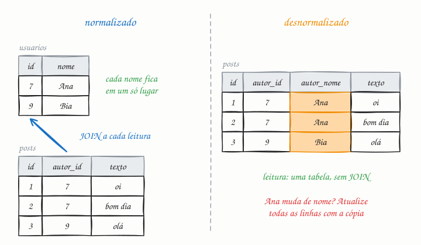

## O essencial

- A normalização organiza os dados em tabelas que reduzem a redundância e as dependências, seguindo regras como a primeira forma normal, a segunda forma normal e assim por diante. Isso evita anomalias em atualizações e inserções.
- A desnormalização duplica dados de propósito para acelerar as leituras e reduzir joins. Em sistemas de grande escala, desnormalizar é comum nos caminhos com muita leitura, como guardar o nome do usuário junto com os posts em vez de fazer um join toda vez.

A verdadeira habilidade é saber onde você pode desnormalizar com segurança sem quebrar a consistência.

## Aprofundando

### As formas normais, sem decoreba

Cada forma normal elimina um tipo de repetição:

- **1FN:** cada coluna guarda um valor atômico. Nada de `telefones = "1111, 2222"` numa célula só.
- **2FN:** numa tabela de chave composta, nenhuma coluna depende só de parte da chave. Em `itens_pedido(pedido_id, produto_id, quantidade, nome_produto)`, o nome depende só do produto, então sai dali.
- **3FN:** nenhuma coluna depende de outra coluna que não é chave. Em `clientes(id, cep, cidade)`, a cidade depende do CEP, não do cliente.

O resumo clássico: cada coluna depende "da chave, da chave inteira e de nada além da chave".

### As anomalias que ela evita

Se o endereço do cliente está copiado em 300 pedidos, mudar o endereço exige atualizar 300 linhas; se uma ficar para trás, o banco passa a ter dois endereços para a mesma pessoa (**anomalia de atualização**). Há também as de inserção (se produto e pedido moram na mesma tabela, não dá para cadastrar um produto que nunca foi vendido) e as de exclusão (apagar o último pedido apaga o único registro do cliente).

### Quando desnormalizar

Num feed, mostrar 20 posts com o nome de cada autor exige um JOIN a cada leitura. Com milhares de leituras por segundo, ou com os usuários em outro shard (cap. 23), esse JOIN pesa. Copiar `autor_nome` para dentro do post resolve a leitura, mas cria uma obrigação: quando alguém muda de nome, todas as cópias precisam ser atualizadas, em geral de forma assíncrona.

Outras formas comuns: contadores pré-calculados (`total_curtidas`), views materializadas e documentos que embutem os dados lidos juntos.

A desnormalização segura tem três características: o dado muda pouco, um atraso na atualização das cópias é aceitável e existe uma **fonte da verdade** normalizada, a partir da qual as cópias podem ser reconstruídas.

## Analogia

Numa escola, a secretaria guarda o cadastro de cada aluno, e o diário de classe usa só o número de matrícula: para saber quem é o 17, o professor consulta a secretaria (normalizado). Se cada diário trouxer nome, telefone e responsável de cada aluno (desnormalizado), a consulta fica mais rápida, mas quando uma família troca de telefone, alguém precisa corrigir todos os diários. O que ficar esquecido vira ligação para o número errado.

## No mundo real

- Bancos transacionais como **PostgreSQL** e **MySQL** costumam ser modelados até a 3FN: é o ponto de partida padrão para dados que mudam muito.
- **Data warehouses** seguem o caminho oposto: o modelo dimensional (esquema estrela) de Ralph Kimball desnormaliza as dimensões de propósito, porque ali quase tudo é leitura.
- **Cassandra** e **DynamoDB** são modelados a partir das consultas: é comum ter a mesma informação em várias tabelas, uma para cada padrão de acesso.
- No **MongoDB**, a recomendação é embutir no mesmo documento os dados que são lidos juntos.

## Trade-offs

| | Normalizado | Desnormalizado |
|---|---|---|
| Leitura | Exige joins, que pesam em escala | Uma consulta, sem join |
| Escrita | Cada fato muda num lugar só | Várias cópias para atualizar |
| Consistência | Garantida pelo próprio modelo | Depende do código que sincroniza as cópias |
| Espaço | Menor | Maior |
| Consultas novas | Flexível para perguntas que ninguém previu | Otimizado para as consultas que já existem |

## Na entrevista

- Comece normalizado e desnormalize só os caminhos quentes, com um motivo: "O feed tem 50 mil leituras por segundo; vou copiar o nome e a foto do autor no post."
- Diga sempre **como** as cópias ficam em dia: na mesma transação, por um evento assíncrono ou por um job que reconstrói tudo.
- Deixe claro qual é a fonte da verdade e quanto atraso cada cópia tolera. É isso que o entrevistador quer ouvir.

## Cuidado com

- **Nem toda cópia é desnormalização.** O preço guardado no item do pedido é o preço daquele momento, um fato diferente do preço atual do catálogo. Ele deve ser copiado e não deve mudar.
- **JOIN não é vilão.** Com índices, juntar poucas linhas é barato. O problema aparece em volumes muito altos ou quando as tabelas estão em shards diferentes.
- **Cópia sem responsável pela sincronização** é inconsistência com hora marcada. Se nenhum processo atualiza as cópias, elas vão divergir.

## Teste-se

**P:** O que é uma anomalia de atualização?

**R:** É quando o mesmo fato está guardado em várias linhas e uma atualização muda só parte delas, deixando o banco com informações contraditórias, como dois endereços para o mesmo cliente.

**P:** Um feed mostra o nome do autor em cada post e recebe 20 mil leituras por segundo. Nomes mudam raramente. O que você faz?

**R:** Desnormalizo: guardo o nome do autor junto do post (ou no cache do feed) e, quando alguém troca de nome, atualizo as cópias de forma assíncrona. A troca é rara, e um atraso de alguns minutos é aceitável.

**P:** Copiar o preço do produto para a linha do pedido é desnormalização?

**R:** Não. O preço no pedido registra o valor cobrado naquele momento, um fato do próprio pedido. Ele precisa ser copiado justamente para não mudar quando o catálogo mudar.
