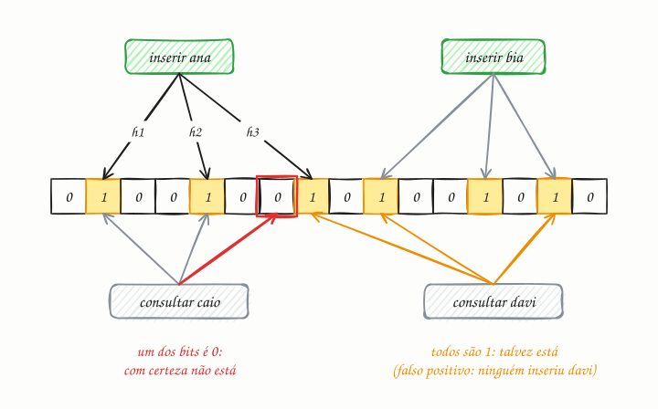

## O essencial

Um Bloom filter é uma estrutura de dados eficiente em espaço que responde rapidamente à pergunta "este item pode estar no conjunto?", com possíveis falsos positivos, mas nenhum falso negativo. Ele usa várias funções de hash para ligar bits num array de bits quando os itens são inseridos. Para verificar se um item pertence ao conjunto, você testa os mesmos bits: se algum bit for zero, o item com certeza não está lá. Bancos de dados e caches usam Bloom filters para evitar buscas desnecessárias no disco ou cache misses. Pense neles como porteiros rápidos que dizem "com certeza não" ou "talvez".

## Aprofundando

Um Bloom filter tem só duas peças: um array de **m bits**, todos começando em zero, e **k funções de hash**, cada uma levando um item a uma posição do array.

- **Inserir:** calcule as k posições do item e ligue esses bits.
- **Consultar:** calcule as mesmas k posições. Se algum bit estiver desligado, o item **com certeza não** foi inserido, porque a inserção teria ligado todos. Se todos estiverem ligados, a resposta é **talvez**: outros itens podem ter ligado aqueles bits.



No diagrama, o array tem 16 bits e há três funções de hash. Ana liga os bits 1, 4 e 7 (contando do zero), e Bia liga 9, 12 e 14. Caio cai em 1, 4 e 6: o bit 6 está desligado, então ele com certeza não está no conjunto. Davi cai em 7, 9 e 14, todos ligados por outros itens: o filtro responde "talvez", e é um **falso positivo**.

### Quanto erra e quanto ocupa

A taxa de falsos positivos (p) depende de quantos itens você inseriu (n), do tamanho do array (m) e do número de funções de hash (k):

```text
p ≈ (1 − e^(−k·n/m))^k
```

A regra de bolso: com cerca de **10 bits por item** e 7 funções de hash, a taxa fica perto de **1%**. Para um bilhão de itens, isso dá pouco mais de 1 GB, contra 32 GB só para guardar IDs de 32 bytes. E o filtro nunca guarda os itens, só bits.

A taxa sobe à medida que o filtro enche. Inserir muito mais itens do que o planejado liga quase todos os bits, e o filtro passa a dizer "talvez" para tudo. Por isso ele é dimensionado para um número esperado de itens.

### O uso clássico

O filtro fica na frente de algo caro. Numa LSM-Tree (cap. 26), cada SSTable tem o seu Bloom filter em memória. Para buscar uma chave, o banco consulta o filtro de cada arquivo e só lê do disco os que responderam "talvez". Uma busca por uma chave inexistente, que poderia abrir dezenas de arquivos, quase nunca toca o disco.

## Analogia

Pense num teste de triagem que nunca deixa passar quem tem a doença, mas às vezes acusa quem não tem. Resultado negativo: você vai para casa tranquilo. Resultado positivo: você faz o exame completo, caro e demorado, para confirmar. O Bloom filter é essa triagem barata na frente do disco: só manda para a consulta cara quem pode mesmo estar lá.

## No mundo real

- **Cassandra**, **HBase** e **RocksDB** mantêm um Bloom filter por arquivo de dados; no Cassandra, a taxa de falsos positivos é configurável por tabela (`bloom_filter_fp_chance`).
- O artigo do **Bigtable** (Google, 2006) já descrevia Bloom filters para evitar idas ao disco atrás de linhas que não existem.
- A **Akamai** documentou o uso de Bloom filters para não ocupar o cache com "one-hit wonders", objetos pedidos uma única vez: um objeto só entra no cache quando é pedido pela segunda vez.
- O **Redis** oferece Bloom filters prontos (`BF.ADD`, `BF.EXISTS`), úteis, por exemplo, para checar se um nome de usuário já foi usado antes de ir ao banco.

## Trade-offs

**Você ganha:**

- Memória mínima: uns 10 bits por item para 1% de erro, seja o item um número ou uma URL inteira.
- Inserção e consulta em tempo constante (k cálculos de hash).
- Um "com certeza não" confiável, que poupa idas ao disco, à rede ou ao banco.

**Você paga:**

- Falsos positivos, que pedem uma verificação de verdade depois.
- Nada de remover itens: desligar um bit pode "apagar" outros.
- Nada de listar o conteúdo, e o tamanho precisa ser planejado antes.

## Na entrevista

- Traga o Bloom filter quando houver muitas consultas por coisas que provavelmente **não** existem: "Antes de ir ao banco checar se o nome de usuário está livre, consulto um Bloom filter; se ele disser 'com certeza não', respondo na hora."
- Saiba dizer de que lado fica o erro: falso positivo pode, falso negativo nunca.
- Cite os usos clássicos: LSM-Trees e crawlers ("esta URL já foi visitada?").
- Se perguntarem sobre remoção: counting Bloom filter ou cuckoo filter.

## Cuidado com

- **Não inverta a garantia.** O "talvez" pode estar errado; o "com certeza não", nunca. Uma estrutura que às vezes "esquece" itens inseridos não é um Bloom filter.
- **Filtro lotado perde a graça.** Passar muito do número de itens planejado faz a taxa de falsos positivos disparar. Dimensione com folga ou use um filtro que cresce em camadas.
- **Atualização:** o artigo diz que Bloom filters evitam cache misses. Mais preciso: eles evitam consultas inúteis, como pedidos de chaves que não existem e que, sem o filtro, passariam pelo cache e chegariam ao banco toda vez (o chamado cache penetration).

## Teste-se

**P:** Um Bloom filter pode dar falso negativo?

**R:** Não. Se o item foi inserido, todos os bits dele foram ligados e nunca são desligados, então a consulta sempre responde "talvez". O único erro possível é o falso positivo.

**P:** Seu crawler já visitou 5 bilhões de URLs e precisa evitar revisitá-las sem guardar todas em memória. O que você usa?

**R:** Um Bloom filter das URLs visitadas. Com uns 10 bits por URL, são cerca de 6 GB para 1% de falsos positivos, e o custo do erro é só deixar de visitar algumas URLs novas.

**P:** Dá para remover um item de um Bloom filter desligando os bits dele?

**R:** Não. Esses bits podem ter sido ligados também por outros itens, e desligá-los criaria falsos negativos. Para remover, use um counting Bloom filter (contadores no lugar de bits) ou um cuckoo filter.
