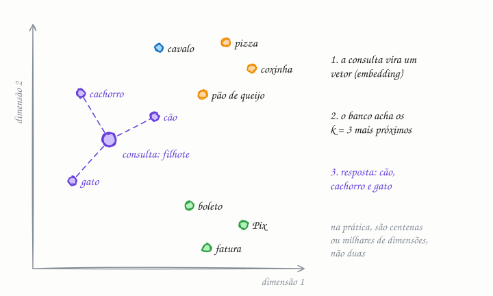

## O essencial

Bancos de dados vetoriais armazenam e consultam vetores, que são representações numéricas de dados como texto, imagens ou áudio. Esses vetores vêm de modelos, como os de embeddings, e permitem a busca por similaridade, como "encontre os documentos mais parecidos com este". Em vez de comparações exatas de igualdade, eles usam métricas de distância, como a similaridade de cosseno ou a distância euclidiana. Isso é essencial para os sistemas modernos de busca, recomendação e assistentes de IA. Em entrevistas, basta saber que bancos vetoriais suportam a busca por vizinhos mais próximos (nearest neighbor search) em dados de alta dimensão.

## Aprofundando

### De dado para vetor

Um modelo de embeddings transforma um item num vetor de tamanho fixo, em geral de algumas centenas a alguns milhares de números (384, 768, 1.536...). O modelo é treinado para que itens de significado parecido fiquem perto nesse espaço: "cachorro" e "cão" ficam vizinhos, e "boleto" fica longe dos dois. Para buscar, você passa a consulta pelo **mesmo** modelo e procura os k vetores mais próximos dela (k-NN).

### Medindo "perto"

- **Similaridade de cosseno:** compara o ângulo entre os vetores e ignora o comprimento deles.
- **Distância euclidiana (L2):** a distância em linha reta.
- **Produto interno (dot product):** comum quando o modelo foi treinado para ele.

Com vetores normalizados (comprimento 1), as três produzem o mesmo ranking. Na dúvida, use a métrica para a qual o modelo foi treinado.

### Por que "aproximado"

A busca exata compara a consulta com todos os vetores. Com 10 milhões de vetores de 768 dimensões, são uns 7,7 bilhões de multiplicações por consulta: viável em lote, caro demais para responder em milissegundos a milhares de consultas por segundo. E as estruturas clássicas de índice espacial, como as árvores, perdem a eficácia com centenas de dimensões.

Por isso, bancos vetoriais usam índices de **vizinhos mais próximos aproximados (ANN)**:

- **HNSW:** um grafo em camadas. A busca começa numa camada esparsa, dá saltos largos e desce para camadas mais densas, refinando. É rápido e preciso, mas gasta bastante memória.
- **IVF:** agrupa os vetores em clusters (com k-means) e, na consulta, examina só os clusters mais próximos.
- **Quantização (PQ):** comprime os vetores para caber mais em memória, perdendo um pouco de precisão.

O preço é o **recall**: em vez de garantir os 10 vizinhos exatos, o índice devolve, digamos, 9 deles. Você ajusta parâmetros para trocar recall por latência e memória.

Na prática, a busca vetorial quase nunca vem sozinha: ela se combina com filtros de metadados ("só documentos deste cliente") e, muitas vezes, com busca por palavra-chave (busca híbrida).

## Analogia

Num supermercado, ninguém acha o requeijão pelo código de barras: vai ao corredor dos frios, onde ficam as coisas parecidas, como manteiga e cream cheese. Uma busca exata pergunta "existe o produto de código 789...?"; uma busca vetorial pergunta "o que está perto disto?". O mercado só funciona porque alguém organizou os corredores por semelhança. O modelo de embeddings faz esse papel com os seus dados.

## No mundo real

- O **pgvector** acrescenta ao PostgreSQL um tipo `vector` e índices HNSW e IVFFlat, com distância euclidiana, cosseno e produto interno.
- Bancos dedicados como **Pinecone**, **Milvus**, **Weaviate** e **Qdrant** nasceram para isso, e o **FAISS**, da Meta, é a biblioteca de referência para busca de similaridade.
- O **Spotify** abriu o código do **Annoy**, biblioteca de vizinhos aproximados criada lá para recomendar músicas.
- **Elasticsearch**, **OpenSearch**, **MongoDB Atlas** e **Redis** também oferecem busca vetorial, o que permite combiná-la com filtros e busca textual no mesmo lugar.

## Trade-offs

| | Busca exata (k-NN) | Busca aproximada (ANN) |
|---|---|---|
| Resultado | Os k mais próximos, garantido | Quase sempre os mesmos (recall ajustável, como 95%) |
| Custo por consulta | Proporcional ao número de vetores | Cresce bem mais devagar |
| Memória | Só os vetores | Vetores mais o índice (o grafo HNSW pesa) |
| Atualizações | Triviais | Mais trabalhosas: o índice precisa ser mantido e, às vezes, reconstruído |
| Bom para | Coleções pequenas ou reordenar poucos candidatos | Milhões a bilhões de vetores com latência baixa |

## Na entrevista

- Em perguntas de busca semântica, recomendação ou RAG, desenhe o fluxo: dividir os documentos em trechos, gerar os embeddings, indexar, buscar os top-k e, se precisar, reordenar (rerank) antes de mandar ao modelo de linguagem.
- Diga que usaria um índice ANN (HNSW, por exemplo) e que existe um trade-off entre recall, latência e memória.
- Lembre dos filtros ("só documentos que este usuário pode ver") e da busca híbrida com palavras-chave.
- Ponto extra: trocar o modelo de embeddings obriga a reindexar tudo.

## Cuidado com

- **Vetores de modelos diferentes não se comparam.** Cada modelo cria o próprio espaço. Mudar de modelo, ou de versão, exige gerar todos os embeddings de novo.
- **Parecido não é exato.** Para códigos de produto, nomes próprios e mensagens de erro, a busca por palavra-chave (como o BM25) costuma ganhar; por isso a busca híbrida é tão comum.
- **Atualização:** "banco vetorial" deixou de ser só uma categoria de produto. Muitos bancos populares ganharam índice vetorial, então a decisão costuma ser entre ativá-lo no banco que você já usa ou adotar um dedicado para escala muito grande. E, em vagas que envolvem IA, espere perguntas além do "vizinho mais próximo": ANN, recall e RAG.

## Teste-se

**P:** O que é um embedding?

**R:** Um vetor de números, de tamanho fixo, gerado por um modelo para representar o significado de um item. Itens parecidos ficam com vetores próximos.

**P:** Você precisa de busca semântica sobre 50 milhões de trechos de documentos, com resposta em menos de 100 ms. Busca exata ou aproximada?

**R:** Aproximada, com um índice ANN como o HNSW. Comparar cada consulta com 50 milhões de vetores é caro demais; aceita-se perder um pouco de recall em troca de latência baixa.

**P:** Dá para comparar vetores gerados por dois modelos de embedding diferentes?

**R:** Não. Cada modelo cria o próprio espaço, e a distância entre vetores de modelos diferentes não significa nada. Trocar de modelo exige gerar os embeddings de novo.
