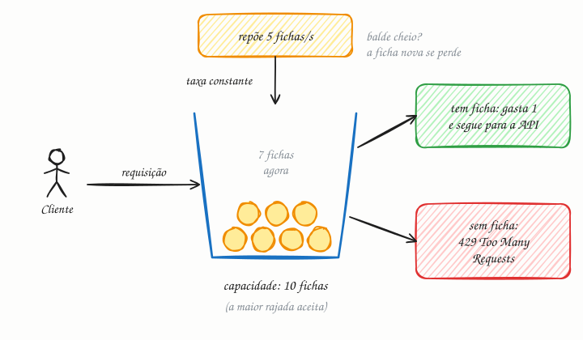

## O essencial

O rate limiting (limitação de taxa) controla quantas requisições um usuário, um IP ou uma chave de API pode fazer numa determinada janela de tempo. Ele protege o seu sistema contra abuso, picos acidentais de tráfego e loops descontrolados. Estratégias comuns incluem janela fixa, janela deslizante e token bucket. Os limites costumam ser aplicados no API gateway ou no load balancer. Pense neles como freios de segurança que impedem que recursos compartilhados fiquem sobrecarregados.

## Aprofundando

Todo rate limiter responde à mesma pergunta a cada requisição: "esta chave ainda tem cota?". A chave pode ser o usuário, o IP, a chave de API ou uma combinação, como usuário mais endpoint. O que muda é o jeito de contar.

### Janela fixa

Um contador por chave e por janela: "no máximo 100 requisições por minuto", zerado às 12:00:00, às 12:01:00 e assim por diante. É o mais simples e barato, mas falha nas bordas: um cliente pode mandar 100 requisições às 12:00:59 e mais 100 às 12:01:00. São 200 em dois segundos, o dobro do limite.

### Janela deslizante

Olha sempre para "os últimos 60 segundos". A versão exata guarda o horário de cada requisição (um log), o que custa memória. A versão aproximada guarda só dois contadores, o da janela anterior e o da atual, e faz uma média ponderada. Exemplo: limite de 100 por minuto, 80 requisições no minuto anterior, 30 no atual e 15 segundos já corridos do minuto atual. Os últimos 60 segundos incluem 45 segundos (75%) do minuto anterior, então a estimativa é 30 + 80 × 0,75 = 90. Ainda cabe.

### Token bucket

Cada chave tem um balde (bucket) com capacidade fixa de fichas (tokens), reposto a uma taxa constante. Cada requisição gasta uma ficha; sem ficha, a resposta é **429 Too Many Requests**.

Com capacidade 10 e reposição de 5 por segundo, um cliente parado acumula 10 fichas e pode disparar uma rajada de 10 requisições de uma vez; depois disso, fica limitado à média de 5 por segundo. São dois botões independentes: a taxa média (reposição) e a maior rajada aceita (capacidade). Um parente próximo é o **leaky bucket** (balde furado): as requisições entram numa fila que escoa num ritmo constante, o que achata as rajadas em vez de permiti-las.

### Onde guardar a contagem

Com um servidor só, o contador fica em memória. Com dez réplicas atrás de um load balancer, cada uma vê só um pedaço do tráfego, então o estado costuma ir para um armazenamento compartilhado, como o Redis, com operações atômicas (`INCR` com expiração, ou um script Lua que lê e atualiza o balde de uma vez). Ao recusar, devolva `429` com o cabeçalho `Retry-After`, para o cliente saber quando tentar de novo (cap. 35).

## Analogia

O limite do Pix noturno é um rate limiter. Das 20h às 6h, o banco limita quanto você pode transferir para outra pessoa física (R$ 1.000, por padrão), mesmo que haja saldo sobrando. Não é desconfiança de você: é um teto que limita o estrago se o celular for roubado. E, como num plano de API mais caro, dá para pedir ao banco um limite maior.

## No mundo real

- **AWS API Gateway:** limita com token bucket. Na maioria das regiões, cada conta tem por padrão 10.000 requisições por segundo, com um balde de 5.000 para rajadas; quem passa disso recebe 429.
- **NGINX:** o módulo `limit_req` usa o método leaky bucket, com o parâmetro `burst` para enfileirar o excesso. Por padrão, ele recusa com 503, e não 429, a menos que você configure `limit_req_status`.
- **GitHub:** a API REST aceita 5.000 requisições por hora de usuários autenticados e 60 por hora sem autenticação, e informa a cota nos cabeçalhos `x-ratelimit-remaining` e `x-ratelimit-reset`.
- **Stripe:** o blog de engenharia da empresa descreve limitadores com token bucket sobre Redis, além de um limitador de requisições simultâneas.

## Trade-offs

| Algoritmo | Estado por chave | Rajadas | Ponto fraco |
|---|---|---|---|
| Janela fixa | 1 contador | Até 2× o limite na virada da janela | Imprecisão nas bordas |
| Janela deslizante (log) | 1 horário por requisição | Respeita o limite à risca | Memória cresce com o limite |
| Janela deslizante (contador) | 2 contadores | Suaviza a borda | É uma estimativa |
| Token bucket | Fichas e hora da última reposição | Aceita rajada até a capacidade | Dois parâmetros para calibrar |
| Leaky bucket | Fila e ritmo de saída | Achata as rajadas | Requisições esperam na fila |

## Na entrevista

- "Projete um rate limiter" é uma pergunta clássica por si só. Comece pelos requisitos: limitar por quê (abuso, custo, justiça entre clientes), por qual chave e com que precisão.
- Diga onde ele mora (na borda, no API gateway, com estado no Redis) e o que acontece se o Redis cair: falhar aberto (deixa passar) ou fechado (recusa tudo). Em geral, falhar aberto é o menos ruim, exceto em endpoints sensíveis, como login.
- Frase pronta: *"Token bucket por chave de API no gateway, com estado no Redis: capacidade de 20 para absorver rajadas e reposição de 10 por segundo. Quem estoura recebe 429 com Retry-After."*

## Cuidado com

- **Limite por instância multiplica a cota.** Se cada um de 10 servidores aplica 100 por minuto em memória, um cliente consegue até 1.000.
- **Limitar só por IP pune inocentes.** Redes móveis e provedores com CGNAT colocam centenas de clientes atrás do mesmo IP. Prefira usuário ou chave de API quando houver.
- **Rate limiting não é load shedding.** Um limita a cota de cada cliente; o outro descarta trabalho quando o próprio servidor está sobrecarregado, venha de quem vier. Você precisa dos dois.
- **Atualização:** além das três estratégias citadas no artigo, o leaky bucket é muito usado (é o do NGINX), e hoje é comum limitar em camadas: na borda contra DDoS, no gateway por chave de API e dentro do serviço para operações caras.

## Teste-se

**P:** Numa janela fixa de 100 requisições por minuto, o que acontece se um cliente manda 100 requisições às 12:00:59 e mais 100 às 12:01:00?

**R:** As duas levas passam, porque caem em janelas diferentes: são 200 requisições em dois segundos, o dobro do limite. A janela deslizante e o token bucket evitam esse pico.

**P:** Uma API pública precisa aceitar rajadas curtas (um app que sincroniza 20 itens ao abrir), mas manter a média em 5 requisições por segundo. Qual algoritmo você usa e como configura?

**R:** Token bucket com capacidade 20, que é a rajada, e reposição de 5 fichas por segundo, que é a média. Cada parâmetro atende a um dos requisitos.

**P:** A API tem 10 réplicas, cada uma com um limitador em memória de 100 requisições por minuto por usuário. Qual é o limite real?

**R:** Até 1.000 por minuto, se o load balancer espalhar as requisições do usuário entre as réplicas. Para um limite global, o estado precisa ser compartilhado (no Redis, por exemplo) ou a cota precisa ser dividida entre as réplicas.
