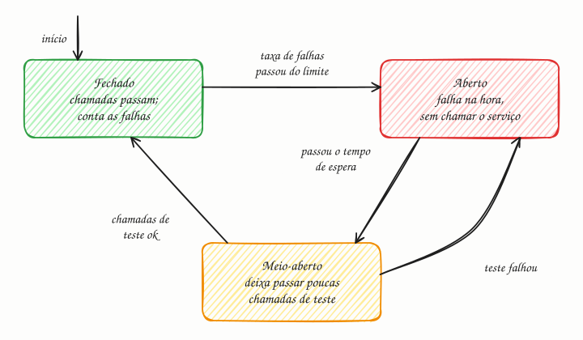

## O essencial

Um circuit breaker (disjuntor) monitora as chamadas a um serviço remoto e "abre" se houver falhas demais. Quando está aberto, ele faz as novas requisições falharem imediatamente, em vez de tentar de novo o serviço quebrado. Depois de um período de espera, ele deixa passar algumas chamadas de teste para ver se o serviço se recuperou, e fecha se elas tiverem sucesso. Esse padrão evita falhas em cascata, em que um serviço lento arrasta o sistema inteiro para baixo. Agora, a parte delicada: circuit breakers precisam ser calibrados com cuidado, para não abrirem agressivamente demais nem tarde demais.

## Aprofundando

### Por que um serviço lento é pior que um morto

Um serviço morto recusa a conexão em milissegundos. Um serviço lento prende quem o chama. Imagine que o serviço de pedidos tem 200 threads e chama o serviço de frete, que passou a responder só no timeout de 30 segundos. Chegando 10 requisições por segundo que precisam de frete, cada uma fica presa 30 s: em 20 segundos, as 200 threads estão esperando, e o serviço de pedidos para de atender até quem nem precisava de frete. A falha subiu um andar. Se outros serviços dependem de pedidos, sobe mais um. Isso é a falha em cascata.

### Os três estados

- **Fechado:** a situação normal. As chamadas passam e o breaker registra o resultado numa janela deslizante, por exemplo as últimas 100 chamadas. Se a taxa de falhas passa do limite (digamos, 50%) depois de um número mínimo de chamadas, ele abre.
- **Aberto:** nenhuma chamada sai. Quem chamou recebe erro na hora ou um fallback (plano B): um valor em cache, uma resposta padrão, a página sem aquela seção. As threads ficam livres, e o serviço doente ganha fôlego para se recuperar.
- **Meio-aberto:** passado o tempo de espera (por exemplo, 30 s), o breaker deixa passar algumas chamadas de teste. Se derem certo, ele fecha. Se falharem, volta a abrir e recomeça a contar o tempo.

### O que conta como falha

Timeouts, erros de conexão e respostas 5xx contam. Respostas 4xx, em geral, não: um 404 diz que o pedido estava errado, não que o serviço está doente. As bibliotecas atuais também podem contar **chamadas lentas** como falha (acima de 2 s, por exemplo), porque lentidão é justamente o sintoma que derruba quem chama.

O padrão foi popularizado por Michael Nygard no livro *Release It!* (2007). Ele não substitui o timeout: o breaker decide *se* a chamada sai; o timeout limita *quanto tempo* cada chamada pode prender um recurso.

## Analogia

Você pede almoço sempre no mesmo restaurante pelo aplicativo de delivery. Três pedidos seguidos chegam com mais de uma hora de atraso. Você para de pedir lá por uma semana e almoça em outro lugar (o fallback), sem nem abrir o cardápio deles. Passada a semana, arrisca um pedido só. Chegou no horário? Volta à rotina. Atrasou de novo? Mais uma semana de castigo.

## No mundo real

- **Resilience4j:** a biblioteca padrão no ecossistema Java, inclusive por trás do Spring Cloud Circuit Breaker. Por padrão, abre com 50% de falhas numa janela das últimas 100 chamadas e espera 60 s antes de passar para meio-aberto.
- **Netflix Hystrix:** popularizou o padrão em microsserviços, mas está em modo de manutenção desde 2018; a própria Netflix passou a indicar o Resilience4j para projetos novos.
- **Polly:** a biblioteca de resiliência do .NET implementa a mesma máquina de três estados.
- **Envoy e Istio:** chamam de "circuit breaking" outra coisa: limites de conexões, requisições pendentes e retries por cluster. O que tira um host doente de rotação, mais parecido com o padrão clássico, é a outlier detection (detecção de pontos fora da curva).

## Trade-offs

| | Breaker sensível (abre cedo) | Breaker tolerante (abre tarde) |
|---|---|---|
| A dependência caiu de vez | Corta rápido e protege as threads | Acumula timeouts antes de cortar |
| Soluço passageiro de rede | Abre à toa e recusa chamadas que dariam certo | Aguenta sem cortar |
| Risco típico | Fica oscilando entre aberto e fechado | Deixa a cascata começar |
| Ajuste que ajuda | Número mínimo de chamadas e janela maior | Timeout curto e chamadas lentas contando como falha |

## Na entrevista

- Traga o circuit breaker em toda chamada síncrona entre serviços, junto com timeout e retry (cap. 35). O entrevistador quer ver que você pensou no que acontece quando a dependência fica **lenta**, e não só quando cai.
- Descreva os três estados e, principalmente, o fallback de cada funcionalidade. É aí que o design aparece.
- Frase pronta: *"Se o serviço de recomendações degradar, o breaker abre e a página de produto sai sem a vitrine personalizada, com os mais vendidos do cache. O checkout não depende dele e nunca espera por ele."*

## Cuidado com

- **Breaker não substitui timeout.** Sem timeout, cada chamada no estado fechado ainda pode prender uma thread por minutos antes de contar como falha.
- **Retry contra breaker aberto é desperdício.** Cada tentativa falha na hora; o certo é desistir rápido e usar o fallback.
- **Cada instância tem o seu breaker.** Com 50 réplicas, são 50 visões independentes da mesma dependência, cada uma abrindo no seu tempo. Em geral isso é aceitável, mas não espere um interruptor global.
- **Atualização:** muito material ainda ensina com o Hystrix, que não recebe versões novas. Em código novo, use Resilience4j, Polly ou os recursos da malha de serviços (service mesh).

## Teste-se

**P:** Quais são os três estados de um circuit breaker?

**R:** Fechado (as chamadas passam e as falhas são contadas), aberto (as chamadas falham na hora, sem tocar no serviço) e meio-aberto (algumas chamadas de teste decidem se ele fecha ou volta a abrir).

**P:** O serviço de recomendações começou a responder em 30 segundos. O que o breaker do serviço de produto deve fazer, e o que o usuário vê?

**R:** Contar as chamadas lentas como falha, abrir e servir um fallback, como os mais vendidos em cache. O usuário vê a página normal, só sem a vitrine personalizada.

**P:** Configurar o breaker para abrir na primeira falha deixa o sistema mais seguro?

**R:** Não. Qualquer soluço de rede abriria o circuito e recusaria chamadas que dariam certo, e ele ficaria oscilando. É preciso um número mínimo de chamadas e uma taxa de falhas medida numa janela.
