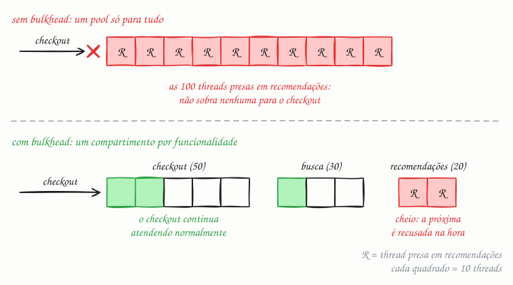

## O essencial

O padrão bulkhead (antepara) isola partes de um sistema para que uma falha numa área não afunde tudo. Isso pode significar pools de conexões separados, pools de threads separados ou até clusters de serviço inteiros separados para funcionalidades diferentes. Se um compartimento é inundado de tráfego, os outros continuam funcionando. O nome vem das anteparas dos navios, que contêm a inundação num único compartimento. Em discussões de design, usar bulkheads mostra que você está pensando em isolamento de falhas e em raio de impacto (blast radius).

## Aprofundando

### O problema do pool compartilhado

Imagine o serviço de uma loja virtual com um único pool de 100 threads atendendo três funcionalidades: checkout, busca e recomendações. O serviço de recomendações, uma dependência externa, começa a levar 10 segundos para responder. Cada chamada a ele segura uma thread por 10 s, e em pouco tempo as 100 estão presas esperando. Chega uma requisição de checkout e não há thread livre. O checkout caiu por causa de uma vitrine que nem é essencial.

### Compartimentos

O bulkhead dá a cada funcionalidade, ou a cada dependência, o seu próprio recurso, com limite: 50 threads para o checkout, 30 para a busca, 20 para as recomendações. Quando recomendações trava, só os 20 lugares dela enchem; a 21ª chamada é recusada na hora (ou espera numa fila curta e limitada), e o checkout segue com os 50 lugares dele intactos.

O mesmo raciocínio vale em vários níveis:

- **Dentro do processo:** pools de threads ou semáforos por dependência ("no máximo 20 chamadas simultâneas ao serviço de recomendações").
- **Conexões:** um pool de conexões com o banco para o tráfego transacional e outro, menor, para relatórios pesados, ou uma réplica de leitura só para eles.
- **Instâncias e clusters:** máquinas separadas para a API pública e para o processamento interno, ou para clientes grandes e pequenos.
- **Células:** cópias completas da pilha, cada uma atendendo uma fatia dos clientes. Uma célula com problema afeta só os clientes dela.

### Quanto dar para cada um

A lei de Little ajuda a dimensionar: concorrência média = vazão × latência. Se o checkout faz 40 chamadas por segundo ao serviço de pagamento e cada uma leva 250 ms, há em média 10 chamadas em andamento. Um compartimento de 20 dá folga para picos sem deixar que uma lentidão do pagamento consuma o resto do sistema.

## Analogia

O caixa rápido do supermercado, para até 10 volumes, é um bulkhead. Em dia de promoção, a fila dos carrinhos cheios pode dar a volta no corredor, mas quem só foi comprar pão e leite não fica preso atrás dela: existe um recurso reservado para o seu tipo de compra. Sem essa separação, as compras lentas travariam todas as rápidas.

## No mundo real

- **Hystrix e Resilience4j:** o Hystrix isolava cada dependência num pool de threads próprio por padrão. O Resilience4j oferece um bulkhead por semáforo, mais leve, e outro com pool de threads fixo e fila limitada.
- **AWS Route 53:** usa shuffle sharding, uma forma refinada de compartimento. Cada domínio de cliente recebe uma combinação de 4 servidores de nomes virtuais, entre 2.048. Um ataque contra um domínio atinge os 4 servidores dele, mas nenhum outro domínio divide mais de 2 servidores com ele.
- **Kubernetes:** requests e limits de CPU e memória por contêiner, e cotas por namespace (ResourceQuota), impedem que um serviço ou um time consuma os recursos do cluster inteiro.

## Trade-offs

| | Pool compartilhado | Compartimentos (bulkhead) |
|---|---|---|
| Uma dependência trava | Pode esgotar o pool e derrubar tudo | Esgota só o compartimento dela |
| Uso dos recursos | Alto: quem precisa pega | Parte fica ociosa, reservada |
| Configuração | Um número para ajustar | Um tamanho por compartimento, mais filas e alertas |
| Prioridades | Todo mundo disputa igual | O essencial tem lugar garantido |

## Na entrevista

- Traga o bulkhead quando um serviço tem dependências de importâncias diferentes ("o checkout não pode cair por causa da vitrine") ou quando vários clientes dividem a mesma infraestrutura, o problema do vizinho barulhento (noisy neighbor).
- Use o vocabulário: isolamento de falhas, raio de impacto, células.
- Combine com o circuit breaker (cap. 33): o bulkhead limita o estrago; o breaker para de alimentá-lo.
- Frase pronta: *"Cada dependência tem o seu limite de chamadas simultâneas. Se recomendações travar, perco só a vitrine; o checkout tem 50 lugares só dele."*

## Cuidado com

- **Compartimento sem timeout só adia o problema.** Ele enche e fica cheio. Precisa de timeout nas chamadas e de recusa rápida quando lota.
- **Fila ilimitada anula o isolamento.** Se o excesso espera numa fila sem fim, a memória vira o recurso compartilhado que afunda tudo.
- **Pools dentro do mesmo processo não isolam CPU nem memória.** Um vazamento de memória numa funcionalidade derruba o processo inteiro; para isso, separe em processos, contêineres ou máquinas.
- **Atualização:** com I/O assíncrono e threads virtuais (Java 21 em diante), threads deixaram de ser o recurso escasso. O bulkhead moderno costuma ser um limite de chamadas simultâneas por dependência, e não um pool de threads.

## Teste-se

**P:** O que é o raio de impacto (blast radius) de uma falha, e como o bulkhead o reduz?

**R:** É a parte do sistema afetada quando algo quebra. O bulkhead separa recursos por funcionalidade, dependência ou cliente, então a falha esgota só o compartimento dela.

**P:** Numa API usada por várias empresas, um cliente dispara relatórios gigantes e deixa todo mundo lento. Como aplicar bulkhead?

**R:** Separando o trabalho pesado do interativo: pool, fila ou instâncias próprios para relatórios, com limite. Se o problema é um cliente específico, ele ganha um compartimento ou uma célula própria, junto com rate limiting (cap. 32).

**P:** Separar pools de threads dentro do mesmo processo protege contra o vazamento de memória de uma das funcionalidades?

**R:** Não. Os pools isolam threads e conexões, mas memória e CPU do processo continuam compartilhadas. Esse tipo de falha exige isolamento em processos, contêineres ou máquinas diferentes.
