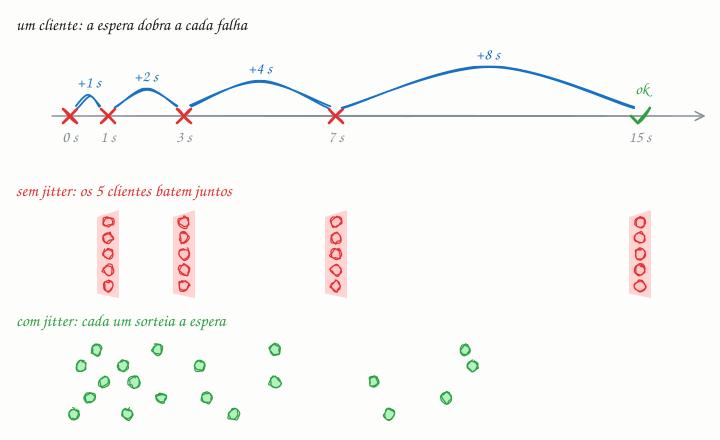

## O essencial

Retries (novas tentativas) ajudam a se recuperar de erros passageiros, como timeouts de rede ou sobrecarga temporária. Backoff exponencial significa que cada nova tentativa espera mais do que a anterior, por exemplo 1 segundo, 2 segundos, 4 segundos, e assim por diante. Isso evita que o seu cliente fique martelando um serviço que já está com dificuldade. Boas políticas de retry também usam jitter (um pouco de aleatoriedade) para evitar o efeito manada (thundering herd). Explicando melhor: retries sem backoff podem piorar uma queda em vez de ajudar.

## Aprofundando

### O que vale repetir

Só erros **passageiros**: timeout, conexão recusada ou interrompida, `503 Service Unavailable` e `429 Too Many Requests` (respeitando o cabeçalho `Retry-After`). Um `400`, `401`, `403` ou `404` vai dar o mesmo erro na décima tentativa. E só repita operações **idempotentes** (cap. 36); do contrário, o retry de um pagamento pode cobrar duas vezes.

### A conta do backoff

```text
espera(n) = min(teto, base × 2^n)        n = 0, 1, 2, ...
base = 1 s, teto = 30 s  ->  1 s, 2 s, 4 s, 8 s, 16 s, 30 s, 30 s...
```

Com um limite de, digamos, 4 retries, o cliente desiste cerca de 15 s depois da primeira falha e devolve o erro, ou manda a mensagem para uma dead letter queue (cap. 46).

### Por que o jitter



O backoff resolve o problema de *um* cliente insistente, mas não o de mil. Se o servidor reinicia e mil clientes falham no mesmo segundo, todos voltam juntos em t = 1 s, depois em t = 3 s, em t = 7 s. Cada onda é um pico que pode derrubar o servidor de novo. O jitter quebra essa sincronia. Na variante full jitter (jitter total), a espera inteira é sorteada entre zero e o teto exponencial:

```text
espera(n) = aleatório(0, min(teto, base × 2^n))
```

As mil tentativas de cada rodada se espalham pelo intervalo, em vez de chegarem no mesmo milissegundo.

### Retries se multiplicam

Se o app repete 3 vezes, o gateway repete 3 vezes e o serviço repete 3 vezes a chamada ao banco, uma falha no banco vira até 4 × 4 × 4 = 64 chamadas, porque cada camada faz a chamada original mais 3 retries. Por isso, repita em uma camada só e use um **orçamento de retries** (retry budget). O livro de SRE do Google descreve um limite de 3 tentativas por requisição e um orçamento por cliente: retries só acontecem enquanto forem menos de 10% das requisições dele.

## Analogia

Sexta à noite, você liga para a pizzaria e dá ocupado. Você não fica rediscando sem parar: espera um minuto, depois dois, depois quatro. Agora imagine o bairro inteiro, que ligou no mesmo instante, rediscando exatamente um minuto depois: a linha continua ocupada para sempre. O que faz as ligações entrarem é cada um esperar um tempo um pouco diferente. Isso é o jitter.

## No mundo real

- **Kubernetes:** reinicia contêineres que caem com backoff exponencial, 10 s, 20 s, 40 s, até o teto de 5 minutos. O `CrashLoopBackOff` que aparece no `kubectl` é exatamente esse estado de espera.
- **gRPC:** a política de retry é declarada na configuração do serviço: máximo de tentativas, backoff inicial, multiplicador, teto e quais códigos repetir (como `UNAVAILABLE`). A espera é sorteada entre zero e o valor exponencial, ou seja, já vem com jitter.
- **SDKs da AWS:** repetem as chamadas com backoff exponencial e jitter e mantêm uma cota de retries (um token bucket) que para de repetir quando as falhas se generalizam. O full jitter foi popularizado por um artigo do blog de arquitetura da AWS, de 2015.

## Trade-offs

| | Retry imediato | Backoff exponencial | Backoff com jitter |
|---|---|---|---|
| Carga sobre o serviço doente | Rajadas seguidas | Menor, mas em ondas sincronizadas | Menor e espalhada |
| Espera de cada cliente | Curta | Cresce a cada tentativa | Cresce, com valor sorteado |
| Previsibilidade | Alta | Alta | Menor |
| Quando usar | Quase nunca | Poucos clientes | Padrão quando há muitos clientes |

## Na entrevista

- Toda vez que desenhar uma chamada de rede, diga a política: quais erros repetir, quantas tentativas, backoff com jitter, teto e timeout por tentativa.
- Amarre com idempotência (cap. 36): "posso repetir porque a operação tem chave de idempotência".
- Mostre que conhece o lado ruim: a amplificação entre camadas e o efeito manada depois de uma queda.
- Frase pronta: *"Retry só para erros transitórios, no máximo 3 tentativas, backoff exponencial com full jitter e teto de 10 s. Esgotou, a mensagem vai para a dead letter queue."*

## Cuidado com

- **Atualização:** o artigo descreve o jitter como "um pouco de aleatoriedade", mas somar um ruído pequeno (alguns milissegundos sobre uma espera de 4 s) desfaz pouco a sincronia. A análise publicada pela AWS em 2015 comparou variantes, e as melhores sorteiam a espera inteira, como o full jitter.
- **Retry sem timeout não ajuda.** Se a primeira tentativa fica pendurada para sempre, a segunda nunca acontece. Cada tentativa precisa do seu timeout, e todas juntas precisam caber no tempo que o usuário espera.
- **Retry em várias camadas multiplica a carga** justamente quando o serviço está mais fraco.
- **Retry não conserta erro permanente.** Repetir um `400` só gasta recursos e atrasa o erro.

## Teste-se

**P:** Com backoff exponencial de base 1 s, quanto o cliente espera antes da quarta nova tentativa, e em que instante ela acontece?

**R:** Espera 8 s, porque as esperas são 1, 2, 4 e 8 s. Ela acontece 1 + 2 + 4 + 8 = 15 s depois da primeira falha, sem contar a duração das próprias chamadas.

**P:** Um app com um milhão de celulares perde a conexão quando o servidor reinicia. O que configurar nos clientes para que a volta não derrube o servidor de novo?

**R:** Reconexão com backoff exponencial, teto e jitter (full jitter). Assim as reconexões se espalham por vários segundos, em vez de chegarem todas no mesmo instante.

**P:** Vale a pena dar retry num `404 Not Found`?

**R:** Não. O recurso não existe, e repetir dá o mesmo resultado. Retries são para falhas passageiras: timeouts, `503`, `429` e erros de conexão.
