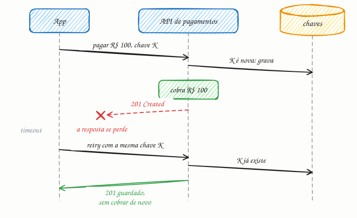

## O essencial

Uma operação é idempotente se executá-la várias vezes tem o mesmo efeito que executá-la uma vez. Por exemplo, "definir o status do usuário como ativo" é idempotente, enquanto "incrementar o saldo da conta em 10" não é. A idempotência é crítica quando os sistemas usam retries, porque a mesma requisição pode ser enviada mais de uma vez. APIs costumam exigir chaves de idempotência em operações como pagamentos, para evitar cobrar duas vezes. Em entrevistas, sempre mencione idempotência quando falar de entrega "pelo menos uma vez" (at-least-once) ou de retries.

## Aprofundando

### O cliente não sabe o que aconteceu

O app manda "pagar R$ 100" e a conexão cai antes da resposta. Há duas histórias possíveis: a requisição se perdeu no caminho, ou o pagamento foi feito e a *resposta* se perdeu. Do lado do cliente, as duas parecem iguais: um timeout. Se ele repete e a verdadeira era a segunda, cobra duas vezes. A idempotência faz a dúvida deixar de importar, porque repetir passa a ser sempre seguro.

### No HTTP

Pela especificação (RFC 9110), `GET`, `HEAD`, `PUT` e `DELETE` são idempotentes: "deixe o recurso 42 com este conteúdo" pode ser repetido à vontade. `POST` não é: cada chamada pode criar um recurso novo. É no `POST` que entram as chaves.

### Chave de idempotência

O cliente gera um identificador único, como um UUID, para a **operação lógica** e o reenvia em todos os retries dela:

```http
POST /v1/pagamentos
Idempotency-Key: 8f14e45f-ceea-4f6a-9a3b-2c1d5e7b9a10
Content-Type: application/json

{"pedido": "A-1027", "valor": 10000}
```

No servidor:

1. Tenta gravar a chave numa tabela com restrição de unicidade, com status "em processamento".
2. Se conseguiu, executa a cobrança e salva a resposta junto da chave, de preferência na mesma transação.
3. Se a chave já existia com resposta pronta, devolve a resposta guardada, sem cobrar de novo. Se o corpo veio diferente do original, recusa: é uso errado da chave.
4. Se a chave existe mas ainda está em processamento (duas requisições simultâneas), responde com erro de conflito (`409`), e o cliente tenta depois.
5. As chaves expiram depois de um prazo, de horas a dias, para a tabela não crescer para sempre.



### Outros caminhos

Nem sempre é preciso uma chave: dá para tornar a própria operação idempotente. "Some 10 ao saldo" vira "registre o crédito 7781, de R$ 10", e um índice único na coluna do identificador do crédito impede a duplicata. Em filas com entrega at-least-once (cap. 44), o consumidor guarda os IDs das mensagens já processadas e ignora as repetidas.

## Analogia

No bar, pedir "mais uma" ao garçom não é idempotente: se ele não ouviu direito e você repete, podem chegar duas cervejas. Já dizer "a comanda 27 fica com três cervejas no total" é idempotente: repetir a frase dez vezes não muda a conta. A chave de idempotência é o garçom anotar "pedido 3 da mesa 27": se você repete, ele vê que esse pedido já está na comanda e não anota de novo.

## No mundo real

- **Stripe:** todas as requisições `POST` aceitam o cabeçalho `Idempotency-Key`. A API guarda o código de status e o corpo da primeira resposta, devolve o mesmo resultado nos retries, recusa a mesma chave com parâmetros diferentes e pode descartar chaves com mais de 24 horas.
- **Kafka:** o produtor idempotente numera as mensagens por partição, e o broker descarta as duplicatas criadas por retries. Nas versões recentes, ele vem ligado por padrão.
- **Amazon SQS FIFO:** cada mensagem tem um ID de deduplicação; reenvios com o mesmo ID dentro de 5 minutos não entram duplicados na fila.

## Trade-offs

| Abordagem | Como funciona | Custo |
|---|---|---|
| Operação idempotente por natureza | `PUT` com o estado final, "definir status = ativo" | Nem toda regra de negócio cabe nesse formato |
| Chave de idempotência | O cliente manda um ID por operação; o servidor guarda ID e resposta | Tabela extra, consulta a cada requisição e expiração das chaves |
| Restrição de unicidade | Índice único num ID natural (pedido, crédito) | Precisa de um identificador estável vindo de fora |
| Deduplicação no consumidor | Guarda os IDs das mensagens já processadas | Estado extra e janela de deduplicação limitada |

## Na entrevista

- Sempre que disser "retry" ou "pelo menos uma vez", complete: "...e por isso o consumidor é idempotente". O entrevistador costuma cobrar isso.
- Em pagamentos, descreva a chave: quem gera (o cliente), por quanto tempo vale e onde fica (numa tabela com unicidade, na mesma transação do efeito).
- Frase pronta: *"O cliente gera um UUID por compra e o reenvia em todos os retries. O servidor grava a chave com restrição de unicidade na mesma transação da cobrança; uma repetição recebe a resposta guardada."*

## Cuidado com

- **Idempotente não quer dizer mesma resposta.** O primeiro `DELETE /pedidos/42` devolve `204`; o segundo pode devolver `404`. O que se repete é o efeito no servidor: o pedido não existe mais.
- **Efeitos colaterais quebram a idempotência.** "Definir status = ativo" é idempotente no banco, mas não se cada chamada dispara um e-mail de boas-vindas.
- **"Consultar e depois inserir" tem corrida.** Duas requisições simultâneas consultam, não acham a chave e inserem as duas. Quem garante é a restrição de unicidade do banco.
- **"Exatamente uma vez" tem asterisco.** Sistemas que prometem entrega exactly-once, como o Kafka, combinam entrega pelo menos uma vez com idempotência e deduplicação. Na rede, exatamente uma vez não existe de graça.

## Teste-se

**P:** Por que "incrementar o saldo em 10" não é idempotente e "definir o status como ativo" é?

**R:** Cada repetição do incremento soma mais 10, enquanto repetir a definição deixa o status no mesmo valor. O efeito de várias execuções é diferente do de uma no primeiro caso e igual no segundo.

**P:** O app envia um pagamento, a conexão cai e ele não sabe se a cobrança aconteceu. Como repetir sem risco de cobrar em dobro?

**R:** Reenviando a mesma chave de idempotência gerada para esse pagamento. O servidor reconhece a chave e devolve o resultado da primeira execução, em vez de cobrar de novo.

**P:** O cliente gera uma chave de idempotência nova a cada retry. Está protegido?

**R:** Não. Para o servidor, cada chave nova é uma operação nova, e a cobrança pode acontecer duas vezes. A chave identifica a operação lógica e precisa ser a mesma em todas as tentativas.
