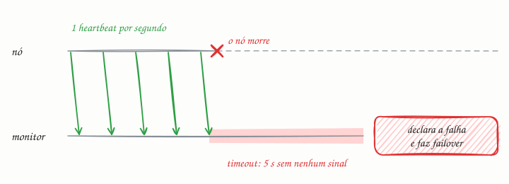

## O essencial

Um heartbeat (batimento cardíaco) é um sinal periódico enviado por um serviço ou nó para indicar que está vivo e saudável. Sistemas de monitoramento ou coordenadores ficam escutando esses heartbeats. Se param de recebê-los, marcam o nó como fora do ar e disparam ações de failover ou de escalonamento. Heartbeats são ferramentas simples, mas poderosas, para detectar se um nó está vivo (liveness). Pense neles como a "checagem de pulso" do sistema.

## Aprofundando

### Dois números: intervalo e timeout

Um heartbeat é definido por **com que frequência** o sinal sai e **quanto silêncio** o monitor tolera. Com intervalo de 1 s e timeout de 5 s, um nó que morre é declarado fora do ar cerca de 5 segundos depois. Timeout curto detecta rápido, mas confunde lentidão com morte; timeout longo evita alarme falso, mas deixa um nó morto recebendo tráfego por mais tempo. Por isso é comum exigir vários intervalos perdidos seguidos antes de agir.

### Empurrar ou perguntar

No heartbeat clássico, o nó **empurra** o sinal ("estou vivo") para o monitor. No health check, o monitor **pergunta** ("você está bem?"), como fazem os load balancers (cap. 11). O Kubernetes usa os dois: o kubelet de cada nó renova periodicamente um objeto Lease no control plane, e o próprio kubelet consulta cada contêiner, pelas probes, para saber se ele está vivo (liveness) e se está pronto para receber tráfego (readiness).

### Silêncio não é morte

O problema de fundo: o monitor não sabe *por que* o sinal parou. O nó pode ter morrido, mas pode estar numa pausa longa de garbage collection, ou a rede entre os dois pode ter caído enquanto ele continua atendendo clientes. Se o coordenador promove outro nó e o antigo "ressuscita" achando que ainda manda, o sistema fica com dois líderes (split brain). Sistemas sérios se defendem de três jeitos:

- **Confirmar com outros:** no Redis Sentinel, um sentinela que deixa de ouvir o master só registra uma suspeita (SDOWN); o master só é dado como fora do ar (ODOWN), e o failover pode começar, quando um quórum de sentinelas concorda.
- **Detectores adaptativos:** o Cassandra usa o phi accrual failure detector, que aprende o ritmo normal de chegada dos sinais e calcula um nível contínuo de suspeita, em vez de um prazo fixo.
- **Fencing:** cada novo líder recebe um número de época maior, e o armazenamento recusa ordens com número antigo. Um nó que ressuscita não consegue estragar nada.

Num cluster grande, heartbeat de todos para todos custa N² mensagens a cada rodada; protocolos gossip (cap. 22) espalham essa informação de forma muito mais barata.

## Analogia

Todo dia às 7h, a tia manda "bom dia" com figurinha no grupo da família. No dia em que o bom-dia não chega até as 10h, alguém liga para saber se está tudo bem. Mas ninguém chama a ambulância no primeiro atraso: pode ser só o celular sem bateria. Esse é o dilema do heartbeat: o silêncio é um sinal de alerta, não uma prova.

## No mundo real

- **etcd (Raft):** o líder manda heartbeats a cada 100 ms por padrão, e um seguidor que passa 1 s sem ouvi-lo, o election timeout padrão, inicia uma eleição (cap. 38).
- **Kubernetes:** se o Lease de um nó para de ser renovado, o control plane marca o nó como `Unknown` e, depois de um prazo (5 minutos, por padrão), começa a despejar os pods dele para que sejam recriados em outros nós.
- **HAProxy:** por padrão, verifica cada servidor a cada 2 s, tira de rotação o que falhar 3 verificações seguidas e só o devolve depois de 2 verificações bem-sucedidas.

## Trade-offs

| | Timeout curto (ex.: 2 s) | Timeout longo (ex.: 30 s) |
|---|---|---|
| Detecção de nó morto | Rápida: failover em segundos | Lenta: o nó morto segue recebendo tráfego |
| Alarme falso | Frequente: uma pausa de GC ou um soluço de rede derruba o nó | Raro |
| Efeito colateral | Failovers à toa e risco de dois líderes | Indisponibilidade mais longa |
| Tráfego de heartbeats | Maior, se o intervalo também for curto | Menor |

## Na entrevista

- Sempre que houver líder, réplica, pool de workers ou service discovery, diga como uma falha é detectada: "heartbeat a cada X, falha declarada depois de Y sem sinal".
- Mostre o trade-off do timeout e a defesa contra o falso positivo: confirmação por quórum e fencing.
- Separe vivo de pronto: a liveness reinicia o contêiner; a readiness só o tira do balanceamento.
- Frase pronta: *"Os workers mandam heartbeat a cada 2 s; com 10 s de silêncio, o coordenador redistribui as tarefas deles. Como um worker 'morto' pode estar só lento, cada tarefa carrega um token de fencing, e o resultado atrasado é descartado."*

## Cuidado com

- **Atualização:** o artigo diz que, sem heartbeats, o nó é marcado como fora do ar. Mas silêncio não prova morte: o nó pode estar lento ou isolado e voltar. Sistemas atuais tratam a falta de sinal como suspeita (detectores adaptativos, quórum) e se protegem do nó que volta (fencing).
- **Vivo não é saudável.** Um processo pode responder ao heartbeat com o disco cheio ou sem conexão com o banco.
- **Não ponha o banco na liveness probe.** Se o banco cai, todas as réplicas falham a checagem e o Kubernetes reinicia todas em loop, o que piora o problema. Dependências externas vão, quando vão, na readiness.
- **Thread de heartbeat isolada pode mentir:** ela continua batendo enquanto o trabalho principal está travado.

## Teste-se

**P:** Qual a diferença entre heartbeat e health check?

**R:** No heartbeat, o nó envia sinais periódicos por conta própria; no health check, o monitor pergunta ativamente e o nó responde. Nos dois casos, a falta de resposta dentro de um prazo é tratada como falha.

**P:** Um coordenador declara workers mortos depois de 1 s sem heartbeat, e tarefas estão sendo executadas em dobro. O que está acontecendo e o que você muda?

**R:** O timeout curto gera falsos positivos (pausas de GC, picos de rede): o worker "morto" continua trabalhando enquanto outro recebe a mesma tarefa. Aumente o timeout para vários intervalos e torne as tarefas idempotentes ou protegidas por fencing.

**P:** Se um nó parou de mandar heartbeats, ele morreu?

**R:** Não necessariamente. O monitor só sabe que não ouviu nada: o nó pode estar lento, pausado ou isolado por uma partição. Por isso o sistema trata isso como suspeita e se protege para o caso de ele voltar.
