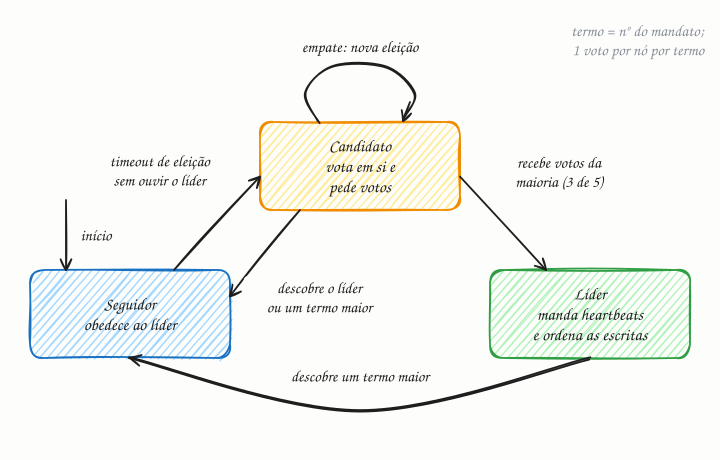

## O essencial

A eleição de líder é o processo de escolher um único nó, entre muitos, para atuar como coordenador. Algoritmos como Paxos e Raft garantem que só um líder seja escolhido e que todos os nós acabem concordando sobre quem é ele. O líder cuida de tarefas como distribuir trabalho, gerenciar metadados ou ordenar as escritas. Se o líder falha, um novo é eleito automaticamente. Você não precisa decorar a matemática para as entrevistas, mas deve saber que algoritmos de consenso sustentam muitos sistemas críticos, como repositórios de metadados e logs distribuídos.

## Aprofundando

### Por que maioria

Ter um líder simplifica tudo: um só nó decide a ordem das escritas, e os outros copiam. O perigo é haver **dois** líderes ao mesmo tempo (split brain), cada um aceitando escritas diferentes. A defesa é exigir maioria: num cluster de 5 nós, um líder precisa de 3 votos. Como duas maiorias de 5 sempre têm pelo menos um nó em comum, e cada nó vota uma vez só por mandato, dois candidatos não conseguem vencer a mesma eleição. A conta geral: **2f + 1 nós toleram f falhas**. Três nós aguentam 1 falha; cinco aguentam 2.

### Raft, passo a passo

O Raft (Diego Ongaro e John Ousterhout, Stanford, 2014) foi criado para ser mais fácil de entender que o Paxos. O tempo é dividido em **termos** (mandatos) numerados, e cada nó está sempre em um de três estados:

1. Todos começam como **seguidores**. O líder manda heartbeats periódicos (cap. 37).
2. Se um seguidor passa o seu election timeout (tempo de eleição) sem ouvir o líder, vira **candidato**: incrementa o termo, vota em si e pede votos aos demais.
3. Cada nó vota em no máximo um candidato por termo, no primeiro que pedir, e só se o log do candidato estiver pelo menos tão atualizado quanto o seu.
4. Com a maioria dos votos, o candidato vira **líder** e começa a mandar heartbeats.
5. Se os votos se dividem e ninguém chega à maioria, os candidatos esperam um novo timeout e tentam de novo. Os timeouts são sorteados (150 a 300 ms, no artigo original) justamente para que, quase sempre, um só nó acorde primeiro.
6. Quem descobre um termo maior que o seu volta a ser seguidor, inclusive um líder antigo que estava isolado.

Exemplo: o líder A, do termo 7, cai. O seguidor C é o primeiro a estourar o timeout, abre o termo 8 e recebe os votos de B e D. São 3 de 5, contando o dele, e C vira líder. Quando A volta, vê o termo 8 e vira seguidor.

### E o Paxos?

O Paxos, de Leslie Lamport, oferece a mesma garantia de segurança, com papéis de proponente, aceitador e aprendiz e duas fases de mensagens. Na forma básica, ele decide um único valor; o Multi-Paxos, usado na prática, elege um líder estável para não repetir a primeira fase a cada decisão.

## Analogia

Pense na eleição de síndico. O síndico tem mandato, que é o termo, e precisa da maioria na assembleia. Se ele some e para de responder, qualquer morador pode convocar uma assembleia e se candidatar; se os votos empatam, marca-se outra. E se o síndico antigo volta de viagem e tenta dar ordens, ninguém obedece: há um mandato novo, e o dele acabou.

## No mundo real

- **Raft:** o etcd (o banco de configuração do Kubernetes), o Consul, o CockroachDB e o TiKV. O Kafka também: o modo KRaft, baseado em Raft, gerencia os metadados do cluster e, desde a versão 4.0 (2025), é o único modo.
- **Paxos:** o Chubby, serviço de locks do Google, e o Spanner, que replica cada fatia dos dados com Paxos.
- **ZAB:** o ZooKeeper usa um protocolo próprio, parecido com o Paxos, o ZooKeeper Atomic Broadcast.

## Trade-offs

| | Com líder (Raft, Multi-Paxos) | Sem líder (quóruns no estilo Dynamo) |
|---|---|---|
| Ordem das escritas | Uma só, decidida pelo líder | Não há ordem global; conflitos se resolvem depois |
| Consistência | Forte: todos aplicam as mesmas escritas na mesma ordem | Eventual ou ajustável por quórum |
| Quando um nó cai | Se for o líder, as escritas param até a nova eleição | Sem pausa: as outras réplicas aceitam |
| Gargalo | Todas as escritas passam pelo líder | Escritas espalhadas entre as réplicas |

## Na entrevista

- Traga a eleição de líder quando o design precisa de um coordenador único: scheduler, dono de uma partição, lock distribuído, metadados.
- Não implemente consenso no quadro. Diga: *"Uso um serviço de coordenação pronto, como etcd ou ZooKeeper. O líder é quem segura um lease, um lock com prazo; se ele morrer, o lease expira e outro assume."*
- Mostre que sabe as contas: maioria, número ímpar de nós (3 ou 5) e tempo de failover, que é o timeout de eleição mais a própria eleição.
- O entrevistador quer ouvir como você evita dois líderes: maioria, termos e fencing.

## Cuidado com

- **Atualização:** muito material ainda descreve o Kafka elegendo o controller pelo ZooKeeper. O Kafka 4.0, de 2025, removeu o suporte ao ZooKeeper; o KRaft, baseado em Raft, virou o único modo.
- **"Um líder só" vale por termo.** Um líder antigo, isolado por uma partição, pode continuar achando que manda; ele só não consegue confirmar escritas sem maioria. Por isso clientes e armazenamento precisam checar o termo.
- **Consenso cobra em disponibilidade.** O Raft é CP (cap. 2): durante a eleição, e do lado minoritário de uma partição, ninguém confirma escritas. E mais nós deixam cada escrita mais lenta: com 7, ela só é confirmada quando 4 nós a gravam.
- **O ZooKeeper não usa Paxos**, e sim o ZAB, um protocolo parecido.

## Teste-se

**P:** Por que um cluster Raft de 5 nós tolera 2 falhas, e não 3?

**R:** Porque o líder precisa da maioria, 3 de 5, para ser eleito e para confirmar escritas. Com 3 nós fora, sobram 2, que não formam maioria, e o cluster para de aceitar escritas.

**P:** Um job agendado precisa rodar em só uma de 10 instâncias por vez. Como você garante isso?

**R:** Com eleição de líder sobre um serviço de coordenação (etcd, ZooKeeper, Consul): a instância que obtém o lease roda o job; se ela cair, o lease expira e outra assume. Para o caso de o líder antigo voltar no meio, proteja o efeito do job com um token de fencing.

**P:** Um cluster de 4 nós é mais tolerante a falhas que um de 3?

**R:** Não. Com 4 nós, a maioria é 3, então ele tolera só 1 falha, igual ao de 3, e ainda exige mais votos e mensagens por escrita.
