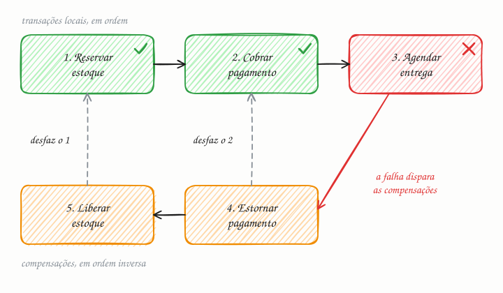

## O essencial

Uma transação distribuída abrange vários serviços ou bancos de dados. O padrão SAGA modela essa transação como uma sequência de passos locais, com ações de compensação para os rollbacks. Em vez de travar tudo, como numa única transação ACID, cada serviço executa a sua parte e publica um evento. Se algo falha, passos de compensação tentam desfazer as mudanças anteriores. Isso combina naturalmente com microsserviços e consistência eventual. A contrapartida é uma lógica mais complexa e a possibilidade de falhas parciais, que precisam ser tratadas de forma controlada.

## Aprofundando

### De onde vem

O termo vem de um artigo de 1987 de Hector Garcia-Molina e Kenneth Salem sobre transações longas dentro de um único banco. Voltou com força nos microsserviços, em que cada serviço tem o seu banco (cap. 9) e não existe uma transação ACID (cap. 4) que abranja todos.

### Um pedido em três passos

Cada passo é uma transação local, com commit no banco do seu serviço, e tem uma **compensação** correspondente:

| Passo | Serviço | Compensação |
|---|---|---|
| 1. Reservar o estoque | Estoque | Liberar o estoque |
| 2. Cobrar o pagamento | Pagamentos | Estornar o pagamento |
| 3. Agendar a entrega | Logística | Nenhuma: é o último passo |

Se a logística não consegue agendar a entrega, as compensações rodam de trás para a frente: estornar, depois liberar o estoque. Se a falha fosse na cobrança, só o estoque seria liberado, porque um passo que não chegou a fazer commit não tem o que desfazer.

### Coreografia ou orquestração

- **Coreografia:** cada serviço reage aos eventos dos outros. O estoque publica `EstoqueReservado`, pagamentos escuta, cobra e publica `PagamentoAprovado`, e assim por diante. Não há ponto central, mas o fluxo fica espalhado e difícil de enxergar.
- **Orquestração:** um orquestrador, uma máquina de estados com o progresso salvo, chama cada passo e decide as compensações. O fluxo fica num lugar só, mais fácil de testar e monitorar.

### Regras para não se machucar

- Compensações precisam ser **idempotentes** (cap. 36) e repetidas até dar certo: uma compensação não pode "falhar de vez".
- Ponha por último os passos difíceis de desfazer. Despachar o pacote vem depois da cobrança, nunca antes.
- Grave no banco e publique o evento de forma atômica, com o padrão **outbox**: o evento entra numa tabela na mesma transação local, e um processo separado o publica.

## Analogia

Você monta as férias em três compras separadas: passagem aérea, hotel e aluguel de carro. Não existe um botão que desfaça as três de uma vez. Se a locadora fica sem carro, você cancela o hotel e pede o reembolso da passagem, na ordem inversa, talvez pagando multa. Compensar não é voltar no tempo: é fazer uma nova operação que anula o efeito da anterior.

## No mundo real

- **AWS Step Functions:** o guia de padrões de nuvem da AWS mostra uma saga orquestrada por uma máquina de estados, com passos de pedido, estoque e pagamento e as compensações correspondentes, como reverter o pagamento e o estoque.
- **Temporal:** plataforma de workflows, criada pelos autores do Cadence, da Uber, em que a saga vira código comum, com o estado de cada passo persistido e retomado depois de falhas.
- **microservices.io:** o catálogo de padrões de Chris Richardson, a referência mais citada sobre o tema, descreve as duas formas de coordenar uma saga, coreografia e orquestração.

## Trade-offs

| | Coreografia (eventos) | Orquestração (orquestrador) |
|---|---|---|
| Quem decide o próximo passo | Cada serviço, reagindo a eventos | Um orquestrador central |
| Visão do fluxo | Espalhada pelos serviços | Num lugar só, fácil de monitorar |
| Acoplamento | Baixo, mas com risco de dependências cíclicas | Os serviços dependem do orquestrador |
| Bom para | Sagas curtas, de 2 a 4 passos | Fluxos longos, com muitas regras e compensações |

## Na entrevista

- Traga a saga sempre que uma operação de negócio atravessa serviços com bancos próprios: checkout, reserva de viagem, transferência entre carteiras.
- Liste os passos e as compensações em voz alta e justifique a ordem: o que é difícil de desfazer vai por último.
- Mostre que sabe o preço: não há isolamento, o usuário pode ver um pedido "pendente" e cada passo precisa ser idempotente.
- Frase pronta: *"Cada serviço tem o seu banco, então não existe transação ACID única. Uso uma saga orquestrada: reservar estoque, cobrar, agendar entrega; se a entrega falhar, estorno e libero o estoque. Os passos são idempotentes, e os eventos saem por um outbox."*

## Cuidado com

- **Compensação não é rollback.** O estado intermediário existiu e foi visto, e efeitos externos não voltam: não dá para "desenviar" um e-mail, só mandar outro corrigindo.
- **Falta o I do ACID.** Enquanto a saga roda, outra requisição pode ver o estoque reservado de um pedido que vai ser cancelado. Estados explícitos, como `PENDENTE` e `CONFIRMADO`, avisam aos outros o que ainda está em andamento.
- **Atualização:** o artigo descreve só a coreografia ("cada serviço publica um evento"). Na prática, a orquestração com motores de workflow, como Step Functions e Temporal, é igualmente comum, principalmente em fluxos longos.

## Teste-se

**P:** O que é uma ação de compensação?

**R:** Uma nova operação que anula, do ponto de vista do negócio, o efeito de um passo já confirmado, como estornar uma cobrança ou liberar uma reserva. Ela não apaga o passo original; registra outro por cima.

**P:** No checkout, a ordem é reservar o estoque, cobrar e agendar a entrega. A cobrança foi recusada. Quais compensações rodam?

**R:** Só a liberação do estoque. A cobrança não chegou a acontecer, então não há o que estornar, e a entrega nem começou.

**P:** Uma saga garante o mesmo isolamento de uma transação ACID?

**R:** Não. Cada passo faz commit sozinho, então outros processos veem os estados intermediários. O design precisa lidar com isso, por exemplo com estados como `PENDENTE`.
