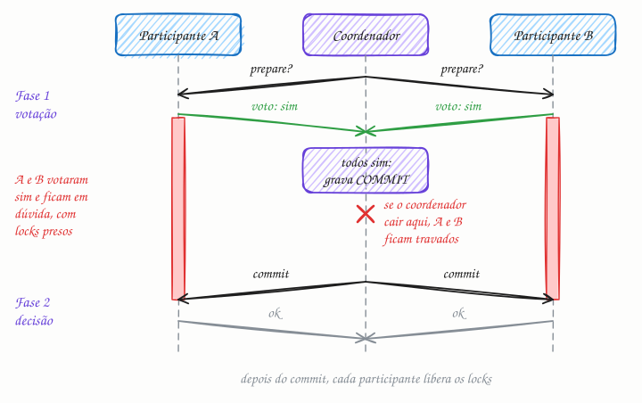

## O essencial

O Two-Phase Commit (confirmação em duas fases) é um protocolo que tenta oferecer transações atômicas em vários nós.

- Na primeira fase, o coordenador pergunta a todos os participantes se eles podem confirmar (commit).
- Na segunda fase, se todos concordarem, ele manda todos confirmarem; caso contrário, manda todos desfazerem (rollback).

O 2PC oferece garantias fortes, mas pode travar se o coordenador falhar, e é caro em escala por causa dos bloqueios (locks). Em sistemas modernos na nuvem, o 2PC costuma ser evitado nos caminhos de alto throughput e substituído por padrões como SAGA.

## Aprofundando

### As duas fases, numa transferência

Imagine uma transferência de R$ 100 da conta X, no banco A, para a conta Y, no banco B. Um coordenador conduz a transação.

**Fase 1, votação.** O coordenador manda `prepare` para A e B. Cada um executa a sua parte (A debita, B credita), grava tudo de forma durável no log em disco (cap. 27), mantém os locks das linhas e responde com o voto: **sim**, se pode confirmar, ou **não**, se algo impede, como saldo insuficiente.

**Fase 2, decisão.** Se todos votaram sim, o coordenador grava "commit" no próprio log. Esse é o ponto de commit: a partir dali, a transação está decidida. Então manda `commit` para todos. Se alguém votou não, ou não respondeu a tempo, manda `abort`. Os participantes aplicam a decisão, liberam os locks e confirmam o recebimento.

### O voto é uma promessa

Votar sim significa "eu confirmo, aconteça o que acontecer, mesmo se reiniciar". Por isso o participante grava tudo antes de votar, e por isso ele perde o direito de desistir sozinho. Suponha que o coordenador caia logo depois de receber os votos. O participante A fica **em dúvida**: não pode confirmar, porque talvez B tenha votado não, nem desfazer, porque talvez o coordenador tenha decidido commit e B já tenha aplicado. Ele espera, com as linhas da conta X travadas, até o coordenador voltar e ler a decisão no log. Qualquer outra transação que tocar a conta X espera junto.

### Por que é caro

São pelo menos duas idas e voltas de rede e gravações forçadas em disco em cada participante, com os locks presos durante tudo isso. O participante mais lento dita o ritmo de todos, e uma transação que envolve 5 nós depende de os 5 estarem saudáveis ao mesmo tempo.

### Quando o coordenador volta

Ele lê o próprio log. Se encontra "commit", reenvia `commit` a todos; se não encontra decisão nenhuma, aborta, porque nenhum participante pode ter confirmado sem ela. É por isso que o ponto de commit é a gravação no log, e não o envio das mensagens.

## Analogia

Você organiza um churrasco com quatro amigos e pergunta no grupo: "dá para sábado?". Essa é a fase 1. Quem responde "dá" guarda o sábado e recusa outros convites. Só quando todos dizem sim você confirma; se um diz não, cancela para todos. Essa é a fase 2. Agora imagine que você some depois de colher as respostas: os amigos ficam com o sábado travado, sem saber se vai ter churrasco.

## No mundo real

- **PostgreSQL:** suporta as duas fases com `PREPARE TRANSACTION` e `COMMIT PREPARED`, mas vem com o recurso desligado (`max_prepared_transactions = 0`). A documentação avisa que uma transação preparada e esquecida continua segurando locks e atrapalha o `VACUUM`.
- **XA e JTA:** gerenciadores de transação no Java usam 2PC para gravar num banco e numa fila de mensagens de forma atômica.
- **Google Spanner:** transações que tocam vários grupos de réplicas usam 2PC, mas o coordenador e os participantes são grupos replicados por Paxos. Se uma máquina cai, outra réplica do grupo assume, e o protocolo não trava.

## Trade-offs

| | 2PC | SAGA (cap. 39) |
|---|---|---|
| Atomicidade | Tudo ou nada, de verdade | Eventual, via compensações |
| Isolamento | Locks seguram os dados até o fim | Nenhum: estados intermediários ficam visíveis |
| Se o coordenador cai | Os participantes ficam travados, em dúvida | Sem bloqueio: o fluxo é retomado do estado salvo |
| Latência e escala | Duas idas e voltas com locks; o mais lento dita o ritmo | Passos locais e rápidos; serviços independentes |
| Exige | Que todos os participantes falem o protocolo (XA, por exemplo) | Uma compensação para cada passo |

## Na entrevista

- Quando a pergunta for "como garantir atomicidade entre dois bancos?", cite o 2PC, explique as fases e logo depois o problema: bloqueio se o coordenador cair e locks presos durante duas idas e voltas.
- Entre microsserviços, proponha saga (cap. 39) com outbox. Dentro de um banco distribuído que já faz 2PC por baixo, como Spanner ou CockroachDB, deixe o banco cuidar disso.
- Frase pronta: *"2PC dá atomicidade de verdade, mas segura locks durante duas idas e voltas e trava se o coordenador cair depois dos votos. No caminho de alto volume, prefiro saga; onde preciso de atomicidade forte entre shards, uso um banco que faz 2PC sobre réplicas com consenso."*

## Cuidado com

- **2PC não é consenso.** O 2PC exige que *todos* votem sim e trava se o coordenador sumir; Paxos e Raft (cap. 38) precisam só da maioria e seguem funcionando com nós fora. Um confirma uma transação em todos; os outros fazem um grupo concordar sobre um valor.
- **O three-phase commit (3PC) não resolve.** Ele reduz o bloqueio, mas supõe atrasos de rede limitados; com partições, pode levar a decisões inconsistentes, e quase ninguém o usa.
- **Atualização:** "evitar 2PC" vale entre microsserviços. Bancos distribuídos como Spanner e CockroachDB usam 2PC ou variantes por dentro, com o estado da transação replicado por Paxos ou Raft, o que elimina o bloqueio pela queda de uma única máquina.

## Teste-se

**P:** O que acontece em cada fase do 2PC?

**R:** Na fase 1, o coordenador manda `prepare`, e cada participante grava tudo de forma durável e vota sim ou não. Na fase 2, se todos votaram sim, o coordenador grava a decisão e manda `commit`; se alguém votou não ou não respondeu, manda `abort`.

**P:** Um sistema interno, de baixo volume, precisa debitar num PostgreSQL e creditar em outro, de forma atômica. 2PC é uma opção razoável?

**R:** Sim. Com poucos participantes e pouco volume, `PREPARE TRANSACTION` e `COMMIT PREPARED`, ou um gerenciador XA, dão atomicidade real. Só é preciso monitorar transações preparadas órfãs, que seguram locks.

**P:** Depois de votar sim, o participante pode desistir sozinho se o coordenador demorar?

**R:** Não. O voto sim é uma promessa de confirmar; ele precisa esperar a decisão do coordenador, ou de outro participante que a conheça, mesmo segurando locks. É exatamente aí que o 2PC trava.
