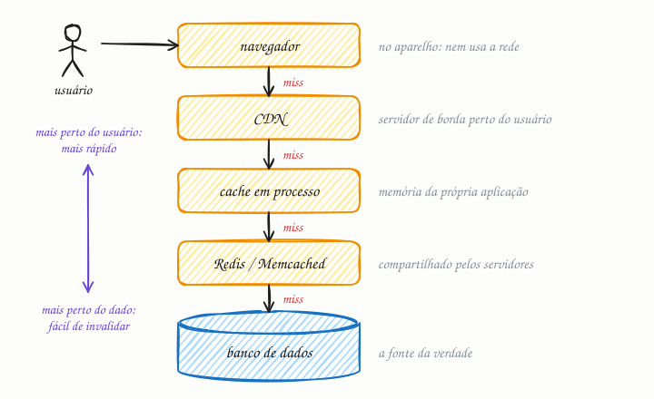

## O essencial

Cache é guardar os dados acessados com frequência numa camada de armazenamento rápida, geralmente a memória, para reduzir a latência e a carga sobre o backend. Camadas de cache comuns incluem caches dentro do próprio processo, armazenamentos chave-valor externos e CDNs. O cache é especialmente eficaz em cargas com muita leitura e em computações caras. Agora vem a parte complicada: dados desatualizados e a invalidação tornam o cache mais difícil do que parece à primeira vista. Como diz o ditado, invalidar cache é um dos problemas difíceis da ciência da computação.

## Aprofundando

O cache funciona porque o acesso aos dados quase nunca é uniforme. Numa loja online, algumas centenas de produtos em destaque recebem a maior parte das visitas; numa rede social, o post do momento é lido milhões de vezes. Guardar essa fatia quente em memória resolve a maioria das leituras.

### Taxa de acerto

A métrica central é a **taxa de acerto** (hit ratio): a fração das leituras que o cache responde. Quando o dado está lá, é um **hit**; quando não está, um **miss**, e a leitura segue para a origem. Faça a conta com um Redis que responde em 1 ms e um banco que leva 20 ms. Toda leitura paga o cache; só os misses pagam também o banco:

| Taxa de acerto | Latência média | Leituras que chegam ao banco |
|---|---|---|
| 90% | 1 + 0,10 × 20 = 3 ms | 10% |
| 99% | 1 + 0,01 × 20 = 1,2 ms | 1% |

Subir de 90% para 99% parece pouco, mas divide por dez a carga do banco. O banco só enxerga os misses.

### Camadas

Entre o usuário e o banco pode haver várias camadas, e a leitura só desce para a seguinte num miss:

- **Navegador:** com `Cache-Control: max-age=3600`, o aparelho reaproveita a resposta por uma hora sem tocar a rede.
- **CDN** (cap. 15): servidores de borda guardam imagens, scripts e até páginas inteiras perto do usuário.
- **Cache em processo:** um mapa na memória da própria aplicação. Responde em menos de um microssegundo, mas cada instância tem a sua cópia.
- **Cache distribuído:** Redis ou Memcached, compartilhado por todas as instâncias. Custa uma ida pela rede: cerca de meio milissegundo no mesmo datacenter.
- **Banco:** a fonte da verdade, que também mantém em memória as páginas mais lidas.

Quanto mais perto do usuário, mais difícil invalidar: você apaga uma chave no Redis com um comando, mas não alcança o navegador de quem já baixou a resposta.

### Validade

Toda entrada precisa de uma regra para sair. O **TTL** (time to live, tempo de vida) limita a idade do dado: com TTL de 60 s, ninguém vê um preço com mais de um minuto de atraso. A **invalidação explícita** apaga a chave quando o dado muda na origem. Use as duas juntas: a invalidação mantém o dado fresco no caso comum, e o TTL corrige o que ela deixar escapar. Não por acaso, a frase citada pelo autor, atribuída a Phil Karlton, diz que só há duas coisas difíceis em computação: invalidar cache e dar nome às coisas.

## Analogia

O caixa da padaria tem um papel colado no balcão com o preço dos vinte itens que mais saem. Pão francês, café, pão de queijo: ele olha o papel e cobra na hora. Para um item raro, vai até o escritório consultar a tabela completa. O problema aparece quando o dono reajusta o pão e ninguém troca o papel: o caixa continua cobrando o preço antigo, rápido e errado. Decidir quando trocar o papel é a invalidação.

## No mundo real

- **Facebook:** o artigo *Scaling Memcache at Facebook* (NSDI 2013) descreve a frota de Memcached que fica na frente do MySQL e já atendia bilhões de requisições por segundo.
- **Redis e Memcached** são os caches distribuídos mais comuns, inclusive como serviço gerenciado (o Amazon ElastiCache, por exemplo). Depois que o Redis mudou de licença, em 2024, a Linux Foundation lançou o **Valkey**, um fork aberto e compatível.
- **HTTP:** navegadores e CDNs seguem as regras de cache da RFC 9111, com cabeçalhos como `Cache-Control` e `ETag`. É o cache mais barato que existe, porque a requisição nem chega ao seu servidor.
- **Bancos:** o PostgreSQL (`shared_buffers`) e o InnoDB do MySQL (buffer pool) guardam em memória as páginas mais lidas.

## Trade-offs

**Você ganha**

- Latência menor: um dado em memória volta em micro ou nanossegundos; uma consulta ao banco custa milissegundos.
- Menos carga na origem, o que adia a hora de escalar o banco.
- Fôlego em picos de leitura concentrados em poucos itens.

**Você paga**

- Dados que podem estar velhos por até um TTL.
- Mais uma peça para operar, monitorar e dimensionar.
- Risco de enxurrada no banco quando o cache esvazia ou uma chave quente expira.

## Na entrevista

- Traga o cache assim que o requisito disser "muita leitura" ou "latência baixa", e diga **o que** vai no cache, **com qual chave** e **com qual TTL**: "Cacheio o perfil em `user:{id}` no Redis, com TTL de 5 minutos e invalidação quando o perfil muda."
- Estime o efeito no banco: com 95% de acerto, 20 mil leituras por segundo viram mil no banco.
- Diga quanto atraso cada dado tolera: "Na vitrine, um preço com até um minuto de atraso é aceitável; no checkout, leio direto do banco." É a consistência eventual (cap. 7) aplicada.

## Cuidado com

- **Avalanche de misses (cache stampede):** quando uma chave muito acessada expira, centenas de requisições dão miss juntas e vão todas ao banco. Defesas: deixar só uma recarregar a chave enquanto as outras esperam, renovar antes de expirar e espalhar os TTLs com um pouco de aleatoriedade.
- **Chave incompleta vaza dados:** se a resposta depende do usuário, do idioma ou da permissão, isso precisa estar na chave. No Natal de 2015, um erro de configuração de cache na Steam mostrou páginas de conta de cerca de 34 mil usuários a outras pessoas.
- **Cache frio:** depois de um reinício, o cache começa vazio e o banco leva a carga inteira.
- **Cache não conserta consulta lenta:** só a esconde enquanto a taxa de acerto é alta.

## Teste-se

**P:** O que é a taxa de acerto (hit ratio) de um cache e por que ela importa tanto?

**R:** É a fração das leituras que o cache responde. Ela decide quanto da carga chega ao banco: com 99% de acerto, o banco recebe 1% das leituras; com 90%, recebe dez vezes mais.

**P:** Num e-commerce, você trataria do mesmo jeito o estoque exibido na página do produto e o estoque conferido ao fechar o pedido?

**R:** Não. Na vitrine, um número com alguns segundos de atraso é aceitável, e um cache com TTL curto resolve. No fechamento, a conferência vai à fonte da verdade, com transação ou reserva; senão você vende o que não tem.

**P:** Colocar um cache na frente do banco sempre reduz a latência?

**R:** Não. Num miss você paga o cache e o banco, então, com taxa de acerto baixa (chaves muito variadas, dados lidos uma vez só), o cache só acrescenta latência e custo.
