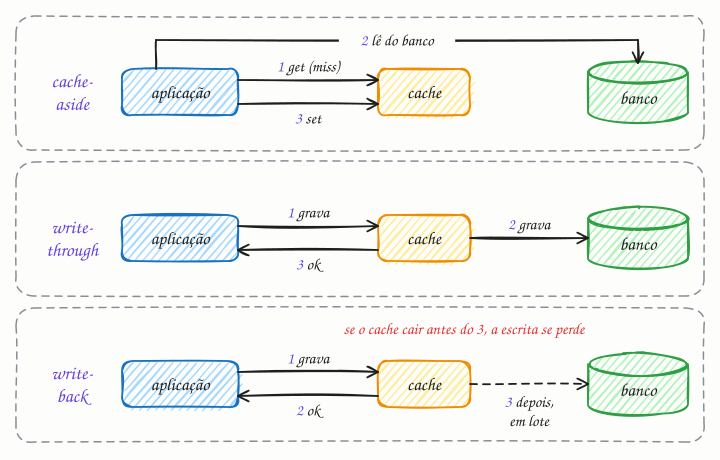

## O essencial

- **Cache-aside** significa que a aplicação lê do cache e, quando não encontra o dado (um miss), carrega do banco de dados e grava no cache.
- **Write-through** grava no cache e no banco ao mesmo tempo, garantindo que o cache e a fonte fiquem sempre sincronizados.
- **Write-back** grava primeiro no cache e só depois descarrega no banco, o que é rápido, mas arriscado se o cache falhar.

Cada estratégia equilibra de um jeito diferente o frescor dos dados, a complexidade e o desempenho. Os entrevistadores adoram quando você diz qual estratégia escolheria para um determinado cenário.

## Aprofundando

Toda estratégia responde a duas perguntas: **quem preenche o cache nas leituras** e **o que acontece com ele nas escritas**. O diagrama mostra as três do artigo, passo a passo.



### Cache-aside (lazy loading)

A aplicação conversa com os dois, e só entra no cache o que alguém leu:

```python
def buscar_produto(id):
    produto = cache.get(f"produto:{id}")
    if produto is None:                      # miss
        produto = banco.buscar_produto(id)
        cache.set(f"produto:{id}", produto, ttl=300)
    return produto

def mudar_preco(id, preco):
    banco.atualizar_preco(id, preco)
    cache.delete(f"produto:{id}")            # apaga em vez de atualizar
```

A escrita **apaga** a chave em vez de gravar o valor novo. Se gravasse, duas atualizações concorrentes poderiam chegar ao cache na ordem inversa da que chegaram ao banco, e o preço antigo ficaria no cache até o TTL vencer. Apagando, a próxima leitura busca o valor atual. Ainda sobra uma corrida rara (uma leitura lenta que repõe o valor velho logo depois do delete), e por isso o TTL continua lá como rede de segurança.

### Read-through

Igual ao cache-aside, mas quem vai ao banco no miss é o próprio cache; a aplicação só fala com ele. A lógica de carga sai do código e vira configuração da biblioteca ou do serviço.

### Write-through

A escrita passa pelo cache, que grava no banco e só então confirma. Uma leitura logo depois da escrita já encontra o dado no cache, mas cada escrita paga as duas gravações, e o cache se enche de dados que talvez ninguém leia.

### Write-back (write-behind)

A escrita é confirmada assim que chega ao cache, e o banco é atualizado depois, em lote. Um contador que recebe mil incrementos por segundo pode virar uma única gravação por segundo no banco. O preço: se o nó de cache cair antes de descarregar, essas escritas somem. Por isso o write-back aparece onde há proteção contra a perda, como a bateria das controladoras de disco, ou onde perder alguns segundos é tolerável.

### Write-around

A escrita vai só para o banco, apagando a chave se ela existir, e o cache se enche apenas nas leituras. É o que o próprio cache-aside faz nas escritas, e serve bem para dados muito escritos e pouco lidos, como logs de auditoria.

## Analogia

Na recepção de um consultório, a secretária tem a agenda do dia impressa na mesa (o cache) e o sistema oficial no computador (o banco). **Cache-aside:** o paciente pergunta o horário; se não estiver na folha, ela consulta o sistema e anota. **Write-through:** ao marcar consulta, lança no sistema e na folha antes de liberar o paciente. **Write-back:** na correria, anota só na folha e passa tudo para o sistema no fim do dia. Se o café cair na folha antes disso, as marcações somem.

## No mundo real

- **Amazon ElastiCache:** a documentação da AWS apresenta o lazy loading (o cache-aside) e o write-through como as estratégias básicas e recomenda somar um TTL às duas.
- **DynamoDB Accelerator (DAX):** fica no caminho das requisições e faz read-through e write-through: grava primeiro no DynamoDB e depois atualiza o próprio cache.
- **Hazelcast:** o `MapStore` faz write-through quando o atraso de escrita é zero e write-behind quando você configura alguns segundos de atraso.
- **Linux:** o page cache é write-back. Um `write()` volta antes de o dado chegar ao disco; quem precisa de durabilidade chama `fsync`, como os bancos fazem com o WAL (cap. 27).

## Trade-offs

| | Cache-aside | Write-through | Write-back |
|---|---|---|---|
| Quem grava no banco | A aplicação | O cache, antes de confirmar | O cache, depois, em lote |
| Latência da escrita | A do banco | Cache + banco | Só a do cache |
| Cache após a escrita | Vazio até a próxima leitura | Atualizado | Atualizado; o banco fica para trás |
| Principal risco | Corridas e misses em massa | Escritas mais lentas | Perder escritas se o cache cair |
| Bom para | Leitura pesada em geral | Ler logo depois de escrever | Contadores e escrita intensa |

## Na entrevista

- Escolha por cenário e justifique em uma frase: "Para o catálogo, cache-aside com TTL de 10 minutos e delete na atualização. Para o contador de visualizações, write-back: perder alguns segundos de contagem num crash é aceitável, e o banco deixa de receber milhares de escritas por segundo."
- Mencione a corrida do cache-aside e explique por que apaga em vez de atualizar; isso mostra que você já pensou em concorrência.
- Se escolher write-back, diga como protege o dado: réplica do cache, persistência em disco (o AOF do Redis) ou perda tolerada por contrato.

## Cuidado com

- **Atualização:** o "ao mesmo tempo" do write-through é uma simplificação. Cache e banco são dois sistemas, sem transação entre eles: se a segunda gravação falhar, os dois divergem, e escritas concorrentes podem chegar em ordens diferentes a cada um. "Sempre sincronizados" é o objetivo, não uma garantia; mantenha um TTL mesmo com write-through.
- **Ordem no cache-aside:** grave no banco e só depois apague a chave. Apagar antes abre uma janela em que uma leitura recarrega o valor antigo.
- **Write-back e quem lê o banco direto:** relatórios e integrações que consultam o banco veem dados atrasados.

## Teste-se

**P:** Qual a diferença entre cache-aside e read-through?

**R:** No cache-aside, a aplicação trata o miss: vai ao banco e grava no cache. No read-through, o próprio cache busca no banco, e a aplicação só conversa com ele.

**P:** Um contador de visualizações de vídeo recebe milhares de incrementos por segundo, e perder alguns segundos de contagem num crash é aceitável. Qual estratégia de escrita você usa?

**R:** Write-back. O cache acumula os incrementos e grava o total no banco em lote, poupando milhares de escritas por segundo; a perda possível está dentro do tolerado.

**P:** Com write-through, cache e banco nunca divergem?

**R:** Podem divergir. Sem uma transação entre os dois, uma falha entre as gravações ou escritas concorrentes podem deixar valores diferentes; por isso o TTL continua útil.
