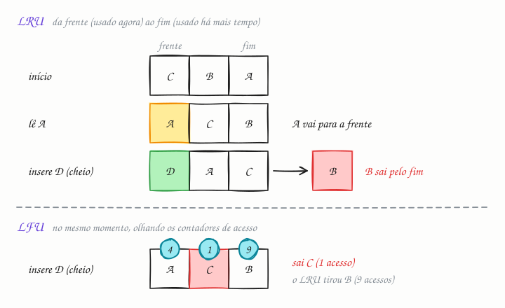

## O essencial

As políticas de remoção (eviction) de cache decidem quais itens tirar quando o cache está cheio.

- **LRU** (Least Recently Used, o usado menos recentemente) remove os itens que não foram acessados recentemente, supondo que os itens recentes têm mais chance de ser usados de novo.
- **LFU** (Least Frequently Used, o usado com menos frequência) remove os itens raramente acessados, com foco na popularidade de longo prazo.

Alguns sistemas usam remoção aleatória, FIFO ou algoritmos mais avançados. A ideia central é que o espaço do cache é limitado, então você quer manter na memória os itens mais valiosos.

## Aprofundando

### LRU: uma lista ordenada pelo último acesso

Imagine o cache como uma lista que vai do item usado agora (a frente) ao usado há mais tempo (o fim). Todo acesso move o item para a frente; quando o cache está cheio e chega um item novo, sai o do fim.

Para que cada operação custe O(1), a implementação clássica junta um **mapa de hash** (da chave para o nó, para achar o item sem percorrer a lista) com uma **lista duplamente encadeada** (para tirar um nó do meio e pô-lo na frente sem varrer nada).

### LFU: um contador por item

O LFU guarda quantas vezes cada item foi acessado e remove o de menor contagem; no empate, o menos recente. Ele protege o que é popular de verdade: um item lido 500 vezes não sai só porque ficou alguns minutos sem acesso.

### Onde cada um erra

- **LRU e a varredura:** um relatório noturno que lê 50 mil produtos uma única vez empurra para fora os mil produtos quentes do dia, e a taxa de acerto despenca até o cache se refazer.
- **LFU e a popularidade velha:** a notícia que bombou na semana passada acumulou milhões de acessos e fica no cache indefinidamente, enquanto itens novos entram com contagem 1 e são os primeiros a sair. A correção é envelhecer os contadores, por exemplo dividindo todos por dois de tempos em tempos.

### Na prática, tudo é aproximado

Uma lista exata custa dois ponteiros por chave e uma atualização a cada leitura, um gargalo quando muitas threads leem ao mesmo tempo. Por isso os sistemas aproximam. O Redis sorteia algumas chaves (5, por padrão) e remove a de acesso mais antigo entre elas; o LFU dele usa um contador logarítmico de 8 bits que decai com o tempo. O Caffeine, do Java, usa o W-TinyLFU: uma pequena janela LRU recebe os itens novos, e um item só entra no cache principal se a frequência estimada dele, guardada num sketch probabilístico parente do Bloom filter (cap. 30), for maior que a da vítima.

## Analogia

Seu guarda-roupa tem 30 cabides; para pendurar uma camisa nova, alguma precisa sair. Pela regra **LRU**, sai a que você não veste há mais tempo, e em janeiro o casaco vai embora, para fazer falta em junho. Pela **LFU**, sai a que você vestiu menos vezes no total, e a camisa da seleção, usada em todos os jogos da última Copa, segura o cabide por anos sem ser vestida de novo.

## No mundo real

- **Redis:** com `maxmemory` definido, as políticas `allkeys-lru` e `allkeys-lfu` escolhem a vítima entre todas as chaves, e as variantes `volatile-*`, só entre as que têm TTL. O padrão, `noeviction`, não remove nada: quando o limite é atingido, as escritas passam a falhar.
- **Caffeine:** essa biblioteca de cache em memória para Java, sucessora do cache do Guava e suportada pelo Spring, usa W-TinyLFU em vez de LRU puro.
- **PostgreSQL:** o buffer pool usa o *clock sweep*, uma aproximação de LRU com um pequeno contador de uso por página.
- **ZFS:** o cache em memória é o ARC (Adaptive Replacement Cache), que divide o espaço entre itens recentes e frequentes e ajusta a proporção sozinho.

## Trade-offs

| | LRU | LFU |
|---|---|---|
| Critério | Último acesso | Número de acessos |
| Custo por acesso | Mover um nó na lista: O(1) | Atualizar o contador: O(1) com listas por frequência, mais memória |
| Vai bem quando | O interesse muda rápido (sessões, notícias do dia) | A popularidade é estável (catálogo, configurações) |
| Erra quando | Uma varredura única passa por cima dos itens quentes | Itens antigos acumulam contagem e itens novos não têm chance |
| Ajuste típico | LRU segmentado: o item só vira "protegido" no segundo acesso | Envelhecer os contadores |

## Na entrevista

- Ao propor um cache, diga o tamanho e o que acontece quando ele enche: "Com 10 GB de Redis e `allkeys-lru`, os perfis menos acessados saem primeiro."
- Se pedirem para implementar, é o clássico LRU em O(1): mapa de hash mais lista duplamente encadeada. Em Python, `OrderedDict` com `move_to_end` resolve em poucas linhas, mas explique a estrutura por baixo.
- Mostre que conhece a fraqueza de cada um: o LRU sofre com varreduras; o LFU precisa envelhecer os contadores.

## Cuidado com

- **Atualização:** os "algoritmos avançados" que o original cita de passagem são o padrão hoje. Quase ninguém usa LRU ou LFU exatos: o Redis amostra chaves, o Caffeine usa W-TinyLFU, o ZFS usa ARC. E pesquisas recentes, como o S3-FIFO (2023) e o SIEVE (2024), mostraram que variações de FIFO, mais simples e baratas que o LRU, acertam tanto quanto ele, ou mais, em muitas cargas web reais.
- **Remoção não é expiração:** o TTL tira o dado por idade, mesmo com espaço sobrando; a remoção tira por falta de espaço.
- **Redis sem `maxmemory`:** em 64 bits não há limite, e o processo cresce até a máquina ficar sem memória.

## Teste-se

**P:** Qual a diferença entre LRU e LFU?

**R:** O LRU remove o item acessado há mais tempo; o LFU remove o item acessado menos vezes. O primeiro olha a recência; o segundo, a frequência.

**P:** Um cache de catálogo é varrido toda noite por um job que lê todos os produtos uma vez, e de manhã a taxa de acerto despenca. Qual é o problema e o que você muda?

**R:** O LRU deixa a varredura expulsar os itens quentes. Troque por uma política resistente a varreduras (LFU com envelhecimento, W-TinyLFU, LRU segmentado) ou faça o job ler sem passar pelo cache.

**P:** Configurar TTL em todas as chaves dispensa uma política de remoção?

**R:** Não. O TTL remove por idade, mas, se as escritas chegarem mais rápido do que as chaves expiram, o cache enche do mesmo jeito. Sem política (o `noeviction` do Redis), as escritas passam a falhar.
