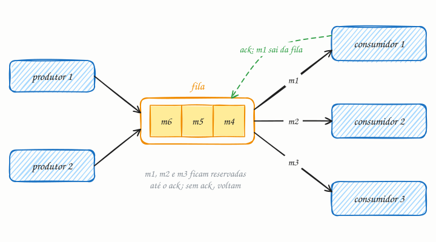

## O essencial

Uma fila de mensagens permite que um componente envie mensagens a outro sem que os dois precisem estar online ao mesmo tempo. No modelo ponto a ponto, cada mensagem da fila é consumida por um único receptor e depois removida. Isso desacopla o remetente do destinatário, que podem escalar e falhar de forma independente. Filas são ótimas para tarefas em segundo plano, envio de e-mails e processamento assíncrono de tarefas pesadas. Pense nelas como uma lista de tarefas compartilhada entre serviços.

## Aprofundando

São três papéis: o **produtor** envia, o **broker** (RabbitMQ, Amazon SQS) guarda e o **consumidor** processa. O ciclo de vida de uma mensagem tem um detalhe que muda tudo:

1. O produtor envia a mensagem; o broker a grava (em disco e, em geral, em réplicas) e confirma o recebimento.
2. Um consumidor recebe a mensagem, que **não é apagada**: fica reservada, invisível para os outros consumidores.
3. O consumidor termina o trabalho e envia um **ack** (confirmação). Só então o broker apaga a mensagem.
4. Se o ack não chegar (o consumidor travou, caiu ou estourou o prazo), a mensagem volta para a fila e outro consumidor a recebe.

O passo 4 garante que a queda de um consumidor não perde mensagens, mas tem um efeito colateral: se o consumidor caiu depois de mandar o e-mail e antes do ack, o e-mail sai duas vezes. Essa garantia se chama **pelo menos uma vez** (at-least-once), e é por isso que consumidores precisam ser idempotentes (cap. 36).

### Consumidores concorrentes

Vários consumidores na mesma fila dividem o trabalho. A conta de quantos você precisa é direta: se chegam 50 e-mails por segundo e cada envio leva 200 ms, pela lei de Little há em média 50 × 0,2 = 10 envios em andamento, então são pelo menos 10 consumidores, mais uma folga. Para processar mais rápido, basta subir mais consumidores; o produtor nem fica sabendo.

### Amortecedor de picos

Numa Black Friday hipotética, o checkout gera 3 mil pedidos por minuto durante uma hora, mas o emissor de notas fiscais processa 2 mil por minuto. Sem fila, o checkout teria de recusar pedidos ou esperar. Com fila, ela acumula 60 mil mensagens no pico e esvazia quando o movimento cai, enquanto o cliente recebe "pedido recebido" na hora. Acompanhe o **tamanho da fila** e a **idade da mensagem mais antiga**: se crescem sem parar, faltam consumidores.

### Ordem

Com consumidores concorrentes, a ordem global se perde: a mensagem 2 pode terminar antes da 1. Se a ordem importa por entidade (os eventos de um mesmo pedido), use uma fila FIFO com chave de grupo, como o `MessageGroupId` do SQS FIFO.

## Analogia

Na cozinha de um restaurante, o garçom pendura a comanda no trilho e volta para o salão, sem esperar o prato ficar pronto. Cada cozinheiro livre pega a próxima comanda, e dois nunca fazem o mesmo pedido. Se um cozinheiro passa mal no meio do prato, a comanda volta para o trilho e outro assume. Na hora do rush, o trilho enche, mas o salão continua atendendo.

## No mundo real

- **Amazon SQS:** a mensagem recebida fica invisível por um prazo (o visibility timeout, 30 s por padrão) e reaparece se não for apagada até lá. Filas padrão entregam pelo menos uma vez e sem ordem garantida; filas FIFO preservam a ordem dentro de cada grupo de mensagens.
- **RabbitMQ:** o consumidor confirma com ack, e o *prefetch* limita quantas mensagens sem ack cada um pode segurar. Se a conexão cai, as pendentes voltam para a fila.
- **Jobs em segundo plano:** o Sidekiq (Ruby, sobre Redis) e o Celery (Python, sobre RabbitMQ ou Redis) usam filas para e-mails, relatórios e processamento de imagens.

## Trade-offs

**Você ganha**

- Produtor e consumidor sobem, caem e escalam de forma independente.
- Picos viram fila em vez de erro.
- Resposta rápida ao usuário, com o trabalho pesado feito depois.

**Você paga**

- Mais um componente crítico para operar (o broker também precisa de réplicas).
- Duplicatas e falta de ordem, que o consumidor precisa tolerar.
- Fluxo assíncrono: o resultado não sai na hora, e depurar fica mais difícil.

## Na entrevista

- Traga a fila sempre que uma etapa for lenta, sujeita a falhas ou não precisar de resposta imediata: e-mails, transcodificação de vídeo, geração de relatórios.
- Fale do contrato de entrega: "A entrega é pelo menos uma vez, então o consumidor é idempotente; uso o ID do pedido como chave de deduplicação."
- Diga o que acontece com falhas: retries com backoff (cap. 35) e, depois de algumas tentativas, uma dead letter queue (cap. 46).
- Mostre que monitora a fila: o tamanho e a idade da mensagem mais antiga disparam o autoscaling dos consumidores.

## Cuidado com

- **Atualização:** "consumida e depois removida" pula o passo mais importante. A mensagem só sai depois do ack; até lá, pode ser entregue de novo, inclusive a outro consumidor. O efeito de "exatamente uma vez", de ponta a ponta, depende de um consumidor idempotente.
- **Fila não é banco de dados:** as mensagens têm retenção limitada (no SQS, no máximo 14 dias) e não servem para consultas.
- **Kafka não é uma fila ponto a ponto clássica:** ler não apaga a mensagem; cada grupo de consumidores guarda a própria posição (offset) num log, como mostra o capítulo 45.

## Teste-se

**P:** O que significa entrega "pelo menos uma vez" (at-least-once)?

**R:** Que o broker garante que toda mensagem chega a um consumidor, mas pode entregá-la mais de uma vez, por exemplo quando o consumidor cai depois de processar e antes de confirmar.

**P:** Seu serviço de upload precisa gerar miniaturas das fotos, o que leva 2 s por imagem. Como você desenha isso?

**R:** O upload grava a foto, publica uma mensagem numa fila e responde na hora. Consumidores geram as miniaturas, escalam pelo tamanho da fila e são idempotentes, para que uma entrega repetida só refaça a mesma miniatura.

**P:** Se cada mensagem vai para um único consumidor, como ela pode ser processada duas vezes?

**R:** Se o ack não chega a tempo (consumidor lento, travado ou que caiu depois de processar), o broker devolve a mensagem para a fila, e outro consumidor a processa de novo.
