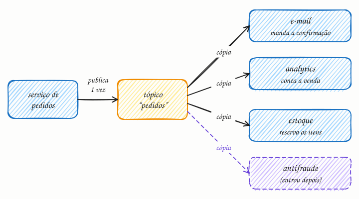

## O essencial

No pub/sub, os publicadores enviam mensagens para tópicos, e não diretamente para os consumidores. Os assinantes escutam os tópicos que lhes interessam e recebem cópias das mensagens relevantes. Isso permite uma comunicação no estilo transmissão (broadcast) e um acoplamento fraco entre produtores e consumidores. Vários serviços podem reagir ao mesmo evento de formas diferentes, como registro de logs, analytics e notificações. Em entrevistas, o pub/sub costuma aparecer em designs orientados a eventos, como feeds de atividade ou event sourcing.

## Aprofundando

Pense no evento "pedido 123 criado". O serviço de pedidos o publica uma vez no tópico `pedidos`, e o broker entrega uma cópia a cada assinatura: o e-mail manda a confirmação, o analytics conta a venda, o estoque reserva os itens.

O ganho está no que o publicador **não** sabe. Se amanhã surgir um serviço antifraude, ele cria uma assinatura e passa a receber os eventos, sem nenhuma mudança no serviço de pedidos. Com chamadas diretas, o serviço de pedidos chamaria três APIs, ficaria esperando as três e precisaria de um deploy a cada consumidor novo.

### Fila ou pub/sub? Os dois

Na fila (cap. 44), cada mensagem vai para **um** consumidor: é distribuição de trabalho. No pub/sub, cada mensagem vai para **todas** as assinaturas: é distribuição de fatos. Na prática, os dois se combinam: cada assinatura funciona como uma fila própria, e as instâncias de um mesmo serviço competem por ela. Se o serviço de e-mail roda em 4 instâncias, cada evento gera um e-mail, e não quatro: uma cópia por **serviço**, não por instância. É assim nos grupos de consumidores do Kafka, nas assinaturas do Google Cloud Pub/Sub e no fan-out em que um tópico do Amazon SNS entrega cada mensagem a várias filas SQS.

### Assinatura durável ou efêmera

Se o estoque ficar fora do ar por dez minutos, o que acontece com os eventos desse intervalo? Depende do broker. No Redis Pub/Sub, a assinatura é efêmera: quem não estava conectado perde a mensagem. No Kafka, os eventos ficam num log durante o período de retenção (7 dias, por padrão), e cada grupo de consumidores guarda onde parou (o offset); ao voltar, o estoque continua de onde estava. Para eventos de negócio, você quase sempre quer a durável.

### Ordem

Com várias partições e várias instâncias, não existe ordem global. O Kafka garante a ordem dentro de cada partição: use o ID do pedido como chave para que "criado", "pago" e "enviado" do mesmo pedido caiam na mesma partição e cheguem em sequência.

## Analogia

O grupo de WhatsApp do condomínio: a síndica escreve uma vez "a água será cortada amanhã às 9h", e cada morador recebe a sua cópia. Um enche baldes, outro avisa a diarista, o porteiro cola um cartaz no elevador. Quem estava sem internet recebe quando reconectar. Mas quem entra no grupo depois não vê o aviso: a assinatura só vale dali para a frente.

## No mundo real

- **Apache Kafka:** criado no LinkedIn e aberto em 2011 para distribuir eventos de atividade, como visualizações de página, a vários sistemas ao mesmo tempo.
- **Amazon SNS + SQS:** a AWS documenta o fan-out em que um tópico do SNS entrega cada mensagem a várias filas SQS, uma por serviço.
- **Google Cloud Pub/Sub:** cada assinatura recebe as mensagens publicadas depois da sua criação, e os clientes de uma mesma assinatura dividem o trabalho.
- **RabbitMQ:** exchanges do tipo `fanout` copiam a mensagem para todas as filas ligadas a elas; as do tipo `topic`, para as filas cujo padrão casa com a chave de roteamento.

## Trade-offs

| | Fila (ponto a ponto) | Pub/sub |
|---|---|---|
| Cada mensagem vai para | Um consumidor | Cada assinatura |
| Uso típico | Distribuir trabalho | Avisar que algo aconteceu |
| Novo interessado | Disputa as mesmas mensagens | Ganha a própria cópia |
| O que o produtor sabe | Que existe um trabalho a fazer | Nada sobre quem escuta |
| Risco | Fila crescendo sem consumidor | Evento mal desenhado vira contrato com muitos serviços |

## Na entrevista

- Use pub/sub quando **um fato** interessa a **vários serviços**: "pedido criado", "usuário cadastrado", "pagamento aprovado". Para uma tarefa que só um serviço executa, use fila.
- Diga o tópico, a chave de partição e quem assina: "Publico `PedidoCriado` no tópico `pedidos`, particionado por ID do pedido; e-mail, estoque e analytics têm cada um o seu grupo de consumidores."
- Em fluxos de vários passos, eventos podem coordenar uma saga coreografada (cap. 39).
- Em feeds, mostre o custo do fan-out: um post de uma conta com 10 milhões de seguidores vira 10 milhões de entregas, e muitos designs montam o feed dessas contas na hora da leitura.

## Cuidado com

- **Assinatura efêmera perde mensagem:** no Redis Pub/Sub, quem não está conectado no momento da publicação nunca recebe aquela mensagem. Para eventos de negócio, use um broker com retenção (Kafka, Redis Streams, um serviço gerenciado).
- **Pub/sub não é event sourcing:** event sourcing é guardar o estado como uma sequência de eventos, que vira a fonte da verdade; pub/sub é só um jeito de distribuí-los. Dá para usar um sem o outro.
- **Acoplamento fraco não é acoplamento zero:** o formato do evento vira um contrato com todos os assinantes. Mudar um campo sem versionar quebra serviços que você nem sabe que existem.

## Teste-se

**P:** Qual a diferença entre uma fila ponto a ponto e um tópico de pub/sub?

**R:** Na fila, cada mensagem é entregue a um único consumidor. No tópico, cada assinatura recebe a sua cópia de todas as mensagens.

**P:** Quando um pagamento é aprovado, o sistema precisa enviar o recibo, liberar o pedido e atualizar o painel financeiro. Como você conecta isso?

**R:** O serviço de pagamentos publica `PagamentoAprovado` num tópico, e os três serviços assinam, cada um com a sua assinatura. O pagamento não conhece nenhum deles, e um novo interessado só cria mais uma assinatura.

**P:** O serviço de e-mail roda em 5 instâncias, todas ligadas ao tópico de pedidos. O cliente recebe 5 e-mails?

**R:** Não, se as instâncias compartilharem a mesma assinatura (o mesmo grupo de consumidores): elas dividem as mensagens, e cada evento é processado uma vez pelo serviço. Se cada instância criar a própria assinatura, aí sim saem 5 e-mails.
