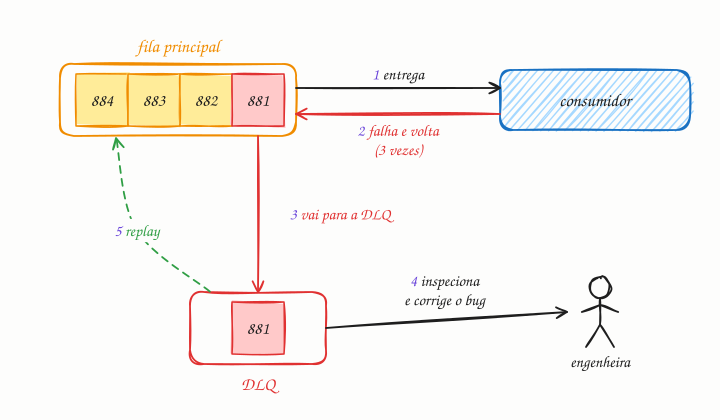

## O essencial

Uma dead letter queue (DLQ, ou fila de mensagens mortas) guarda as mensagens que não puderam ser processadas com sucesso depois de várias tentativas. Em vez de tentar para sempre e travar a fila principal, essas mensagens são colocadas de lado. Os engenheiros podem inspecionar a dead letter queue para depurar problemas, corrigir dados ou reprocessar as mensagens mais tarde. Esse padrão aumenta a resiliência e evita que o sistema fique travado em "mensagens envenenadas" (poison messages). Pense nela como uma área de espera para tarefas problemáticas.

## Aprofundando

O nome vem dos correios: *dead letter* é a carta que não pode ser entregue nem devolvida. Numa fila, é a mensagem que o consumidor não consegue processar.

### O caminho de uma mensagem envenenada

Imagine uma fila de pedidos com limite de 3 tentativas:

1. O consumidor recebe o pedido 881, cujo JSON traz uma data num formato que ele não entende. Ele lança uma exceção e não manda o ack.
2. A mensagem volta para a fila, e o broker conta mais uma entrega (no SQS, o `ApproximateReceiveCount`).
3. Na terceira falha, o broker para de devolvê-la à fila principal e a move para a DLQ.
4. Um alarme dispara porque a DLQ deixou de estar vazia. Alguém inspeciona a mensagem e corrige o parser.
5. Vem o **replay**: a mensagem volta para a fila principal e, agora, passa.

Sem a DLQ, o pedido 881 voltaria para sempre. Numa fila comum, ocuparia consumidores sem parar; numa fila com ordem (um grupo FIFO, uma partição do Kafka), bloquearia todas as mensagens atrás dele.

### Falha transitória ou permanente

Nem todo erro merece as mesmas tentativas. Um timeout do banco é **transitório**: vale tentar de novo com backoff exponencial (cap. 35). Um JSON inválido é **permanente**: tentar de novo só atrasa o inevitável, e o melhor é mandar direto para a DLQ. Um limite entre 3 e 5 tentativas é comum. Com 1, qualquer soluço momentâneo lota a DLQ; com 50, uma mensagem envenenada ocupa consumidores por muito tempo.

### O que guardar e como reprocessar

Junto com a mensagem, guarde o contexto do erro: a exceção, o número de tentativas, a hora da primeira falha e a versão do consumidor. Sem isso, a investigação vira arqueologia. No replay, devolva as mensagens aos poucos e garanta que o consumidor é idempotente (cap. 36), porque algumas podem ter sido processadas pela metade. E lembre que elas chegam fora de ordem em relação às mais novas.

## Analogia

O entregador tenta deixar uma encomenda três vezes, e ninguém atende: o número da casa não existe. Em vez de rodar com o pacote para sempre, ele o deixa na agência, numa prateleira separada, e segue com as outras entregas. Lá, alguém confere a etiqueta, corrige o endereço com o remetente e põe o pacote de volta na rota.

## No mundo real

- **Amazon SQS:** a redrive policy define o `maxReceiveCount`; passada essa contagem de entregas, a mensagem vai para a DLQ configurada. O próprio SQS oferece o redrive de volta para a fila de origem depois da correção.
- **RabbitMQ:** mensagens rejeitadas sem reenfileiramento, expiradas por TTL ou descartadas por fila cheia vão para um *dead letter exchange*.
- **Kafka:** o broker não tem DLQ. O consumidor publica a mensagem problemática num tópico separado; o Kafka Connect faz isso nos conectores de destino (sink) com `errors.deadletterqueue.topic.name`.
- **Sidekiq:** depois de 25 novas tentativas com backoff exponencial, que somam cerca de 20 dias, o job vai para o conjunto *Dead*, de onde pode ser reexecutado pela interface web.

## Trade-offs

**Você ganha**

- A fila principal continua andando quando uma mensagem não tem conserto.
- Nenhuma mensagem some em silêncio: a falha fica guardada, com contexto.
- Uma forma controlada de reprocessar depois da correção.

**Você paga**

- Mais uma fila para monitorar; sem alarme, ela vira um cemitério que ninguém visita.
- Retenção e replay para planejar, porque a DLQ também expira mensagens.
- Ordem quebrada: quem passou pela DLQ volta depois das mensagens mais novas.

## Na entrevista

- Toda vez que desenhar uma fila, complete a frase: "com retries e backoff para erros transitórios e uma DLQ depois de 5 tentativas, com alarme quando ela tiver qualquer mensagem".
- Diferencie erro transitório de permanente; isso mostra maturidade operacional.
- Explique o replay: "Corrigido o bug, devolvo as mensagens da DLQ aos poucos; o consumidor é idempotente, então reprocessar é seguro."

## Cuidado com

- **Atualização:** a DLQ não é um recurso de todo broker. SQS, RabbitMQ e Google Cloud Pub/Sub têm suporte nativo; no Kafka, você implementa no consumidor, e, enquanto ele insistir numa mensagem envenenada, o offset não avança e a partição inteira fica parada.
- **A DLQ também expira mensagens:** a AWS recomenda que a retenção da DLQ seja maior que a da fila de origem, para não perder justamente o que você queria investigar.
- **DLQ sem dono:** se ninguém olha, ela só adia a perda de dados. Defina alarme, responsável e prazo para tratar.

## Teste-se

**P:** O que é uma mensagem envenenada (poison message)?

**R:** Uma mensagem que falha toda vez que é processada, por dado inválido ou bug, e que, sem DLQ, voltaria para a fila indefinidamente.

**P:** Durante 30 segundos de instabilidade no banco, um consumidor de pagamentos falha com timeouts, e dezenas de mensagens vão parar na DLQ. O que está errado?

**R:** O limite de tentativas e o backoff estão curtos demais para erros transitórios. Com backoff exponencial, as novas tentativas se espalham por mais tempo, e a instabilidade passa antes de esgotar o limite; a DLQ deve receber, sobretudo, falhas permanentes.

**P:** Corrigido o bug, basta devolver todas as mensagens da DLQ de uma vez para a fila principal?

**R:** Não. O consumidor precisa ser idempotente, porque algumas mensagens podem ter sido processadas pela metade, e o replay deve ser gradual para não criar um pico; além disso, elas chegam fora de ordem em relação às mais novas.
