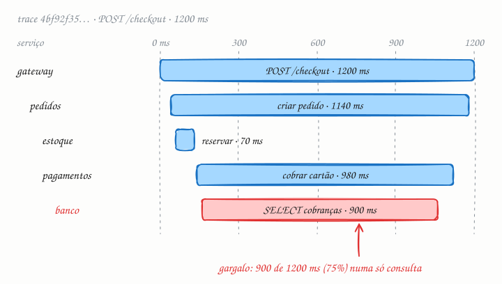

## O essencial

O tracing distribuído acompanha uma única requisição enquanto ela passa por vários serviços. Cada serviço adiciona um trace ID e informações de span, para que você consiga reconstruir o caminho completo da requisição. Isso ajuda muito a depurar respostas lentas ou falhas em arquiteturas de microsserviços. Sem tracing, você só vê erros isolados. Com ele, você vê a história inteira, passando por serviços, filas e bancos de dados.

## Aprofundando

Dois conceitos sustentam tudo:

- **Trace:** a viagem completa de uma requisição. É identificado por um **trace ID** de 128 bits, gerado uma única vez, por quem recebe a requisição primeiro (o gateway ou o próprio app do cliente).
- **Span:** uma etapa dessa viagem, como uma chamada HTTP, uma consulta ao banco ou a publicação numa fila. Cada span guarda o próprio ID, o ID do span pai, o nome da operação, o instante de início, a duração e atributos como o status HTTP ou a consulta SQL.

O que costura os serviços é a **propagação de contexto**. Ao chamar o próximo serviço, cada um envia o trace ID e o ID do span atual num cabeçalho. O padrão hoje é o `traceparent`, do W3C Trace Context:

```http
traceparent: 00-4bf92f3577b34da6a3ce929d0e0e4736-00f067aa0ba902b7-01
```

Os campos são a versão, o trace ID, o ID do span pai e as flags (o `01` diz que este trace foi amostrado). Quem recebe cria um span filho com o mesmo trace ID e repassa o cabeçalho adiante. Os spans são enviados em lotes, de forma assíncrona, a um coletor; o backend junta tudo pelo trace ID e monta a árvore pelos IDs de pai.



O resultado é a cascata do diagrama. Imagine um checkout que levou 1,2 s. Os logs de cada serviço, sozinhos, diriam apenas "terminei com sucesso". A cascata mostra que pedidos e pagamentos passaram quase todo o tempo esperando, e que uma consulta ao banco consumiu 900 ms; talvez falte um índice (cap. 26). Chamadas em fila indiana que poderiam rodar em paralelo também saltam aos olhos.

### Amostragem

Guardar todos os traces de um sistema com milhares de requisições por segundo custa caro, então se amostra:

- **Na entrada (head sampling):** a decisão sai no primeiro span, por exemplo 1% das requisições, e viaja nas flags do `traceparent`. É barato, mas descarta às cegas.
- **No fim (tail sampling):** o coletor espera o trace terminar e guarda os lentos e os que deram erro. Pega o que interessa, mas precisa de memória para segurar os traces até decidir.

## Analogia

Pense no código de rastreio dos Correios. O pacote ganha um código na postagem, e cada unidade por onde ele passa (agência, centro de tratamento, centro de distribuição) registra entrada e saída com esse mesmo código. Quando a encomenda atrasa, você não liga para cada unidade: abre o rastreio e vê que ela ficou cinco dias parada num centro de tratamento. O código é o trace ID; cada parada, com hora de chegada e de saída, é um span.

## No mundo real

- O **Dapper**, do Google, descrito num artigo de 2010, popularizou trace, span e amostragem em larga escala. O **Zipkin**, criado no Twitter e aberto em 2012, nasceu inspirado nele.
- O **Jaeger**, criado na Uber e hoje projeto graduado da CNCF, e o **Grafana Tempo** guardam traces e desenham a cascata.
- O **OpenTelemetry**, também da CNCF, virou o padrão neutro de instrumentação: SDKs para as principais linguagens, um coletor e o W3C Trace Context como propagação padrão. Instrumentando com ele, você troca de backend (Jaeger, Tempo, Datadog, Honeycomb) sem reinstrumentar o código.

## Trade-offs

**Você ganha**

- Onde o tempo de cada requisição foi gasto, serviço por serviço, em vez de palpites cruzando logs soltos.
- O mapa real de dependências (quem chama quem), extraído dos próprios traces.
- Uma ponte entre sinais: do pico na métrica para um trace lento, e dele para as linhas de log com o mesmo trace ID.

**Você paga**

- Instrumentação em todos os serviços: um único elo que não propaga o cabeçalho parte o trace em pedaços.
- Volume e custo de armazenamento, que obrigam a amostrar, e a amostragem pode jogar fora justamente o trace que você queria.
- Um pouco de CPU, memória e rede por span. É pouco, mas não é zero.

## Na entrevista

- Traga o tracing quando o desenho tiver vários serviços e o entrevistador perguntar como você vai investigar lentidão ou erros em produção.
- Mostre que sabe dividir o trabalho entre os sinais: as métricas avisam que a latência do p99 subiu (cap. 5), os traces mostram onde, os logs explicam por quê.
- Cite os detalhes de quem já operou: propagação pelo cabeçalho `traceparent`, instrumentação com OpenTelemetry, amostragem na entrada para controlar o custo e no fim para não perder os traces com erro.
- Frase pronta: *"As métricas me dizem que o p99 do checkout dobrou; o trace me mostra que 75% desse tempo está numa consulta do serviço de pagamentos."*

## Cuidado com

- **Atualização:** o artigo diz que cada serviço "adiciona um trace ID". Na verdade, o trace ID nasce uma vez e só é repassado. O que cada serviço cria é o seu **span**, com um ID novo que aponta para o span pai.
- **Filas quebram o trace sem avisar.** Numa chamada assíncrona por fila (cap. 44), o contexto precisa ir nos cabeçalhos da mensagem; senão, o trace termina no produtor.
- **Relógios diferentes.** Cada span é medido pelo relógio da própria máquina. Com relógios dessincronizados, um filho pode aparecer começando antes do pai; confie mais nas durações do que em alinhamentos de poucos milissegundos.
- **Tracing não substitui métricas.** Traces amostrados servem para diagnosticar casos, não para contar. Alertas e taxas de erro saem das métricas.

## Teste-se

**P:** Qual a diferença entre um trace e um span?

**R:** O trace é a viagem inteira de uma requisição, identificada por um trace ID. O span é uma etapa dessa viagem (uma chamada, uma consulta), com início, duração e o ID do span pai.

**P:** O p99 do checkout saltou de 300 ms para 2 s depois de um deploy. Como o tracing ajuda a achar a causa?

**R:** Você filtra os traces lentos do checkout e abre a cascata: o span mais longo e mais profundo aponta o culpado, por exemplo uma consulta nova sem índice no serviço de pagamentos. Depois, pelo trace ID, chega às linhas de log daquela requisição.

**P:** Se cada serviço gerar o próprio trace ID ao receber uma requisição, o tracing funciona?

**R:** Não. Você terá um trace solto por serviço, sem como ligar um ao outro. O trace ID nasce uma vez e é propagado (no cabeçalho `traceparent`); cada serviço só cria IDs novos de span.
