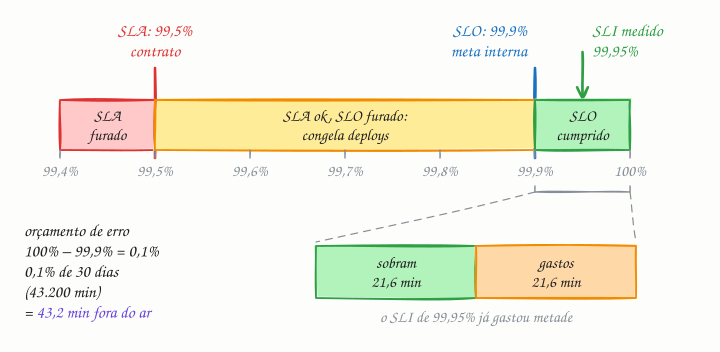

## O essencial

Um SLA (Service Level Agreement, ou acordo de nível de serviço) é uma promessa externa feita aos clientes, como "99,9% de uptime por mês". Um SLO (Service Level Objective, ou objetivo de nível de serviço) é uma meta interna que os engenheiros buscam cumprir, normalmente mais rígida que o SLA. Um SLI (Service Level Indicator, ou indicador de nível de serviço) é a métrica efetivamente medida, como o uptime real ou a taxa de sucesso das requisições. Pense no SLA como o contrato, no SLO como a meta e no SLI como o placar. Em entrevistas, usar esses termos corretamente mostra maturidade ao pensar em confiabilidade.

## Aprofundando

Os três se montam de baixo para cima: primeiro a medida, depois a meta, por último a promessa.

**1. SLI: escolha o que medir.** Um bom SLI é uma razão entre eventos bons e eventos válidos, medida do ponto de vista de quem usa:

- disponibilidade: requisições respondidas sem erro 5xx ÷ requisições válidas;
- latência: requisições respondidas em menos de 300 ms ÷ requisições válidas;
- frescor, num pipeline de dados: registros atualizados há menos de 10 minutos ÷ registros.

Erros 4xx causados pelo próprio cliente costumam ficar fora da conta, porque não são culpa do serviço.

**2. SLO: dê uma meta e uma janela.** Por exemplo: "99,9% das requisições do checkout sem erro, numa janela móvel de 30 dias". A meta nunca é 100%: cada nove a mais custa muito mais caro, e acima de certo ponto o usuário nem percebe a diferença, porque o Wi-Fi e o celular dele falham mais do que isso.

**3. SLA: prometa menos do que mira.** O contrato fica abaixo do SLO, digamos 99,5%, e diz o que acontece se for violado; em geral, créditos na fatura. A folga entre os dois é o seu aviso antecipado: você fura a meta interna bem antes de dever qualquer coisa ao cliente.

### O orçamento de erro

O que o SLO deixa de fora é o **orçamento de erro** (error budget). Com 99,9% em 30 dias, você pode falhar 0,1% do tempo: 0,1% de 43.200 minutos dá 43,2 minutos. Medindo por requisições, a conta é a mesma: com 10 milhões de requisições no mês, até 10 mil podem falhar.

| Meta | Fora do ar permitido em 30 dias |
|---|---|
| 99% | 7 h 12 min |
| 99,5% | 3 h 36 min |
| 99,9% | 43 min 12 s |
| 99,99% | 4 min 19 s |
| 99,999% | 26 s |

O orçamento vira ferramenta de decisão. Enquanto sobra, a equipe pode lançar e arriscar. Quando acaba, congela as mudanças arriscadas e põe o esforço em confiabilidade até a janela se recuperar.

## Analogia

Uma pizzaria anuncia: "entrega em até 50 minutos ou a pizza sai de graça". Essa é a promessa ao cliente, com multa embutida: o SLA. Na cozinha, o gerente cobra da equipe 35 minutos, para sobrar folga contra trânsito e chuva: o SLO. O sistema de pedidos anota a hora de saída e de chegada de cada pizza: o SLI. Quando os atrasos da semana se acumulam, o gerente adia a promoção nova antes de começar a dar pizza de graça.

## No mundo real

- O livro *Site Reliability Engineering* (Google, 2016) popularizou SLIs, SLOs e orçamento de erro. O *Site Reliability Workbook* (2018) traz exemplos de política de orçamento, como congelar lançamentos quando ele acaba.
- Os provedores de nuvem publicam SLAs com créditos na fatura. A AWS diz que o S3 Standard é projetado para 99,99% de disponibilidade, mas o SLA dele garante 99,9% ao mês: o alvo de engenharia acima da promessa, como manda o figurino.
- Na prática, os SLIs saem de contadores de requisições em ferramentas como Prometheus e Datadog. O próprio Workbook recomenda alertar pela velocidade com que o orçamento está sendo queimado (burn rate), e não por erro isolado.

## Trade-offs

| | SLI | SLO | SLA |
|---|---|---|---|
| O que é | A medida real | A meta interna | A promessa ao cliente |
| Exemplo | 99,95% das requisições OK no mês | 99,9% em 30 dias | 99,5%, ou crédito na fatura |
| Quem define | Engenharia | Engenharia com produto | Comercial e jurídico, ouvindo a engenharia |
| Se não cumprir | Não se aplica: é o placar | Congela lançamentos e prioriza confiabilidade | Multa, créditos e cliente insatisfeito |
| Quem vê | A equipe, nos painéis | A empresa | O cliente |

## Na entrevista

- Transforme "precisa ser confiável" em números logo nos requisitos não funcionais: "99,9% de disponibilidade e p99 de leitura abaixo de 300 ms, em 30 dias".
- Traduza noves em tempo para mostrar que sabe o custo: 99,9% são uns 43 minutos por mês, o que cabe um incidente resolvido pelo plantão; 99,99% são 4 minutos, então o failover precisa ser automático.
- Lembre que dependências em série se multiplicam: três serviços de 99,9% em cadeia, com falhas independentes, entregam uns 99,7% (0,999³), a menos que haja redundância ou fallback.
- Frase pronta: *"Proponho um SLO de 99,9% em 30 dias. Isso dá um orçamento de uns 43 minutos, e é ele que decide quando paramos de lançar para cuidar da estabilidade."*

## Cuidado com

- **Atualização:** o artigo fala em "uptime". Hoje o SLI mais comum é por requisição: a fração de requisições boas entre as válidas. Um servidor "no ar" que devolve erro 500 para metade dos usuários tem 100% de uptime e um SLI péssimo.
- **A média esconde a cauda.** Uma latência média de 150 ms pode esconder 1% das requisições levando 5 s. Use percentis (p95, p99) ou a fração de requisições abaixo de um limite (cap. 5).
- **SLO igual ao SLA não avisa nada.** Se a meta interna é a própria promessa, você só descobre o problema quando já deve a multa.
- **O "disponível" do CAP é outro.** No CAP (cap. 2), é uma propriedade formal durante partições; no SLA, é uma porcentagem medida num período.

## Teste-se

**P:** Qual a diferença entre SLI, SLO e SLA?

**R:** O SLI é a medida real, como a fração de requisições sem erro. O SLO é a meta interna para essa medida, como 99,9% em 30 dias. O SLA é a promessa contratual ao cliente, com consequência (créditos, multa) se for violada.

**P:** O SLO do seu serviço é 99,9% em 30 dias, e a janela atual já soma 40 minutos de indisponibilidade. O que fazer?

**R:** Restam uns 3 dos 43 minutos do orçamento. Você congela deploys e lançamentos arriscados e põe a equipe em confiabilidade até a janela se recuperar. O SLA de 99,5% (216 minutos) ainda está longe, e é para isso que serve a folga.

**P:** Se o SLA prometido ao cliente é 99,9%, o SLO interno também deve ser 99,9%?

**R:** Não. Com a meta igual à promessa, o primeiro sinal de problema já é a violação do contrato. O SLO deve ser mais rígido, como 99,95%, para o alarme interno tocar antes da multa.
