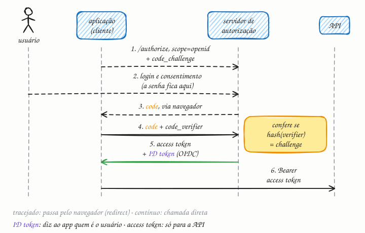

## O essencial

O OAuth 2.0 é um framework de autorização delegada. Ele permite que usuários concedam a uma aplicação acesso limitado aos seus recursos sem compartilhar senhas. O OIDC (OpenID Connect) é construído sobre o OAuth 2.0 para acrescentar autenticação: ele permite que os clientes verifiquem quem é o usuário e obtenham informações sobre a identidade dele. Essa é a base de muitos fluxos do tipo "Entrar com X". A ideia central é que um servidor de autorização emite tokens em que clientes e APIs podem confiar.

## Aprofundando

O OAuth 2.0 (RFC 6749) tem quatro papéis: o **usuário**, dono dos dados; a **aplicação** (o "cliente", no jargão do OAuth), que quer acessá-los; o **servidor de autorização**, que autentica o usuário e emite os tokens; e a **API** (o "servidor de recursos"), que guarda os dados. Para quase tudo que envolve um usuário, de site a app móvel, o fluxo recomendado hoje é o **Authorization Code com PKCE**:

1. A aplicação sorteia um segredo aleatório, o `code_verifier`, e calcula o hash SHA-256 dele, o `code_challenge`.
2. Ela manda o navegador para o `/authorize` do servidor com o `client_id`, os escopos pedidos e o `code_challenge`. Se os escopos incluem `openid`, o pedido vira OIDC.
3. O usuário faz login e consente **no servidor de autorização**. A aplicação nunca vê a senha.
4. O servidor devolve o navegador à aplicação com um **code**: de vida curta, de uso único e que, sozinho, não abre nada.
5. A aplicação troca o code pelos tokens numa chamada direta ao `/token`, enviando junto o `code_verifier`. O servidor só aceita se o hash do verifier bater com o challenge do passo 2. Quem interceptou o code no caminho não tem o verifier.
6. A resposta traz o **access token** e, no OIDC, o **ID token**. A aplicação chama a API com o cabeçalho `Authorization: Bearer <access token>`.

### Dois tokens, dois destinatários

O **access token** é para a API. Diz o que o portador pode fazer (os escopos, como `pedidos:ler`) e costuma valer de minutos a uma hora. Pode ser opaco, e então a API pergunta ao servidor de autorização se ele vale, ou um JWT assinado, que a API valida sozinha com a chave pública do servidor.

O **ID token** é para a aplicação. É sempre um JWT assinado, com quem o emitiu (`iss`), quem é o usuário (`sub`), para quem foi emitido (`aud`, o `client_id` da aplicação) e até quando vale (`exp`). É ele que transforma o OAuth, que só autoriza, num login de verdade.

Para não pedir login de novo quando o access token expira, a aplicação pode receber também um **refresh token**, de vida mais longa, que só serve para buscar access tokens novos no servidor de autorização.

## Analogia

Você está viajando e a diarista precisa entrar no seu apartamento. Em vez de emprestar a chave (a senha), você liga para a portaria, que confere que é você mesmo e libera um crachá de visitante para ela: só para o seu andar, só hoje, e que pode ser cancelado a qualquer hora. O crachá é o access token. Se a portaria ainda entregasse um bilhete carimbado dizendo "quem autorizou foi o morador do 72", esse bilhete faria o papel do ID token.

## No mundo real

- Os botões **"Entrar com Google"** e **"Entrar com Microsoft"** usam OpenID Connect: a aplicação recebe um ID token assinado pelo provedor.
- O **Login Único do gov.br** é integrado por OpenID Connect: o órgão público que usa o login nunca vê a senha do cidadão.
- No **Open Finance Brasil**, quem compartilha seus dados com outra instituição é redirecionado ao próprio banco, faz login e consente lá. A instituição que pediu recebe só tokens com o escopo autorizado, num perfil reforçado de OAuth e OIDC chamado FAPI.
- Para não escrever um servidor de autorização na mão, há opções prontas: **Keycloak** (código aberto), **Auth0**, **Okta**, **Microsoft Entra ID** e **Amazon Cognito**.

## Trade-offs

| | OAuth 2.0 | OIDC |
|---|---|---|
| Pergunta que responde | O que esta aplicação pode fazer? | Quem é o usuário? |
| Token principal | Access token | ID token |
| Destinatário | A API | A aplicação |
| Formato | Opaco ou JWT, à escolha do servidor | Sempre JWT assinado |
| Como pedir | Escopos da API, como `pedidos:ler` | Escopo `openid`, mais `profile` e `email` se quiser |
| Peças extras | Refresh token, introspecção | Endpoint `/userinfo`, descoberta em `/.well-known/openid-configuration` |

## Na entrevista

- Quando o desenho tiver login, delegue a identidade a um provedor via OIDC, com Authorization Code e PKCE, em vez de guardar senhas. Entre serviços, sem usuário, o fluxo é o client credentials.
- Mostre onde o token é validado: o API Gateway (cap. 14) confere assinatura, validade e audiência do JWT com as chaves públicas do provedor, sem consultar o servidor de autorização a cada requisição.
- Antecipe o trade-off: JWT validado localmente é rápido, mas difícil de revogar antes de expirar; daí access token curto, refresh token com rotação e, onde for crítico, consulta ao servidor.
- Frase pronta: *"OAuth diz o que o app pode fazer; OIDC diz quem é o usuário. A API só aceita access token; o ID token fica com a aplicação."*

## Cuidado com

- **Atualização:** o artigo fala em tokens "em que clientes e APIs podem confiar" como se fossem um só. São dois, com destinatários diferentes: o ID token é da aplicação e não deve ir para a API como credencial; o access token é da API.
- **OAuth puro não é login.** Usar o access token como prova de identidade abre brecha: um token emitido para outra aplicação pode ser reaproveitado na sua. O `aud` do ID token evita isso.
- **Fluxos aposentados.** As boas práticas atuais (RFC 9700, de 2025) desaconselham o fluxo implícito (token devolvido na URL), proíbem o de senha (o app recebe a senha do usuário) e recomendam PKCE em todo cliente.
- **JWT assinado não é cifrado.** Qualquer um lê o conteúdo; não guarde segredos nele.

## Teste-se

**P:** Qual a diferença entre OAuth 2.0 e OIDC?

**R:** O OAuth 2.0 é autorização delegada: entrega à aplicação um access token para chamar uma API em nome do usuário. O OIDC é uma camada de identidade por cima, que acrescenta o ID token, dizendo à aplicação quem é o usuário.

**P:** Você está fazendo um app móvel que consome a API da sua empresa, com login centralizado num provedor de identidade. Qual fluxo usar?

**R:** Authorization Code com PKCE, abrindo o login no navegador do sistema. O app é um cliente público (não consegue guardar segredo), e o PKCE impede que um code interceptado seja trocado por tokens. O ID token identifica o usuário; o access token vai para a API.

**P:** Posso mandar o ID token para a minha API como prova de acesso?

**R:** Não deveria. O ID token é endereçado à aplicação (o `aud` é o `client_id` dela) e diz quem é o usuário, não o que ele pode fazer. A API deve exigir um access token emitido para ela, com os escopos certos.
