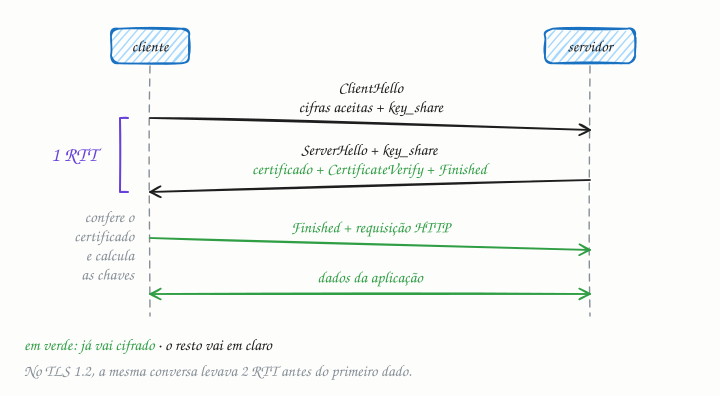

## O essencial

O TLS/SSL protege a comunicação entre cliente e servidor cifrando os dados em trânsito. Durante o handshake, cliente e servidor combinam os algoritmos de criptografia, trocam chaves de forma segura e verificam certificados. Quando o handshake termina, todos os dados seguintes trafegam cifrados, a salvo de quem estiver escutando. É isso que faz aparecer o cadeadinho no seu navegador. Sem TLS, qualquer pessoa na rede poderia ler ou alterar tráfego sensível.

## Aprofundando

O handshake resolve três problemas antes do primeiro byte útil: **combinar** os algoritmos, **criar** uma chave secreta que só os dois lados conhecem e **provar** que o servidor é quem diz ser. No TLS 1.3 (RFC 8446, de 2018), tudo isso cabe numa ida e volta:

1. **ClientHello.** O cliente diz quais versões e cifras aceita, informa o nome do site (o SNI) e já manda a sua **key share**: a parte pública de uma troca de chaves efêmera, criada só para esta conexão. Em geral ela usa a curva X25519, que os clientes mais novos já combinam com o ML-KEM, um algoritmo pós-quântico. O cliente aposta no algoritmo que o servidor vai aceitar; se errar, o servidor pede outro e se perde 1 RTT.
2. **Resposta do servidor.** O ServerHello traz a cifra escolhida e a key share do servidor. Cada lado combina a própria chave privada efêmera com a key share do outro e chega ao mesmo segredo, que nunca passa pela rede. Daí em diante, tudo vai cifrado: o **certificado**; o **CertificateVerify**, uma assinatura feita com a chave privada do certificado sobre tudo o que foi trocado, provando que o servidor tem essa chave; e o **Finished**, um código de verificação do handshake inteiro, que denuncia qualquer adulteração.
3. **Finished do cliente.** O cliente confere a cadeia do certificado até uma autoridade certificadora em que confia, checa se o nome bate com o site e se está na validade, e responde com o seu Finished. Na mesma leva, já vai a primeira requisição HTTP.

Como a troca de chaves do handshake completo é sempre efêmera, o TLS 1.3 tem **sigilo futuro** (forward secrecy): quem gravar o tráfego hoje e roubar a chave privada do servidor amanhã não consegue decifrar o que gravou.

### Quanto custa

No TLS 1.2, o handshake completo leva **2 RTT**. Somado ao handshake do TCP (cap. 17), a requisição HTTP só sai depois de 3 RTT; no TLS 1.3, depois de 2. Com 150 ms de RTT entre continentes, são 450 ms contra 300 ms só de espera. Por isso se reaproveitam conexões, se termina o TLS numa CDN perto do usuário (cap. 15), e o QUIC do HTTP/3 (cap. 18) junta transporte e TLS 1.3 num handshake só. Numa reconexão, o TLS 1.3 permite até mandar dados no primeiro voo (**0-RTT**), com um porém: um atacante pode repetir esses dados.

## Analogia

É como abrir conta numa agência que você nunca visitou. Primeiro você confere se o lugar é mesmo do banco: o alvará na parede tem o carimbo de um órgão em que você confia (o certificado assinado por uma autoridade certificadora). Depois, você e o gerente combinam, sem dizer em voz alta, um código que só os dois conhecem, e dali em diante tudo o que passa entre vocês vai em envelope lacrado. Quem está na fila vê que vocês conversam, mas não o que dizem.

## No mundo real

- O **Let's Encrypt**, autoridade certificadora gratuita e automatizada pelo protocolo ACME, tornou o HTTPS padrão até em sites pequenos, com certificados de vida curta renovados por robôs.
- A validade máxima dos certificados públicos está encolhendo: o CA/Browser Forum aprovou em 2025 a redução de 398 para 200 dias a partir de março de 2026, depois para 100 dias em 2027 e 47 dias em 2029. Renovar à mão deixa de ser opção.
- Em produção, o TLS costuma terminar no load balancer, no proxy reverso (cap. 13) ou na CDN; dali até os serviços, a conexão é reaberta, de preferência cifrada também.

## Trade-offs

| | TLS 1.2 (2008) | TLS 1.3 (2018) |
|---|---|---|
| Handshake completo | 2 RTT | 1 RTT |
| Reconexão | 1 RTT, retomando a sessão | 1 RTT, ou 0-RTT com risco de replay |
| Troca de chaves | RSA estático ou (EC)DHE | Sempre (EC)DHE efêmero: sigilo futuro garantido |
| Certificado | Vai em claro | Vai cifrado |
| Cifras | Dezenas, inclusive combinações hoje fracas | Cinco, todas AEAD, como AES-GCM e ChaCha20-Poly1305 |
| Compatibilidade | Universal, inclusive clientes antigos | Clientes modernos; equipamentos de rede antigos atrasaram a adoção |

## Na entrevista

- Traga o TLS ao falar de latência de conexão nova, de onde terminar a criptografia e de tráfego interno.
- Diga onde ele termina (no load balancer ou na CDN, perto do usuário) e o que vem depois: TLS de novo até os serviços, ou mTLS (cap. 51), em que o cliente também apresenta certificado.
- Mostre que sabe reduzir o custo: conexões persistentes e multiplexadas (HTTP/2), retomada de sessão, TLS 1.3 e HTTP/3.
- Frase pronta: *"Termino o TLS na borda e uso mTLS entre os serviços. Com TLS 1.3, o handshake custa 1 RTT, e com conexões reaproveitadas eu pago isso uma vez, não a cada requisição."*

## Cuidado com

- **Atualização:** "SSL" é nome histórico. O SSL 2.0 e o 3.0 estão quebrados e proibidos, e o TLS 1.0 e o 1.1 foram aposentados em 2021 (RFC 8996). O mínimo hoje é TLS 1.2; o recomendado, 1.3.
- **Atualização:** o cadeado não quer dizer "site confiável", só que a conexão está cifrada com quem tem o certificado daquele domínio, e sites de phishing também têm. Por causa desse mal-entendido, o Chrome trocou o cadeado por um ícone neutro em 2023.
- **0-RTT pode ser repetido.** Use só em requisições idempotentes (cap. 36).
- **TLS protege o caminho, não as pontas.** O servidor vê tudo em claro, e quem observa a rede ainda vê IPs, volumes e, em geral, o nome do site.

## Teste-se

**P:** O que o handshake TLS garante antes do primeiro byte de dados?

**R:** Que os dois lados combinaram os algoritmos e chegaram à mesma chave sem transmiti-la, e que o servidor provou ter a chave privada de um certificado válido para aquele domínio. O Finished garante ainda que ninguém adulterou a conversa.

**P:** Um app abre uma conexão HTTPS nova para cada requisição, com um servidor a 150 ms de RTT. Quanto tempo passa até a requisição sair, com TLS 1.2 e com TLS 1.3? O que você mudaria?

**R:** Contando o TCP, são 3 RTT (450 ms) no TLS 1.2 e 2 RTT (300 ms) no TLS 1.3. Eu reaproveitaria a conexão (keep-alive, HTTP/2), adotaria TLS 1.3 ou HTTP/3 e terminaria o TLS numa borda mais perto do usuário.

**P:** O cadeado no navegador garante que o site é confiável?

**R:** Não. Garante só que a conexão está cifrada e que o servidor tem um certificado válido para aquele domínio. Um site de phishing com domínio parecido também consegue certificado.
