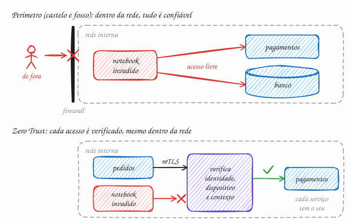

## O essencial

Zero Trust é um modelo de segurança que diz: "nunca confie, sempre verifique". Ele parte do princípio de que ameaças podem existir tanto fora quanto dentro da rede. Toda requisição precisa ser autenticada, autorizada e cifrada, mesmo que venha de dentro do seu data center ou da sua VPC. O acesso é concedido com base em identidade, postura do dispositivo e contexto, e não apenas por estar "dentro do firewall". Nas arquiteturas modernas, o Zero Trust está se tornando a abordagem padrão para projetar sistemas seguros.

## Aprofundando

O modelo antigo é o **perímetro**, apelidado de "castelo e fosso": um firewall forte na borda, uma VPN para quem está fora e, lá dentro, uma rede em que todo mundo confia em todo mundo. O problema aparece depois da primeira invasão. Basta um notebook comprometido por phishing para o atacante alcançar bancos e serviços internos, porque o único teste era "estar dentro". Esse avanço de máquina em máquina se chama **movimento lateral**.

O Zero Trust troca o endereço de rede por **identidade** como base da confiança. A arquitetura de referência do NIST (SP 800-207, de 2020) separa duas funções: um **ponto de aplicação de política** (PEP, de policy enforcement point) na frente de cada recurso, que barra ou deixa passar, e um **motor de política**, que decide. A cada acesso, a decisão considera:

- **Quem pede:** a identidade da pessoa, com login forte (SSO via OIDC, cap. 49, mais MFA), ou a do serviço, comprovada por certificado.
- **De onde:** a postura do dispositivo. É um notebook da empresa, com disco cifrado e sistema atualizado?
- **Em que contexto:** horário, localização, comportamento recente e sensibilidade do recurso.

A resposta segue o **mínimo privilégio**: acesso só àquele recurso, por tempo limitado.

### Entre serviços

Para máquinas, o padrão é dar a cada serviço uma identidade criptográfica e usar **mTLS** (TLS mútuo, cap. 50): os dois lados apresentam certificado, e cada serviço sabe com certeza quem o chama. Um service mesh como Istio ou Linkerd automatiza isso com proxies ao lado de cada serviço (sidecars) e certificados que vencem em horas, renovados sozinhos. O padrão SPIFFE dá nome a essas identidades, como `spiffe://loja.com/ns/prod/sa/pedidos`. Sobre a identidade entram as políticas explícitas, por exemplo: só o serviço de pedidos pode chamar `POST /cobrancas` em pagamentos. Cada decisão fica registrada, e esses registros ajudam a detectar comportamento estranho.

## Analogia

Num hospital, passar pela recepção não leva você à UTI. Cada ala confere de novo: quem é você (documento), quem veio visitar (o paciente certo), em que horário (fora da visita, não entra) e se está paramentado com máscara e avental, o equivalente à postura do dispositivo. Estar dentro do prédio não conta como credencial; cada porta pergunta outra vez.

## No mundo real

- O **BeyondCorp**, do Google, nasceu depois dos ataques da Operação Aurora, em 2009. O Google deixou de confiar na rede corporativa: funcionários acessam aplicações internas de qualquer rede, sem VPN, por um proxy que confere identidade e dispositivo. A empresa descreveu o modelo em artigos a partir de 2014.
- O **NIST SP 800-207** virou a referência do assunto, e o governo dos EUA mandou suas agências migrarem para Zero Trust (memorando M-22-09, de 2022).
- **Istio** e **Linkerd** entregam mTLS automático entre serviços no Kubernetes; o **SPIFFE/SPIRE**, da CNCF, padroniza identidades de serviço.
- Proxies cientes de identidade, como o **Identity-Aware Proxy** do Google Cloud e o **Cloudflare Access**, publicam ferramentas internas sem VPN.

## Trade-offs

| | Perímetro (castelo e fosso) | Zero Trust |
|---|---|---|
| Base da confiança | Estar dentro da rede ou da VPN | Identidade, dispositivo e contexto, a cada acesso |
| Depois de uma invasão | Movimento lateral fácil numa rede plana | Estrago limitado ao que aquela identidade pode acessar |
| Tráfego interno | Muitas vezes em texto claro | Autenticado e cifrado (mTLS) |
| Acesso remoto | VPN que abre a rede inteira | Acesso por aplicação, sem VPN de rede inteira |
| Custo de adoção | Simples de montar | Exige identidade forte, inventário de dispositivos, certificados e políticas por recurso |
| Operação | Pouca verificação no caminho | Mais verificações, mais peças que podem falhar ou somar latência |

## Na entrevista

- Traga o assunto quando perguntarem como os microsserviços se autenticam entre si (cap. 9), como proteger ferramentas internas ou o que acontece se um servidor for invadido.
- Seja concreto: identidade para cada serviço, mTLS entre eles, tokens OIDC dos usuários validados no gateway (cap. 14), políticas de mínimo privilégio por endpoint e credenciais de vida curta.
- Mostre o raciocínio de dano limitado: "se o serviço de recomendações for invadido, ele não tem permissão para chamar pagamentos".
- Frase pronta: *"Não confio em nada só por estar na VPC. Cada serviço tem identidade própria, as chamadas internas usam mTLS, e cada endpoint confere se aquele chamador pode fazer aquela operação."*

## Cuidado com

- **Zero Trust não é um produto.** É uma estratégia. Ferramentas ajudam, mas o trabalho é inventariar identidades, dispositivos e recursos e escrever as políticas.
- **Não é o fim do firewall.** Segmentar a rede continua útil como defesa em profundidade; só deixa de ser o critério principal de confiança.
- **"Sempre verifique" não é pedir senha a cada clique.** Cada requisição é verificada pelo token ou pelo certificado que carrega; o login forte se repete quando o risco muda, como num dispositivo novo ou num lugar estranho.
- **A peça central vira ponto único de falha.** Se o provedor de identidade ou o motor de política cai, ninguém acessa nada. Eles precisam de redundância e de um plano de emergência.

## Teste-se

**P:** O que significa "nunca confie, sempre verifique"?

**R:** Que nenhum acesso é liberado só pela localização na rede. Cada requisição, de pessoa ou de serviço, é autenticada e autorizada com base em identidade, dispositivo e contexto, e recebe só o privilégio mínimo necessário.

**P:** Você tem 40 microsserviços numa mesma VPC. Como aplicar Zero Trust entre eles?

**R:** Dê a cada serviço uma identidade (certificados emitidos e renovados automaticamente, como no SPIFFE), exija mTLS em toda chamada (um service mesh faz isso) e escreva políticas por serviço e endpoint, liberando só o necessário. Registre as decisões para auditoria.

**P:** Toda a equipe acessa os sistemas internos por VPN. Isso já é Zero Trust?

**R:** Não. A VPN verifica uma vez, na entrada, e depois libera a rede inteira: é o perímetro com uma porta a mais. Zero Trust verifica cada acesso a cada recurso, com identidade, dispositivo e contexto.
